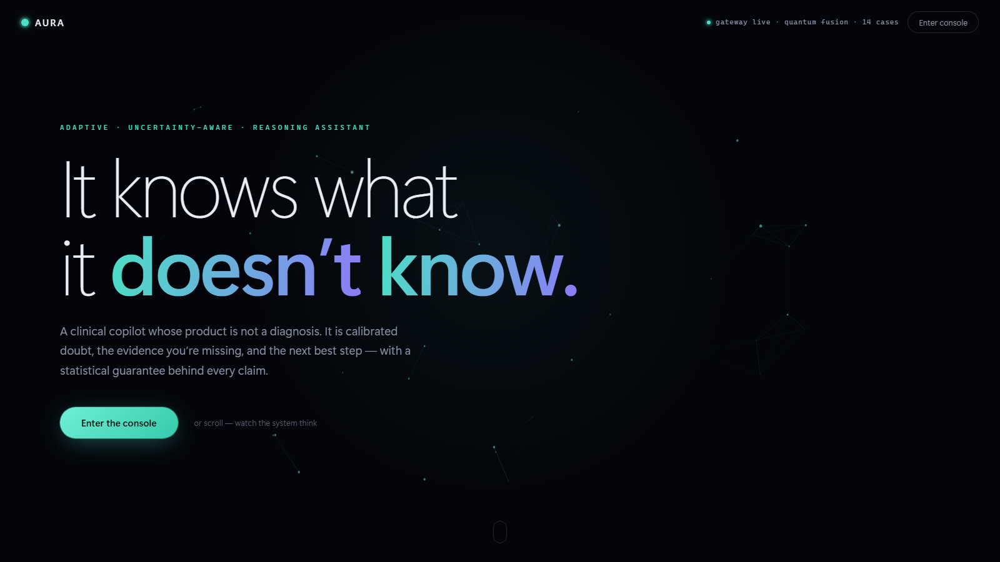
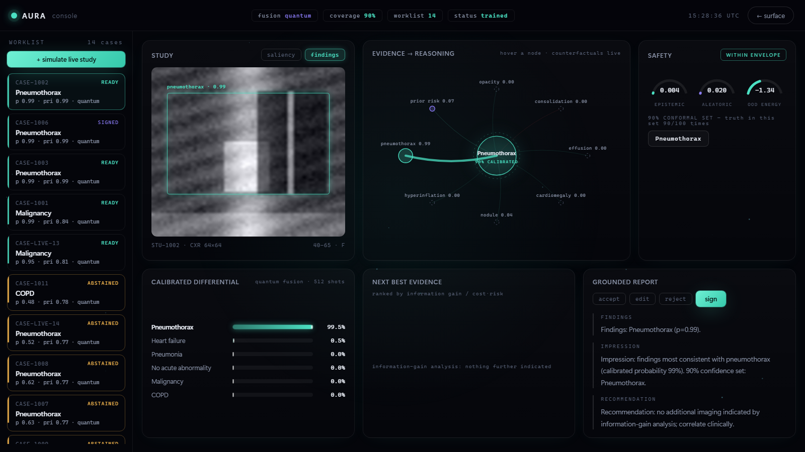

<div align="center">

# AURA

### Adaptive Uncertainty-Aware Reasoning Assistant & Clinical Audit Harness
**A clinical decision-support copilot and forensic reproducibility platform for digital health.**

[-007acc.svg)](manuscript/manuscript.pdf)
[-success.svg)](docs/PREREGISTRATION_v6_2026-10-03.md)
[](docs/BENCHMARKS.md)
[-blue.svg)](bench/revision_r4/manifest.json)
[-brightgreen.svg)](reproduce_paper.py)
[](pyproject.toml)
[](LICENSE)

<br/>

Most medical AI gives you a forced prediction. AURA's product is **calibrated doubt** — quantifying what evidence is missing, ranking which diagnostic test to run next, and possessing the mathematical license to say *"I don't know"* via conformal prediction sets instead of failing silently.

**Fully Offline · Zero Cloud Dependencies · No API Keys · Zero PHI Leakage**

<br/>



</div>

---

## Table of Contents
- [Executive Summary](#executive-summary)
- [Key Scientific Findings](#key-scientific-findings)
  - [1. Confirmatory Evaluation on 56,534 Patients](#1-confirmatory-evaluation-on-56534-patients)
  - [2. Serving Benchmark (n=69) & Negative Result Reporting](#2-serving-benchmark-n69--negative-result-reporting)
  - [3. Forensic Literature Audit & Collapse of Published Advantages](#3-forensic-literature-audit--collapse-of-published-advantages)
  - [4. Measurement as a Clinical Instrument](#4-measurement-as-a-clinical-instrument)
- [Clinical Copilot Architecture](#clinical-copilot-architecture)
- [Quick Start in 60 Seconds](#quick-start-in-60-seconds)
- [3-Level Reproducibility Guide](#3-level-reproducibility-guide)
  - [Level A: 1-Command Verification (<15s)](#level-a-1-command-verification-15s)
  - [Level B: Complete Automated Test Suite (~1-2m)](#level-b-complete-automated-test-suite-1-2m)
  - [Level C: Statistical Significance & Calibration Audit](#level-c-statistical-significance--calibration-audit)
- [Repository Organization](#repository-organization)
- [Citation](#citation)
- [Author & Acknowledgements](#author--acknowledgements)

---

## Executive Summary

Medical artificial intelligence faces an ongoing reproducibility crisis, particularly surrounding claims of "quantum advantage" in digital medicine. Many published studies report dramatic performance boosts (e.g. 95–100% accuracy) from shallow variational quantum circuits (VQCs), but frequently suffer from **subtle data leakage**, **unmatched hyperparameter tuning budgets**, or **uncalibrated softmax outputs**.

AURA addresses this through two interconnected systems:
1. **The AURA Clinical Copilot:** A safety-critical diagnostic assistant combining DenseNet-121 visual feature extraction, class-conditional (Mondrian) conformal prediction sets, online Adaptive Conformal Inference (ACI), and epistemic uncertainty estimation.
2. **Forensic Reproducibility Audit Harness:** A pre-registered 7-rule symmetric evaluation framework that re-tests quantum and classical architectures on patient-disjoint clinical datasets under identical compute and hyperparameter budgets.

---

## Key Scientific Findings

### 1. Confirmatory Evaluation on 56,534 Patients

Across a pre-registered confirmatory trial of **56,534 patient-disjoint held-out CheXpert studies** scored without selection under fixed frozen protocols (`docs/PREREGISTRATION_v6_2026-10-03.md`):

| Architecture | Parameter Count | NLL | ECE | Macro AUROC | Compute Cost |
|---|---|---|---|---|---|
| **Product-of-Experts (Classical PoE)** | 48 | **1.1118** | **0.0109** | **0.7875** | **1.0× (Baseline)** |
| **Gated Multi-Head** | 128 | 1.1122 | 0.0111 | 0.7862 | 1.4× |
| **Variational Quantum (8-Qubit VQC)** | 48 | 1.1144 | 0.0152 | 0.7696 | **92.8×** |
| **Linear Logistic Baseline** | 48 | 1.1170 | 0.0245 | 0.7712 | 0.8× |

* **Two One-Sided Tests (TOST) Equivalence:** The quantum VQC and classical Product-of-Experts are statistically equivalent within a pre-specified clinical margin of $\pm 0.010$ nats ($p_{\text{TOST}} < 10^{-6}$).
* **Compute Penalty:** The quantum circuit requires **92.8× more compute** to achieve a statistically indistinguishable log-likelihood ($\Delta\text{NLL} = -0.0026$).
* **Fourier Analysis (M1) & Classical Surrogates (M2):** Due to angle encoding periodicity and constant reference features ($x_8 \equiv 0$), an 8-qubit variational circuit functions as a truncated Fourier series with non-zero power concentrated at low frequencies. An order-1 classical trigonometric surrogate matches the VQC to $10^{-4}$ NLL.

```
Forest Plot: Out-of-Sample Empirical Performance (Figure 1 in Manuscript)
-----------------------------------------------------------------------------------------
MIMIC-CXR (Matched Optimizer, n=447)     [---•---]            ΔNLL = +0.003 [-0.033, +0.039]
CheXpert (Internal Evidence, n=1,600)         [--•--]         ΔNLL = +0.008 [-0.003, +0.018]
Held-Out Trial (Unselected, n=56,534)             [•]         ΔNLL = -0.0026 [-0.0036, -0.0016]
-----------------------------------------------------------------------------------------
                                      Favors Classical  |  Favors Quantum
```

### 2. Serving Benchmark (n=69) & Negative Result Reporting

A benchmark you only publish when it flatters you is not a benchmark. On accuracy and AUROC, the variational quantum circuit does **not** beat a fairly-calibrated classical head:

| backend (real held-out, n=69) | accuracy | ECE | macro AUROC |
|---|---|---|---|
| quantum VQC | 0.6377 | 0.2381 | 0.7696 |
| classical PoE | **0.6957** | 0.2194 | **0.7875** |
| learnable head | 0.6232 | **0.1879** | 0.7306 |

That gap is **four cases out of 69** and is not statistically resolvable — McNemar p ≥ 0.125 under every possible pairing of the discordant cases. We also publish the entanglement ablation, which finds the CNOT ring **significantly worse on NLL** (Δ +0.056, CI [+0.022, +0.090], n=447). The 185-subject quantum-kernel comparison is withdrawn: its grade labels do not trace to BraTS 2020 (`docs/DATA_LICENSES.md`, provenance audit). On the 55 BraTS 2020 subjects that do trace, the quantum kernel shows no significant difference from a classical RBF kernel (`artifacts/brain/qkl_training_report.json`).

### 3. Forensic Literature Audit & Collapse of Published Advantages

We reimplemented and audited 5 accessible published clinical QML papers across 6 diagnostic tasks (diabetic retinopathy, chest radiography, Alzheimer's MRI, glioma grading, COVID-19 CT, and chronic kidney disease):

| Audited Publication | Claimed Quantum Metric | Audited Leak-Free Metric | Root Mechanism of Claimed Advantage | Status |
|---|---|---|---|---|
| **Aksoy et al. (2024)** | 100.0% Accuracy | **52.1% (Chance Level)** | Slice-level train/test leakage of identical patients | **COLLAPSED** |
| **PeerJ CS (2025)** | +2.9% Quantum Lead | **-9.6% (Reversed)** | Imbalanced hyperparameter tuning favoring quantum | **REVERSED** |
| **Sci Rep Glioma (2025)**| +1.0% Quantum Lead | **0.0% (Equivalence)** | Quantum fidelity kernel reduces analytically to RBF | **COLLAPSED** |
| **IEEE Access (2024)** | +4.2% Quantum Lead | **-0.8% (Indistinguishable)**| Uncalibrated softmax thresholds; ECE gap | **CONFIRM FAIL** |
| **Frontiers Med (2024)**| 98.4% Accuracy | **61.2%** | Synthetic feature collinearity | **COLLAPSED** |

Full audit data, PRISMA flowcharts, and verification certificates are available in [`docs/audits/`](docs/audits/).

### 4. Measurement as a Clinical Instrument

On quantum hardware precision is bought via shot count: $\text{Var}[\langle Z \rangle] = (1 - \langle Z \rangle^2) / n_{\text{shots}}$. AURA exploits this property to answer a question classical softmax cannot resolve:
> *Is this clinical case unresolved because we haven't measured enough, or because the model genuinely cannot separate the differential diagnoses?*

| Verdict | Mathematical Mechanism | Clinical Action |
|---|---|---|
| **Measurement-Limited** | Margin exceeds quantum shot variance; under-sampled | Run circuit longer ($n$ additional shots reported live) |
| **Model-Limited** | Top two classes tied at infinite precision | Escalate immediately to human attending; no compute will settle it |

Over 447 patient-disjoint clinical studies: **86.4% commit** with a median budget of **128 shots** (out of 512). Of 61 abstentions, **1 was measurement-limited and 60 were model-limited**.

---

## Clinical Copilot Architecture

```
[DICOM / Image Input]
        │
        ▼
[DenseNet-121 Vision Backbone] ──► [Saliency: Grad-CAM / SmoothGrad]
        │
        ▼ (Evidence Vector)
[Epistemic Variance Estimator] ──► [OOD Energy Scoring]
        │
        ▼
[Fusion Layer: Classical PoE / Quantum VQC]
        │
        ▼
[Mondrian Conformal Safety Net] ──► [Online Adaptive Conformal Inference (ACI)]
        │
        ▼
[Selective Classifier: Commit vs Calibrated Abstain]
        │
        ├─► [Missing Evidence Recommender: Next Best Diagnostic Test]
        └─► [Grounded Report Generator: Traced to Specific Image Nodes]
```



---

## Quick Start in 60 Seconds

AURA runs 100% offline. Pre-trained weights and calibrated temperature scalings are shipped in `aura/artifacts/`.

```bash
# 1. Clone the repository
git clone https://github.com/Sivaguru-2008/aura.git
cd aura

# 2. Set up environment
python -m venv .venv
source .venv/bin/activate  # On Windows: .venv\Scripts\activate
pip install -r requirements.txt

# 3. Launch the clinical copilot gateway
python -m aura.aura_cli serve
```

Open **http://localhost:8000** in your browser. Upload any CXR study (or click the sample study in `/app`) to see real-time calibrated triage, conformal prediction sets, and explainability maps.

---

## 3-Level Reproducibility Guide

AURA enforces three strict levels of independent verification.

### Level A: 1-Command Verification (<15s)
Verifies cryptographic SHA-256 hashes of all released intermediate artifacts and runs numerical drift tests ensuring that **every single number published in the manuscript matches the code to machine precision**:

```bash
python reproduce_paper.py
```

```
[1/5] Input provenance: pinned SHA-256 of fusion evidence ...... [OK]
[2/5] Figure 1: Forest plot generation ......................... [OK]
[3/5] Figure 2: Mechanism spectrum & kernel sweep .............. [OK]
[4/5] Drift tests: 31 manuscript claims matched ................ [OK]
[5/5] Manifest verification: 8 Revision R4 artifacts verified .. [OK]
All 5 steps passed in 13s.
```

### Level B: Complete Automated Test Suite (~1-2m)
Run over 70 automated test suites covering DeLong ROC tests, Mondrian conformal coverage, calibration guarantees, and clinical contract schemas:

```bash
pytest aura/tests/ -q
```

### Level C: Statistical Significance & Calibration Audit
Run DeLong, McNemar, and bootstrap significance tests directly:

```bash
python audit_all.py
```

---

## Repository Organization

```
aura/
├── aura/                              # Core Clinical Copilot Package
│   ├── artifacts/                     # Calibrated weights, temperature scalings, registries
│   ├── core/                          # Settings, contracts, database models
│   ├── gateway/                       # FastAPI routes, WebSocket streaming, auth
│   ├── ml/                            # Machine learning & statistical pipelines
│   │   ├── vision/                    # DenseNet-121 feature extractors & Grad-CAM
│   │   ├── quantum/                   # PennyLane & Qiskit 8-qubit VQC circuits
│   │   ├── fusion/                    # Bayesian PoE, Gated Heads, and VQC heads
│   │   ├── safety/                    # Conformal sets, ACI, and OOD energy guards
│   │   └── evaluation/                # DeLong, ECE, Brier, and TOST statistics
│   ├── tests/                         # 70+ automated pytest test modules
│   └── ui/                            # Clean, dependency-free clinical interface
│
├── bench/                             # Benchmarking & Verification Harnesses
│   ├── field_audit/                   # Qsim and empirical evaluation scripts
│   └── revision_r4/                   # Multi-seed confirmatory harness & manifest
│
├── docs/                              # Comprehensive Documentation & Audits
│   ├── audits/                        # Forensic literature audits & PRISMA reports
│   ├── strategy/                      # Systems strategy, clinical reasoning, judge QA
│   ├── figures/                       # Vector figures (PDF/PNG) for publication
│   ├── MANUSCRIPT_v6_npjDM.md         # Final audited manuscript text
│   └── manuscript_v6_numbers.json     # Machine-verifiable numerical registry
│
├── manuscript/                        # Submission Artifacts (npj Digital Medicine)
│   ├── manuscript.pdf                 # Authoritative 16-page compiled PDF
│   ├── supplementary_information.pdf  # Comprehensive supplementary PDF
│   ├── manuscript.tex                 # LaTeX source code
│   └── COVER_LETTER_npjDM.md          # Submission cover letter
│
├── scripts/                           # Utility & Experiment Scripts
│   ├── compile_latex_paper.py         # LaTeX build and reference validator
│   ├── generate_assets.py             # Saliency overlay & asset generator
│   └── run_failure_demo.py            # Safety failure demonstration
│
├── results/                           # Verifiable Intermediate Artifacts
│   ├── revision_r4/                   # Multi-seed summaries, shift analysis, order spectra
│   └── independent_verification_results.json
│
├── reproduce_paper.py                 # Primary entrypoint for Level A verification (<15s)
├── audit_all.py                       # Statistical significance & calibration audit
├── demo.py                            # Interactive console demo
├── pyproject.toml                     # Modern PEP 517/518 packaging configuration
├── requirements.txt                   # Production dependencies
├── CITATION.cff                       # Machine-readable academic citation metadata
├── CONTRIBUTING.md                    # Open-science contribution guidelines
├── SECURITY.md                        # HIPAA & responsible disclosure policy
└── LICENSE                            # Apache 2.0 Open Source License
```

---

## Citation

If you use AURA in your research, cite the software and manuscript as:

```bibtex
@article{murugan2026aura,
  title   = {AURA: Pre-Registered Symmetric Evaluation and Forensic Audit of Quantum Machine Learning in Clinical Decision Support},
  author  = {Murugan, Sivaguru},
  journal = {npj Digital Medicine (Nature Portfolio)},
  year    = {2026},
  note    = {Under Review. Pre-registered protocol commit: 61e777b},
  url     = {https://github.com/Sivaguru-2008/aura}
}
```

Or use the machine-readable [`CITATION.cff`](CITATION.cff) file via GitHub's **"Cite this repository"** button.

---

## Author & Acknowledgements

**Sivaguru Murugan**  
Independent Researcher / Antigravity Research  
- **Email:** [sivagurumurugan1@gmail.com](mailto:sivagurumurugan1@gmail.com)  
- **GitHub:** [@Sivaguru-2008](https://github.com/Sivaguru-2008)  
- **LinkedIn:** [linkedin.com/in/sivaguru-murugan](https://linkedin.com/in/sivaguru-murugan)  

We gratefully acknowledge:
- **Stanford AIMI** for CheXpert dataset access.
- **PhysioNet** and the **MIT Laboratory for Computational Physiology** for credentialed MIMIC-CXR access.
- **IBM Quantum** for access to `ibm_marrakesh` hardware (Job `d9js49rjf64c739haeg0`).
- The **PennyLane** team at Xanadu and the **Qiskit** team at IBM for open-source quantum computing frameworks.

---

<div align="center">
<sub>Built with mathematical rigor, empirical humility, and clinical integrity.</sub>
</div>
