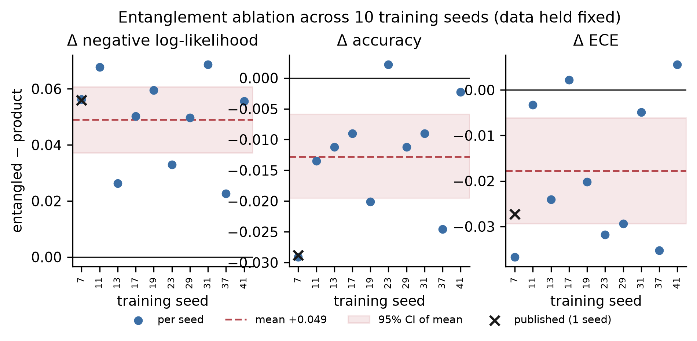
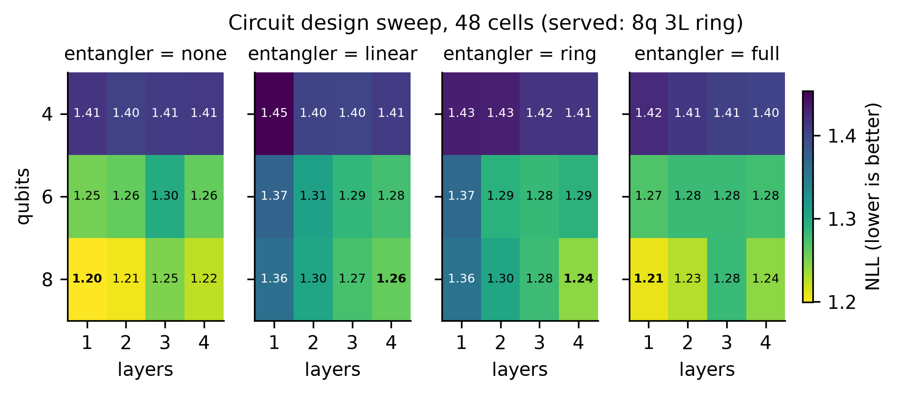

# Additional file 2 — Entanglement ablation and design sweep: full detail

This file holds the detail that the main text (§2.5, §2.6) summarises. The two sections below are
the full text of those sections as they stood before being condensed, followed by per-seed tables
generated from the artifacts named in each heading.

## A2.1 Entanglement ablation (full text of the former §2.5)

We ablated the entangling block directly. The CNOT ring is replaced by no two-qubit gates at all, holding qubit count, layer count, trainable parameter count, encoding, readout, data, seed and training function identical, so that any difference is attributable to entangling topology and to nothing else.

An initial ten-seed ablation at 8 qubits found the ring worse on negative log-likelihood in ten of ten seeds. That result was confounded: the eighth evidence channel, `prior_risk`, is **identically zero in all 2,231 studies**, so under `RY(π·xᵢ)` the eighth qubit receives the identity and the entangled arm couples data qubits to a constant register while the product arm does not — an asymmetry parameter-count matching does not control. We disclose it as the clearest demonstration available to us that a significant, ten-seed, capacity-matched effect can still be an artifact of an input the experimenter never inspected.

Repeating the ablation on the seven informative channels retires two of the three original findings and confirms the third. The likelihood penalty survives at half its magnitude: mean Δ = **+0.025** (95% CI +0.013 to +0.037), worse in **ten of ten seeds**, Holm *p* = 0.006. The ten seeds vary initialisation on a fixed test set, so that *p*-value reflects optimiser variability, not uncertainty over patients. Three further analyses address this. Their decision rules were committed before running (`PREREGISTRATION_ADDENDUM_2026-10.md`), and results are in `revision_v51.json`. Re-running the ten seeds with per-study predictions saved reproduced every published per-seed Δ exactly. (a) **Over patients.** Uniqueness follows from the construction rule. The training CSV holds one row per patient, and the builder emits one study per row: the one with the highest study identifier, which the code uses as a chronology proxy (`build_real_evidence_dataset` in `aura/ml/training/dataset.py`). The builder now also refuses a repeated patient identifier, and both rules are pinned by unit tests (`test_one_study_per_patient.py`). Resampling studies is therefore resampling patients. The evidence cache predates that explicit guard, but the source training CSV holds 64,586 rows with 64,586 distinct patient identifiers, so no patient can contribute two studies. A bootstrap over the 447 test patients of the seed-averaged per-patient Δ gives +0.025 (SE 0.012, 95% CI +0.002 to +0.048, *p* = 0.036). The pre-registered rule keeps the claim, because the interval excludes zero, but only just. A hierarchical bootstrap that resamples seeds and patients together, and so carries both sources of variance, gives 95% CI −0.001 to +0.052 (*p* = 0.062). **The penalty is therefore significant over patients only marginally, and not at all once initialisation variance is added; the original *p* = 0.006 overstated the evidence.** (b) **Over splits.** Across K = 5 fresh patient-disjoint 60/20/20 re-splits, each retrained from scratch, entanglement was worse in 5 of 5 splits (mean Δ +0.032, between-split SD 0.010 against a between-seed SD of 0.017). With K = 5 this is descriptive. (c) **Beyond the RY(πx) family.** RY(πx) encoding without re-uploading restricts each output to a low-degree Fourier series in the inputs [19]. We therefore repeated the ablation with a data re-uploading ansatz [20]: 7 qubits, L = 3 layers, a trainable encoding scale at every layer, and 111 trainable parameters in both arms, with the training protocol, seeds and split unchanged. The entanglement penalty **grew**. Mean Δ was +0.049 (95% t-CI +0.031 to +0.068), worse in 10 of 10 seeds, Wilcoxon *p* = 0.002. The patient bootstrap gave 95% CI +0.023 to +0.076 and the hierarchical bootstrap +0.018 to +0.081. Re-uploading improved the product arm (seed-mean test NLL 1.2368 → 1.2156) but not the entangled arm (1.2618 → 1.2649). The entangled arm's training NLL was also higher in every seed (mean 1.248 against 1.194), so its deficit is a failure to fit, not overfitting. These re-uploading results are in-sample in the sense of (d) below, and the re-uploading ablation was not repeated out of sample, so its larger penalty is unreplicated. (d) **On out-of-sample evidence.** All of the above uses evidence the image model produced for its own training images (Methods, Data). Repeating analysis (a)'s protocol on CheXpert evidence the model never saw (§2.8, last paragraph), the penalty **was not detected**. Entanglement was worse in 8 of 10 seeds, with mean Δ +0.0035 and patient-bootstrap 95% CI −0.005 to +0.012 (*p* = 0.41). That is the same direction at about one-seventh the size, and it is not shown to be zero: a post hoc equivalence test at ±0.01 nats fails (90% CI −0.004 to +0.011). The analysis also changes more than the evidence: the corpus, label map and number of categories differ (§2.8), so a smaller effect could come from that domain change as much as from removing in-sample evidence. We therefore claim neither a general entanglement penalty nor that entanglement is harmless; the effect is not established. The lower training likelihood of the quantum circuit relative to the 54-parameter product-of-experts arm (1.2598 vs 1.2142; `fusion_matched_optimiser.json`; the logistic arm is fitted by L-BFGS and has no comparable training trace) is consistent with either an unfavourable inductive bias or incomplete optimisation; our design cannot separate them. The accuracy penalty (*p* = 0.29) and the calibration benefit (*p* = 0.43) both disappear. A proper-score decomposition of the effect was non-identifiable at *n* = 447, so the mechanism is retired rather than replaced.

**Figure A2.1.** Per-seed entanglement ablation at matched capacity across ten training seeds. Left, negative log-likelihood; centre, accuracy; right, expected calibration error. Filled markers, seven informative channels (controlled); open markers, all eight (confounded).

## A2.2 Per-seed results

**MIMIC, 7 qubits, RY(πx), in-sample evidence (`revision_v51.json`, analysis B)**

| Seed | NLL entangled | NLL product | Δ NLL |
|---:|---:|---:|---:|
| 7 | 1.2824 | 1.2785 | +0.0039 |
| 11 | 1.2522 | 1.2171 | +0.0351 |
| 13 | 1.2416 | 1.2069 | +0.0347 |
| 17 | 1.2719 | 1.2455 | +0.0264 |
| 19 | 1.2883 | 1.2253 | +0.0630 |
| 23 | 1.2653 | 1.2612 | +0.0041 |
| 29 | 1.2330 | 1.2128 | +0.0202 |
| 31 | 1.2349 | 1.2195 | +0.0154 |
| 37 | 1.2782 | 1.2562 | +0.0220 |
| 41 | 1.2702 | 1.2450 | +0.0252 |

Patient bootstrap: +0.0250, SE 0.0120, 95% CI +0.0016 to +0.0483, p = 0.036. Hierarchical seed × patient bootstrap: 95% CI -0.0011 to +0.0522, p = 0.062.

**MIMIC, K = 5 patient-disjoint re-splits, training seed 7 (`revision_v51.json`, analysis C)**

| Split seed | NLL entangled | NLL product | Δ NLL |
|---:|---:|---:|---:|
| 101 | 1.3593 | 1.3221 | +0.0372 |
| 102 | 1.2341 | 1.2125 | +0.0216 |
| 103 | 1.2577 | 1.2323 | +0.0254 |
| 104 | 1.2444 | 1.1983 | +0.0461 |
| 105 | 1.2646 | 1.2325 | +0.0321 |

**MIMIC, 7 qubits, data re-uploading L = 3, 111 parameters per arm (`revision_v51.json`, analysis D)**

| Seed | NLL entangled | NLL product | Δ NLL |
|---:|---:|---:|---:|
| 7 | 1.2634 | 1.2466 | +0.0168 |
| 11 | 1.2292 | 1.1987 | +0.0305 |
| 13 | 1.2484 | 1.1956 | +0.0528 |
| 17 | 1.2652 | 1.2097 | +0.0555 |
| 19 | 1.3148 | 1.2087 | +0.1061 |
| 23 | 1.2750 | 1.2517 | +0.0233 |
| 29 | 1.2433 | 1.2109 | +0.0324 |
| 31 | 1.2462 | 1.1835 | +0.0627 |
| 37 | 1.2976 | 1.2386 | +0.0590 |
| 41 | 1.2658 | 1.2118 | +0.0540 |

Patient bootstrap: +0.0493, SE 0.0135, 95% CI +0.0232 to +0.0761, p = 0.000. Hierarchical seed × patient bootstrap: 95% CI +0.0180 to +0.0812, p = 0.002.

**CheXpert-internal, 7 qubits, RY(πx), out-of-sample evidence (`chexpert_internal.json`, E2)**

| Seed | NLL entangled | NLL product | Δ NLL |
|---:|---:|---:|---:|
| 7 | 1.1599 | 1.1490 | +0.0109 |
| 11 | 1.1606 | 1.1542 | +0.0064 |
| 13 | 1.1590 | 1.1601 | -0.0011 |
| 17 | 1.1538 | 1.1438 | +0.0100 |
| 19 | 1.1454 | 1.1543 | -0.0089 |
| 23 | 1.1559 | 1.1528 | +0.0031 |
| 29 | 1.1541 | 1.1536 | +0.0005 |
| 31 | 1.1586 | 1.1509 | +0.0077 |
| 37 | 1.1568 | 1.1522 | +0.0046 |
| 41 | 1.1463 | 1.1445 | +0.0018 |

Patient bootstrap: +0.0035, SE 0.0043, 95% CI -0.0051 to +0.0119, p = 0.410. Hierarchical seed × patient bootstrap: 95% CI -0.0062 to +0.0129, p = 0.468.

## A2.3 Design sweep (full text of the former §2.6)

A 48-cell sweep over qubit count {4, 6, 8}, depth 1–4, and entangling topology {none, linear, ring, full} was run with one split, one seed, and one training function, with trainable parameter count identical across topologies at fixed width and depth (`design_sweep.json`).

The single best configuration by negative log-likelihood carries zero entanglement (8 qubits, 1 layer, no entangler; NLL 1.1996, accuracy 0.5749), and three of the five best configurations by negative log-likelihood are at zero entanglement. Read by negative log-likelihood the artifact gives three of five; four of five holds only when the ranking is by accuracy, where three configurations tie at 0.5593. This does not support the served design, but because this is one split at one seed, selected from 48 cells, at 8 qubits (constant-channel confound of §2.5), it cannot establish that zero entanglement is optimal.

**Figure A2.2.** Design sweep. Negative log-likelihood against two-qubit gate count for all 48 cells, coloured by entangling topology.

**Five best cells by negative log-likelihood (`design_sweep.json`)**

| Qubits | Layers | Entangler | NLL | Accuracy |
|---:|---:|---|---:|---:|
| 8 | 1 | none | 1.1996 | 0.5749 |
| 8 | 2 | none | 1.2052 | 0.5593 |
| 8 | 1 | full | 1.2078 | 0.5638 |
| 8 | 4 | none | 1.2237 | 0.5593 |
| 8 | 2 | full | 1.2282 | 0.5548 |
