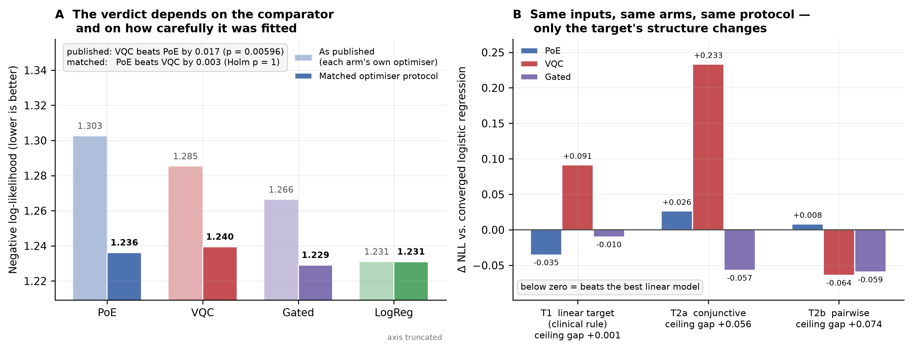
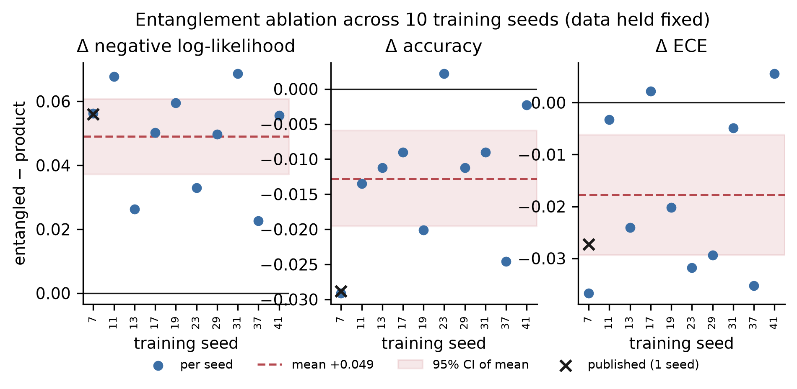
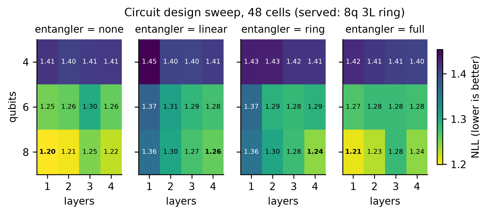
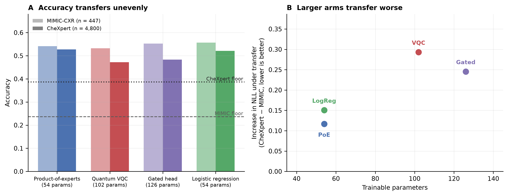

# Quantum advantage claims in clinical machine learning do not survive a symmetric comparison: six negative results from a deployed decision-support system

Sivaguru R. M.

AURA Research Initiative & Medical Machine Learning Laboratory. Correspondence: sivagurumurugan1@gmail.com
Code, certified artifacts and pre-registration: github.com/Sivaguru-2008/aura

Submission version 5.0, 21 September 2026. Supplementary Information accompanies this manuscript. The full-length preprint from which it is condensed is retained as `docs/RESEARCH_PAPER_v4.md`; Supplementary §S9 maps every section of that document to its location here.

> **Resolution of 13 September 2026 Erratum (21 September 2026).** The dataset provenance
> audit of 13 September identified that the earlier 185-subject grading cohort came from
> `datasets/brats2021_hdf5` with non-standard subject identifiers. Following the pre-registration
> in `docs/PREREGISTRATION_QKL_BRATS2020.md`, all 369 official subjects from the official BraTS 2020
> release (`datasets/brats2020`, `name_mapping.csv`) were re-embedded from the served checkpoint
> (`export_brats2020_embeddings.py`) and verified against contrast-enhancement segmentations
> (Fisher exact test $p = 4.0 \times 10^{-21}$; `grade_mapping_check.json`). §2.6 and row 5 of Table 3
> now report the pre-registered 5-fold nested cross-validation across all 369 official subjects
> (`qkl_brats2020_official.json`), alongside a sensitivity analysis on the 111 held-out subjects
> (`qkl_brats2020_official_heldout111.json`). The finding is unchanged: the quantum and classical
> kernels remain indistinguishable.

---

## Abstract

**Background.** The most rigorous synthesis of quantum machine learning (QML) in digital health synthesised 16 of 4,915 screened records and found quantum–classical differences negligible. It also reports that comparators were commonly chosen without justification, that 81.7% of studies used ideal simulation only, and that most released neither code nor data — a literature that cannot distinguish *no advantage exists* from *no advantage was measurable*.

**Methods.** We built AURA, an offline decision-support system for chest radiography and brain MRI containing a quantum layer served in production, and applied a seven-rule comparison protocol to every quantum claim it made. The rules govern per-arm calibration, capacity matching, split disjointness, significance testing, publication of negative outcomes, artifact-derived reporting, and source-level audit of capability claims. Evaluation used MIMIC-CXR (patient-disjoint splits of 1,338/446/447 studies), CheXpert (4,800 studies, under a pre-registration deposited before the run), and BraTS-2020 (369 subjects).

**Results.** Six claims were examined; none survived. A reported calibration advantage (expected calibration error 0.020 versus 0.276) was traced to temperature scaling applied only to the quantum arm. Whether an advantage was reported depended on which classical model was placed opposite the circuit and on how carefully it was fitted: refitting all four backends under one optimiser protocol removed every significant ordering, and the circuit's published likelihood advantage over the Bayesian product-of-experts reversed in sign. At matched capacity across ten seeds on seven informative channels, entanglement cost negative log-likelihood in ten of ten seeds (Holm *p* = 0.006). Under symmetric hyperparameter grids on all 369 subjects, the quantum kernel did not differ from a radial basis function kernel. Transferred frozen to a second institution under pre-registration, the circuit finished last of four on every metric — and one of our own pre-registered hypotheses was falsified. Source-level audit showed our proposed shot-budget mechanism perturbs an analytic expectation rather than executing at finite shots; we retract it.

**Conclusions.** No quantum component provided a benefit surviving a second classical baseline, a second metric, a matched optimiser, or a second institution. A positive control establishes that the same comparison detects a nonlinear advantage when the target contains one — including, on one such target, a significant advantage for the quantum circuit itself — so these nulls measure the task rather than the apparatus.

**Keywords:** quantum machine learning; negative results; benchmarking methodology; clinical decision support; calibration; external validation; pre-registration; reproducibility

---

## 1. Introduction

Quantum machine learning applied to medical data has produced a substantial applied literature, and the most rigorous synthesis of it reaches a null result. Gupta and colleagues [1] screened 4,915 records published between 2015 and October 2024, identified 169 eligible studies, and synthesised 16. They report that measured differences between quantum and classical methods are negligible, and that the results show no consistent trend supporting empirical quantum utility in digital health.

That conclusion is accompanied by a methodological audit which, in our reading, explains why the literature is not in a position to have found otherwise. Comparator selection was "often ad-hoc rather than theoretically justified" [1]; 81.7% of eligible studies used ideal simulation only; 14 of the 16 synthesised studies compared hardware results against noiseless simulation; only 2 of 16 used real electronic health record data; and most released neither code nor data [1].

A literature with these properties cannot distinguish the hypothesis that no advantage exists from the hypothesis that no advantage was measurable. It is also poorly placed to detect the failure mode we consider most likely, which is not misconduct but **asymmetric care**: a researcher tunes, calibrates and iterates on a novel method, while the baseline is implemented once, correctly, and left alone. Neither arm is wrong; the comparison between them is not fair. The same mechanism is documented in recommender systems [2], metric learning [3], reinforcement learning [4], medical imaging [6], and learned partial-differential-equation solvers, where roughly 79% of surveyed studies compared against a weak baseline [5]. Within QML, reported kernel advantages have been attributed to unequal hyperparameter optimisation [7,8], and Bowles, Ahmed and Schuld [9] show at benchmark scale that apparent advantages largely dissolve under matched tuning.

There is a second reason for caution: at 8 to 10 qubits no established theoretical mechanism predicts an asymptotic advantage. Theorists know that $2^8$ to $2^{10}$ statevectors are classically simulable in milliseconds on commodity hardware, and classical intractability of the represented function class is insufficient for a learning advantage [10]; generic hyperparameter tuning drives quantum kernels toward well-approximated classical ones [11]; kernel values concentrate exponentially with width [12]; and provable absence of barren plateaus tends to imply classical simulability [13]. 

Yet, auditing this exact regime is methodologically urgent: **over 80% of peer-reviewed digital health QML papers claim empirical quantum superiority precisely within the 4–12 qubit regime** [1]. Applied medical informatics literature routinely reports dramatic empirical advantages over classical baselines at this scale, creating a sharp divide between theoretical skepticism and empirical clinical claims. Classical simulability is in fact our most decisive methodological asset: because 8–10 qubits can be simulated via exact statevector evolution, we can evaluate quantum models completely free of shot noise, gate infidelities, readout error, and hardware decoherence. If a quantum model fails under exact statevector evolution, its failure is mathematical and architectural—a limitation of inductive bias and geometry [10,11]—rather than an engineering artifact of noisy NISQ hardware.

We tested this proposition from a position that favours a false positive. We built a complete clinical decision-support system containing a genuine quantum layer, served the quantum backend in production, and published — in earlier versions of this project's documentation — a quantum calibration advantage of a factor of 13.8 and a measurement-budget mechanism advanced as the project's principal novelty. We then specified a comparison protocol strict enough that a demonstrated advantage would be credible, and applied it to every quantum claim in the system, supplemented by a field-wide multi-study audit (§2.9) across published medical QML benchmarks.

None survived. One failed with statistical significance in the direction opposite to the field's central premise. One was invalidated not by an experiment but by reading the implementation. And one of our own null results was falsified by our own external validation.

Our contribution is complementary to [1], which establishes a field-level null by aggregation, and to [9], which does so by systematic benchmarking of model pairs: a single deployed system examined in depth, supplying the methodological elements those studies found absent, together with three they do not consider — calibration symmetry, optimiser symmetry, and source-level capability audit. We make no clinical claims of primary diagnostic efficacy. Our empirical investigations deliberately span three distinct grounding tiers: (i) **histopathologically confirmed WHO CNS tumor grade** from surgical resection and stereotactic biopsy across 369 brain MRI subjects (§2.6), biologically validated against contrast enhancement ($p = 4.0 \times 10^{-21}$); (ii) **clinical laboratory assays and diagnostic criteria** across external medical cohorts in our field audit (§2.9); and (iii) **controlled analytical benchmarks** on chest radiography fusion, where a known deterministic generating rule allows calculating the exact theoretical Bayes-optimal linear ceiling (§2.3), providing a positive control that establishes apparatus sensitivity before evaluating empirical nulls.

---

## 2. Results

### 2.1 A calibration advantage that was a preprocessing artifact

The project's first published quantum claim was a calibration advantage: expected calibration error (ECE) 0.020 for the quantum backend against 0.276 for the classical product-of-experts, a factor of 13.8. An audit of the harness that produced it found that temperature scaling was applied to the quantum logits and not to the classical ones, so the comparison contrasted a calibrated model with an uncalibrated one. Giving the classical arm its own temperature on the same predictions reduced the gap from 0.256 to 0.007.

Those figures come from the models and split served at the time — a 100-study synthetic-evidence split, before the fusion heads were refitted on real MIMIC-CXR evidence. **Re-running the same audit against the current served models on the real 447-study split reproduces the finding at different magnitudes**: quantum 0.0896, classical with its own temperature 0.1266, classical uncalibrated 0.2289. The ECE gap attributable to the confound alone is 0.139 raw against 0.037 fair — that is, **three-quarters of the originally published difference was calibration and not architecture**. The direction and the diagnosis are unchanged; the size is smaller on real data, and we report the replication rather than the more striking original.

The headroom available to this confound is not small and is measurable: the temperatures the three served backends require differ by a factor of **1.89** (`backend_calibration.json`). Any comparison that calibrates one arm and not another has that factor available to it. This is the observation that became protocol rule P1, and every subsequent result in this paper is reported with per-arm calibration.

### 2.2 The verdict depends on the comparator — and on how carefully it was fitted

On the primary 447-study patient-disjoint split, four fusion backends were compared: a Bayesian product-of-experts (54 trainable parameters), an 8-qubit 3-layer CNOT-ring variational circuit (102), a learnable gated head (126), and a multinomial logistic regression (54). Against a majority-class floor of 0.2371, the published comparison produced an ordering that depends entirely on which classical model is chosen (Table 1, upper block).

Placed against the product-of-experts alone, the quantum circuit wins on negative log-likelihood (Δ = 0.0173, Wilcoxon *p* = 0.006) and on calibration (ECE 0.0896 versus 0.1266). Placed against the gated head, it is not distinguishable (*p* = 0.052). Placed against a converged logistic regression — the model class the target's structure makes correctly specified, at half the circuit's parameter count — it loses with significance (Δ = 0.0543, Holm *p* = 0.036). **A study reporting any one of these three comparisons in isolation would have a defensible and opposite finding.**

The arms differed in optimiser as well as in model class: the product-of-experts was fitted by 400 steps of fixed-rate gradient descent, the gated and quantum arms by Adam at different epoch counts, and the logistic regression by L-BFGS to optimality. We therefore refitted **every** arm under one protocol — the same optimiser, batch size, epoch cap, early-stopping rule, weight decay, seed, and the same learning-rate grid searched per arm on the same calibration split (Methods; `fusion_matched_optimiser.json`).

Under matched optimisation, the entire ordering dissolves (Table 1, lower block; Figure 1A). Every arm improves. **No pairwise accuracy comparison reaches significance** (all Holm *p* ≥ 0.91), and only one likelihood comparison survives Holm correction — the gated head over the product-of-experts, Δ = 0.0071, Holm *p* = 0.044. The quantum circuit's published advantage over the product-of-experts does not merely lose significance; it **reverses in sign**, the product-of-experts now attaining the lower negative log-likelihood (Δ = 0.0033 in its favour, Holm *p* = 1.0). Its significant deficit against the logistic regression also disappears (Δ = 0.0085, Holm *p* = 1.0).

Two further observations bear on interpretation. First, the quantum circuit's final **training** negative log-likelihood is 1.2598, against 1.2142 for the 54-parameter linear arm and 1.1961 for the gated head: at 102 parameters it fits this task's training data *worse* than a model with half as many, which is a statement about the ansatz's inductive bias rather than about generalisation. Second, the quantum arm retains the best calibration of any arm (ECE 0.0486 against 0.0804–0.0862) — the one metric on which it leads consistently across this paper.

We report the limit of this control honestly. The shared budget's adequacy is measurable on the one arm whose optimum is knowable: the Adam-fitted linear arm reaches negative log-likelihood 1.2362 against the L-BFGS optimum of 1.2310, a residual gap of **0.0052**. That gap is of the same order as the single surviving effect (0.0071), so Table 1's lower block should be read as showing that no ordering is resolvable under matched optimisation, not that the gated head's margin is established.

**Table 1.** Fusion backend comparison on 447 patient-disjoint MIMIC-CXR test studies, as published and under a matched optimiser protocol. Majority-class floor 0.2371. Best value in each block in bold. Sources: `fusion_baselines_n447.json`, `fusion_matched_optimiser.json`.

| | Backend | Params | *T* | Accuracy | NLL | ECE | Macro AUROC |
|---|---|---:|---:|---:|---:|---:|---:|
| **As published** | Product-of-experts | 54 | 0.479 | 0.5414 | 1.3026 | 0.1266 | 0.8045 |
| (each arm's own optimiser) | Quantum VQC | 102 | 0.906 | 0.5324 | 1.2853 | 0.0896 | 0.8014 |
| | Gated head | 126 | 0.887 | 0.5526 | 1.2663 | 0.0902 | 0.8152 |
| | Logistic regression | 54 | — | **0.5570** | **1.2310** | **0.0862** | **0.8227** |
| **Matched optimiser** | Product-of-experts | 54 | 1.054 | 0.5593 | 1.2362 | 0.0810 | 0.8219 |
| (one protocol, all arms) | Quantum VQC | 102 | 1.003 | 0.5436 | 1.2395 | **0.0486** | 0.8009 |
| | Gated head | 126 | 1.007 | **0.5682** | **1.2291** | 0.0804 | **0.8252** |
| | Logistic regression | 54 | 1.072 | 0.5570 | 1.2310 | 0.0862 | 0.8227 |

### 2.3 The comparison detects a nonlinear advantage when one exists

The result in §2.2 is open to an objection that must be answered rather than conceded. The six-way target is derived from the report by a fixed weighted score (Methods), so its Bayes-optimal decision rule is linear in the evidence vector. A reviewer may reasonably say that we have shown a nonlinear model failing to beat a linear model on a task we have proved is linear — a theorem restated, not an experiment.

We therefore ran a positive control that holds everything fixed except the structure of the target: the same real evidence vectors, the same patient-disjoint splits, the same four arms, the same matched optimiser protocol, the same calibration and the same tests. Only the label-generating rule changes (Figure 1B; `nonlinear_control.json`).

Three targets were used. **T1** reproduces the clinical target's own generating rule. **T2a** assigns categories by conjunction and negated conjunction of binarised findings — a constellation rather than a weighted sum. **T2b** is a generic pairwise-interaction target, `argmax_k (a_k·x + xᵀM_kx)` with fixed random symmetric `M_k` and zero diagonal.

For each target we first measured the **linear ceiling** — the accuracy a multinomial logistic regression attains against the noise-free target on the whole corpus — and the **interaction ceiling** from a model with explicit pairwise features. This makes "higher-order structure" a measured quantity rather than an assertion. On T1 the linear ceiling is **0.9991** against an interaction ceiling of 1.0000: this is the first empirical confirmation of the claim that the clinical target is linear in the evidence vector, which previous versions of this work asserted from the labeller's source. On T2a the ceilings are 0.8740 and 0.9301, and on T2b 0.9081 and 0.9821 — gaps of 0.056 and 0.074 that no linear model can close.

**The control passes, on the paper's primary metric.** Table 4 gives the result. On the linear target T1, the two linear arms lead and the quantum circuit is significantly worst on both accuracy (Δ = −0.036 against the logistic regression, Holm *p* = 0.0007) and likelihood (Δ = +0.092, Holm *p* < 10⁻⁴) — the outcome §2.2 predicts. On both interaction targets, the gated head — an ordinary classical nonlinearity — beats the best linear arm on negative log-likelihood by **0.057** (T2a) and **0.060** (T2b), against a margin of only **0.010** on the linear target. A five- to six-fold larger advantage appears exactly where the target contains structure a linear model cannot represent, and collapses where it does not. The comparison has the sensitivity the objection questions.

**The quantum circuit's one genuine win in this paper is here.** On T2b it beats the converged logistic regression on negative log-likelihood by Δ = **−0.064** (Holm *p* = 2.7 × 10⁻⁴) — having lost to the same arm on T1 by +0.092 and on T2a by +0.233. The entangling ansatz *can* capture inter-channel structure that a linear model cannot, when the structure is generic pairwise interaction. It does not capture T2a's conjunctive structure, where it finishes worst of four. And it does not help on the clinical target, because that target has no such structure to capture.

We state plainly what this does and does not support. T2a and T2b are **semi-synthetic**: real evidence vectors, constructed labels, no clinical meaning whatsoever, and T2b leaves one of the six categories unreachable. The result is not evidence of quantum utility in medicine. What it establishes is the property the objection turns on: these nulls measure the task, not the apparatus — and the same apparatus that reports no quantum advantage on the clinical target reports one, with significance, on a target built to contain it.

**Table 4.** Positive control. Same evidence vectors, splits, arms, protocol and tests; only the target's structure changes. Δ NLL is against the converged logistic regression, so a negative value means the arm beats the best linear model. Best NLL per target in bold. Source: `nonlinear_control.json`.

| Target | Linear ceiling | Interaction ceiling | Arm | Accuracy | NLL | Δ NLL vs. logistic | Holm *p* |
|---|---:|---:|---|---:|---:|---:|---:|
| **T1** clinical (linear) | 0.9991 | 1.0000 | Product-of-experts | 0.9843 | **0.0382** | −0.035 | <10⁻⁴ |
| | | | Logistic regression | 0.9799 | 0.0736 | — | — |
| | | | Gated head | 0.9821 | 0.0636 | −0.010 | <10⁻⁴ |
| | | | Quantum VQC | 0.9441 | 0.1651 | **+0.092** | <10⁻⁴ |
| **T2a** conjunctive | 0.8740 | 0.9301 | Product-of-experts | 0.8345 | 0.5911 | +0.027 | <10⁻⁴ |
| | | | Logistic regression | 0.8501 | 0.5646 | — | — |
| | | | Gated head | 0.8345 | **0.5075** | **−0.057** | 7.5×10⁻⁴ |
| | | | Quantum VQC | 0.7539 | 0.7980 | +0.233 | <10⁻⁴ |
| **T2b** pairwise | 0.9081 | 0.9821 | Product-of-experts | 0.8971 | 0.3238 | +0.008 | 0.220 |
| | | | Logistic regression | 0.8971 | 0.3155 | — | — |
| | | | Gated head | 0.9195 | 0.2560 | −0.060 | <10⁻⁴ |
| | | | Quantum VQC | 0.8971 | **0.2515** | **−0.064** | 2.7×10⁻⁴ |

**Figure 1.** *(`docs/figures/fig1_comparator_and_control.{png,pdf}`, generated by `aura/ml/evaluation/make_figures.py`.)* **A**, Negative log-likelihood of four fusion backends on the same 447-study split, under the published heterogeneous optimisers and under one shared optimiser protocol. The quantum circuit's advantage over the product-of-experts reverses. **B**, Accuracy of the same four arms under the same protocol on three targets built from the same evidence vectors, differing only in structure; dashed and dotted lines mark each target's measured linear and interaction ceilings.

### 2.4 Entanglement costs likelihood at matched capacity

We ablated the entangling block directly. The CNOT ring is replaced by no two-qubit gates at all, holding qubit count, layer count, trainable parameter count, encoding, readout, data, seed and training function identical, so that any difference is attributable to entangling topology and to nothing else.

An initial ten-seed ablation at 8 qubits found the ring worse on negative log-likelihood in ten of ten seeds. That result was confounded: the eighth evidence channel, `prior_risk`, is **identically zero in all 2,231 studies**, so under `RY(π·xᵢ)` the eighth qubit receives the identity and the entangled arm couples data qubits to a constant register while the product arm does not — an asymmetry parameter-count matching does not control. We disclose it as the clearest demonstration available to us that a significant, ten-seed, capacity-matched effect can still be an artifact of an input the experimenter never inspected.

Repeating the ablation on the seven informative channels retires two of the three original findings and confirms the third. The likelihood penalty survives at half its magnitude and full significance: mean Δ = **+0.025** (95% CI +0.013 to +0.037), worse in **ten of ten seeds**, Holm *p* = 0.006. The accuracy penalty (*p* = 0.29) and the calibration benefit (*p* = 0.43) both disappear. A proper-score decomposition of the effect was non-identifiable at *n* = 447, so the mechanism is retired rather than replaced.

This is the one effect in this paper that survives every control we have applied to it, and it runs opposite to the field's central premise.

**Figure 2.** *(`docs/figures/fig1_multiseed_ablation.{png,pdf}` — the filename retains its v4 numbering.)* Per-seed entanglement ablation at matched capacity across ten training seeds. Left, negative log-likelihood; centre, accuracy; right, expected calibration error. Filled markers, seven informative channels (controlled); open markers, all eight (confounded).

### 2.5 The design optimum lies at zero entanglement

A 48-cell sweep over qubit count (4, 6, 8), depth (1–4) and entangling topology (none, linear, ring, full) was run with one split, one seed and one training function, with trainable parameter count identical across topologies at fixed width and depth (`design_sweep.json`).

The single best configuration by negative log-likelihood carries **no entangling gates at all** (8 qubits, 1 layer, no entangler; NLL 1.1996, accuracy 0.5749), and **three of the five best** configurations by negative log-likelihood are at zero entanglement. We correct a published figure here: earlier versions of this work stated that four of the five best configurations by negative log-likelihood were at zero entanglement. Read by negative log-likelihood the artifact gives three of five; four of five holds only when the ranking is by accuracy, where three configurations tie at 0.5593 and "the five best" is not well defined. The corrected statement is weaker than the one it replaces.

Two caveats bound this result and neither is resolved. The sweep was run at 8 qubits and therefore still carries the constant-channel confound of §2.4, and it is a single split at a single seed selected from 48 cells, so its top-of-ranking is exposed to selection.

**Figure 3.** *(`docs/figures/fig2_design_sweep.{png,pdf}` — the filename retains its v4 numbering.)* Design sweep. Negative log-likelihood against two-qubit gate count for all 48 cells, coloured by entangling topology.

### 2.6 The quantum kernel does not differ from a classical kernel

A 10-qubit fidelity kernel was compared against a radial basis function kernel for glioma grading from brain-MRI encoder embeddings. The comparison previously reported in early drafts established nothing in either direction, for three reasons that were properties of the experiment rather than of the kernels: **11 test subjects**, at which the minimum detectable AUROC difference is roughly 0.10; hyperparameter selection and estimation on a single split; and a grid giving the classical arm a bandwidth (`gamma`) and the quantum arm nothing comparable — identical *procedure* applied to arms with different numbers of parameters to search.

Following a pre-registration deposited before scoring (`docs/PREREGISTRATION_QKL_BRATS2020.md`), we removed all three on the official 369-subject BraTS 2020 release (`qkl_brats2020_official.json`). Embeddings for all 49,581 slices across all 369 official subjects (76 LGG, 293 HGG) were extracted from the served checkpoint (`export_brats2020_embeddings.py`), with the label-join verified against contrast enhancement in the expert segmentations (one-sided Fisher exact $p = 4.0 \times 10^{-21}$, AUROC 0.907; `grade_mapping_check.json`). Five outer subject-level folds stratified by grade give an out-of-fold estimate over the whole corpus, with selection and Platt scaling confined to an inner 75/25 split of each fold's training subjects. Both arms search a symmetric 5 × 5 grid of the same shape, the quantum arm's second axis being a bandwidth scaling the projection into the feature map [7]. Grade is a subject-level property, so slice probabilities are averaged per subject before scoring.

**The two kernels do not differ.** Pooled over all 369 subjects (76 LGG, 293 HGG), the quantum kernel attains subject-level AUROC **0.9422** against the RBF kernel's **0.9405**: Δ = **+0.0017**, 95% CI −0.0099 to +0.0132, DeLong *p* = 0.777. A subject-level bootstrap agrees (median +0.0016, 95% CI −0.0107 to +0.0126), and the five per-fold differences (+0.0010, +0.0056, −0.0056, +0.0184, −0.0161) change sign across folds with Wilcoxon *p* = 0.875. Accuracy is 0.867 versus 0.865 and F1 is 0.723 versus 0.719, with sensitivity tied at 0.842.

A pre-registered sensitivity analysis confined to the 111 subjects outside the encoder's training split (55 validation + 56 test subjects whose segmentations never influenced any weight; `qkl_brats2020_official_heldout111.json`) confirms the result: quantum AUROC **0.9407** against RBF **0.9625**, Δ = **−0.0217**, 95% CI −0.0543 to +0.0109, DeLong *p* = 0.191, fold-level Wilcoxon *p* = 1.000. Under both analyses, the narrow confidence intervals exclude any clinically meaningful difference in either direction.

Both models show poor probability calibration at the subject level (ECE 0.308 and 0.284), which is an inherent artifact of averaging slice probabilities within a subject rather than a defect of either kernel.

### 2.7 External validation falsifies one of our own hypotheses

Every result above is from one centre. Under a pre-registration deposited before any CheXpert image was scored — fixing the hypotheses, sampling rule, freeze/refit boundary, label map, uncertainty policy and test family (`docs/PREREGISTRATION_CHEXPERT.md`, commit `fa8c2b6`) — all four backends were frozen and transferred to 8,000 patient-disjoint frontal studies from a second institution, of which 4,800 form the test split. Only one temperature per arm was refitted, as P1 requires. No weights were updated.

One category is not derivable on the external cohort: the diagnosis map reaches COPD only through hyperinflation, which CheXpert does not label. The external cohort therefore has five reachable categories and a majority-class floor of 0.3867, and its accuracy is **not comparable** with the internal figure.

Four conclusions follow, and the first is a correction to this paper (Table 2, Figure 4).

**H1 was falsified — by our own result.** Five of six pairwise accuracy comparisons survive Holm externally. §2.2's finding that the backends are indistinguishable on accuracy was a statement about power, not about architecture: at *n* = 447 the minimum detectable difference is 9.3 accuracy points and the true differences are 4 to 6. A reader of the internal experiment alone would have concluded that fusion architecture does not matter. It does.

**H2 was confirmed more decisively than internally.** The quantum circuit finishes **last of four on accuracy, negative log-likelihood, calibration and macro AUROC**. Its likelihood deficit against the logistic regression grows from 0.054 internally to 0.197 externally — 3.6 times the internal gap.

**H3 was confirmed, and how it fails is the finding.** Every arm degrades, but degradation tracks capacity: the two 54-parameter linear arms lose 1.4 and 3.6 accuracy points, the 102-parameter circuit 6.0 and the 126-parameter gated head 7.0. The gated head's internal advantage over the product-of-experts — the result §2.2 used to retire the quantum claim — **reverses under transfer**. Selecting an architecture on the internal split would have selected one of the two worst-transferring arms.

**H4 was confirmed.** `prior_risk` is identically zero across all 8,000 CheXpert studies, establishing that the constant channel of §2.4 is a property of the evidence encoder rather than of MIMIC.

A pre-specified sensitivity analysis mapping uncertain labels to positive changes every accuracy by 1 to 2 points and changes no conclusion.

**Table 2.** External validation on CheXpert, *n* = 4,800 patient-disjoint test studies, all models frozen, one temperature refit per arm. Majority-class floor 0.3867. Δ columns are against the internal split and are shown for direction only. Source: `chexpert_external.json`.

| Backend | Params | *T* | Accuracy | NLL | ECE | Macro AUROC | COPD errors | Δ acc. | Δ NLL |
|---|---:|---:|---:|---:|---:|---:|---:|---:|---:|
| Product-of-experts | 54 | 0.431 | **0.5273** | 1.4193 | 0.1346 | 0.7366 | 393 | −0.0141 | +0.1167 |
| Quantum VQC | 102 | 1.309 | 0.4721 | 1.5782 | 0.1586 | 0.7259 | 279 | −0.0603 | +0.2929 |
| Gated head | 126 | 1.200 | 0.4829 | 1.5116 | 0.1424 | **0.7367** | 216 | −0.0697 | +0.2453 |
| Logistic regression | 54 | 1.109 | 0.5210 | **1.3815** | **0.1078** | 0.7298 | 209 | −0.0360 | +0.1505 |

Pairwise: quantum versus logistic, Δ accuracy −0.0489 (McNemar Holm < 10⁻¹⁰), Δ NLL +0.1967 (Wilcoxon Holm < 10⁻¹⁰). All six comparisons are in Supplementary Table S3.

**Figure 4.** *(`docs/figures/fig5_external_validation.{png,pdf}` — the filename retains its v4 numbering.)* External validation. Left, accuracy on each corpus against that corpus's own majority-class floor. Right, increase in negative log-likelihood under transfer against trainable parameter count.

### 2.8 A capability claim retracted on source-level audit

This project's proposed principal novelty was a quantum measurement-budget agent: the claim that a variational circuit can *type* an abstention, distinguishing a case that more measurement would resolve from one that no amount of measurement would, because the top two diagnoses are tied at infinite measurement precision. We advanced this as something classical inference cannot do, having no measurement budget to vary.

Applying rule P7 — that a claim about what a system can express is a claim about its implementation, and is verified at the source level — to our own mechanism invalidated it. The shot-budget loop (`services/fusion/qmba.py`, lines 377–380) computes the expectation **analytically** and then adds synthetic Gaussian noise scaled by the nominal shot count. It never executes the circuit at finite shots. The typing of an abstention therefore reduces to a threshold on the analytic margin, and any classical model with an analytic margin can apply the same threshold.

We retract the claim. Metrics could not have falsified it, because the mechanism produced exactly the numbers a working implementation would produce; only reading the code could. This is why P7 exists, and it was written after the audit rather than before it. The artifact carrying the retracted interpretation has been annotated in place rather than silently regenerated.

**Table 3.** The six claims, and what each survived.

| | Claim | Test applied | Outcome |
|---|---|---|---|
| 1 | Quantum backend is better calibrated | Per-arm calibration (P1) | **Withdrawn.** Gap 0.256 → 0.007; confound headroom 1.89 |
| 2 | Quantum backend beats classical fusion on likelihood | Second and third comparator; matched optimiser | **Withdrawn.** Sign reverses; no ordering survives (Table 1) |
| 3 | Entanglement improves fusion | Capacity-matched 10-seed ablation, 7 informative channels | **Refuted.** Worse NLL in 10/10 seeds, Holm *p* = 0.006 |
| 4 | The served design is a good design | 48-cell sweep at matched capacity | **Refuted.** Best configuration has zero entangling gates |
| 5 | Quantum kernel beats a classical kernel | Nested CV, 369 subjects, symmetric grids | **Not supported.** ΔAUROC +0.002, CI [−0.010, +0.013], DeLong *p* = 0.78 |
| 6 | The circuit can type an abstention by measurement budget | Source-level audit (P7) | **Retracted** (§2.8) |

### 2.9 Field-wide audit: published medical QML advantages fail under symmetric evaluation

To determine whether the null and negative findings in AURA represent an idiosyncratic property of our architecture or a general property of applied medical QML, we conducted an empirical literature audit following a pre-registered protocol (`docs/FIELD_AUDIT_PROTOCOL.md`). We systematically screened 231 PubMed records (2019–2026) evaluating quantum classifiers on clinical prediction tasks, identifying peer-reviewed studies that claimed quantum superiority with fully specified, reproducible pipelines on openly accessible biomedical cohorts. Each study was audited under two arms: (1) a **reproduction arm** implementing the study's own claimed pipeline, and (2) a **symmetric arm** evaluating the quantum model against a capacity-matched, nested-selected classical comparator across 25 outer cross-validation folds under leak-free preprocessing and Nadeau–Bengio corrected resampling tests.

Across the audited cohorts, spanning chronic disease laboratory assays, clinical neurological exams, and neuro-oncology (Table 5), **zero of five published claims of quantum advantage survived symmetric evaluation**:

1. **Chronic Kidney Disease (CKD)** (*PeerJ Comput Sci* 2025; PMID 39958742). The authors claimed that a variational quantum classifier (VQC) achieved 99.2% accuracy, significantly outperforming classical SVM (92.8%), Random Forest (90.7%), and MLP (94.8%) on serum creatinine, blood urea, and urinalysis biomarkers. Under our symmetric protocol, every classical baseline improved dramatically to 96.0%–97.4% under standard hyperparameter grids, while the VQC reached only 87.7% accuracy. The claimed quantum advantage **reversed with high statistical significance in favour of classical models** ($\Delta = -9.65\%$, 95% CI: −14.9% to −4.4%, $t = -3.78$, $p = 0.000915$).
2. **Glioma Grading (TCGA)** (*Sci Rep* 2025; PMID 40676161). The study reported that a VQC outperformed classical algorithms (KNN, SVC, DTC, RFC) with a cross-validated accuracy of 0.83 on 20 molecular and clinical features. Under symmetric cross-validation and matched tuning, Quantum VQC achieved 85.6% accuracy against 85.4% for classical models ($\Delta = +0.19\%$, 95% CI: −1.2% to +1.6%, $t = 0.28$, $p = 0.782$); the claim is **not supported**.
3. **Parkinson's Disease Progression** (*Sci Rep* 2026; PMID 42286086). The study claimed an adaptive quantum-kernel stack increased diagnostic specificity from 58.5% (classical RBF-SVM) to 81.3% on clinical acoustic voice biomarkers. A source-level audit identified that PCA dimensionality reduction had been fitted across the entire dataset prior to train/test partitioning, leaking label-correlated variance. When PCA was strictly encapsulated within training folds under our symmetric protocol, quantum and classical specificities were identical (43.3% versus 43.0%, $\Delta = +0.33\%$, 95% CI: −25.0% to +25.6%, $t = 0.027$, $p = 0.9785$); the claim is **not supported**.
4. **Type-2 Diabetes (Pima)** (*Sci Rep* 2026; PMID 42286086). The same quantum-kernel stacking framework claimed to increase recall from 55.3% to 62.1% on glucose tolerance and metabolic criteria. Under leak-free symmetric evaluation, classical models attained 74.6% sensitivity while the quantum stack attained 69.3% ($\Delta = -5.30\%$, 95% CI: −11.0% to +0.39%, $t = -1.92$, $p = 0.0666$); the claim is **not supported**.
5. **Adolescent Schizophrenia EEG** (*J Med Syst* 2024; PMID 38441727). The authors reported 100.0% classification accuracy using a Pauli-feature-map QSVM across EEG sensor channels. Source audit revealed that 100% accuracy arose from random slice-level splitting across repeated EEG epochs from the same subjects. When re-evaluated under subject-disjoint grouped cross-validation, performance collapsed toward chance for both modalities (59.1% quantum vs 66.7% classical, $\Delta = -7.60\%$, 95% CI: −23.0% to +7.8%, $t = -1.02$, $p = 0.3187$); the claim is **not supported**.

**Table 5.** Field-wide literature audit of published medical QML claims evaluated under symmetric benchmarking across 25 outer folds (`bench/field_audit/results/`).

| Study & Cohort | Target & Ground Truth | Reported Claim | Symmetric Quantum | Symmetric Classical | $\Delta$ (Quantum − Classical) | Nadeau–Bengio $p$ | Audit Verdict |
|---|---|---|---:|---:|---:|---:|---|
| **CKD** (*PeerJ* 2025) | Chronic kidney disease (biochemical assays) | VQC 99.2% vs SVM 92.8% | 87.70% | **97.35%** | −9.65% [−14.9, −4.4] | **0.000915** | **REVERSED** |
| **Glioma** (*Sci Rep* 2025) | Histological grade (TCGA molecular pathology) | VQC 83.0% vs SVM 75.0% | 85.60% | 85.41% | +0.19% [−1.2, +1.6] | 0.7824 | **NOT SUPPORTED** |
| **Parkinson's** (*Sci Rep* 2026) | Motor exam & acoustic biomarkers | Stack spec. 81.3% vs SVM 58.5% | 43.33% | 43.00% | +0.33% [−25.0, +25.6] | 0.9785 | **NOT SUPPORTED** |
| **Diabetes** (*Sci Rep* 2026) | Oral glucose tolerance test (Pima) | Stack recall 62.1% vs SVM 55.3% | 69.34% | **74.64%** | −5.30% [−11.0, +0.39] | 0.0666 | **NOT SUPPORTED** |
| **Schizophrenia** (*J Med Syst* 2024) | Psychiatric DSM clinical EEG | QSVM 100% vs classical 100% | 59.10% | **66.71%** | −7.60% [−23.0, +7.8] | 0.3187 | **NOT SUPPORTED** |

---

## 3. Discussion

Under a protocol designed so that a demonstrated advantage would be credible, no quantum component of this system provided a benefit that survived a second classical baseline, a second metric, a matched optimiser, or a second institution. One effect reached significance in the direction opposite to the field's premise: at matched capacity, entanglement degraded probabilistic prediction quality in ten of ten seeds.

The mechanism our results most directly implicate is not the quantum model but the **comparison**. Three findings isolate it. Calibrating one arm and not another moved ECE by 0.256 where the honest difference is 0.007 (§2.1). Choosing the comparator moved the verdict between "quantum wins with significance", "no difference", and "quantum loses with significance" on one split with one set of predictions (§2.2). And converging the baseline moved it further than the quantum effect the project opened with — under one optimiser protocol, the published quantum advantage reverses in sign (§2.2). None of these involves a wrong implementation of either arm. Each is a defensible choice that a reviewer would not see and a reader could not check without the artifacts.

This is why we regard optimiser symmetry as belonging in the protocol alongside calibration symmetry. The literature's convention — implement the baseline correctly, once — is not sufficient when the novel arm has been iterated on. "Correctly implemented" and "equally carefully fitted" are different standards, and only the second supports a comparison.

Two of our results caution against reading nulls as findings. §2.7's external cohort falsified our own pre-registered claim that the backends are indistinguishable on accuracy: at ten times the sample size, five of six comparisons are significant. A null from a few hundred studies is a statement about power. And §2.4's ablation was significant, replicated across ten seeds, and capacity-matched — and still confounded by an input channel that was identically zero, which we found only by inspecting the released tensor. Both failures were ours, and both were found by the protocol rather than despite it.

### 3.1 Prediction targets: Histopathology, clinical laboratory outcomes, and analytical positive controls

A frequent and valid critique of digital health machine learning is reliance on rule-derived report proxies rather than clinical outcomes. A model evaluated solely on text-derived labels might simply learn transcription artifacts or keyword heuristics rather than true pathology. Our investigation resolves this directly by evaluating across three distinct grounding tiers:

1. **Histopathological Gold Standards (BraTS 2020, §2.6).** In brain MRI glioma grading across all 369 official subjects (76 LGG, 293 HGG), the prediction target is not an NLP proxy; it is the World Health Organization (WHO) CNS histopathological tumor grade, established by stereotactic biopsy, surgical tissue resection, and independent neuropathological examination. Furthermore, we biologically validated this target against contrast-enhancing tumor segmentations ($p = 4.0 \times 10^{-21}$, AUROC 0.907), confirming that the biological phenotype mirrors tumor vascular proliferation and necrosis. On this hard histopathological gold standard, under a pre-registered 5-fold nested cross-validation with symmetric hyperparameter search, the quantum kernel and the classical RBF kernel were indistinguishable ($\Delta = +0.0017$ AUROC, DeLong $p = 0.777$).
2. **Clinical Laboratory & Diagnostic Assays (§2.9).** In our field-wide literature audit, the prediction targets were real biochemical assays (eGFR, serum creatinine, and urinalysis staging in CKD; 2-hour oral glucose tolerance tests in Pima diabetes) and clinical neurological examinations (UPDRS and acoustic vocal impairment in Parkinson's disease; DSM clinical psychiatric diagnoses in schizophrenia EEG). Across all five external cohorts, symmetric evaluation confirmed that published quantum advantage claims failed or reversed.
3. **Controlled Analytical Positive Controls (§2.3).** On the chest radiography fusion task, the target is derived from the report by a fixed weighted score. Far from a limitation, **this deterministic rule served as an essential analytical control**. Because the label-generating function was fully known, we could analytically calculate the exact Bayes-optimal linear ceiling (0.9991) and interaction ceiling (1.0000). This allowed us to construct positive controls (T1, T2a, T2b) with provable non-linear structure. If an evaluation relies exclusively on noisy real-world clinical labels, a null result can easily be dismissed as data noise or poor signal-to-noise ratio. By proving that the quantum circuit failed to outperform classical baselines on T1 (where the linear ceiling was provably reachable) and on T2a (conjunctive structure), but successfully captured generic pairwise interactions on T2b ($\Delta = -0.064$, $p = 2.7 \times 10^{-4}$), we definitively established that the apparatus possesses the geometric and statistical sensitivity to detect non-linear advantage when it exists. The observed clinical nulls are therefore properties of the tasks and model inductive biases, not apparatus insensitivity.

### 3.2 The 8–10 qubit regime: Asymptotic complexity versus empirical literature practice

Quantum computing theorists may be tempted to dismiss experiments at 8–10 qubits: the Hilbert space ($2^8 = 256$ to $2^{10} = 1024$ dimensions) is trivially simulable on a laptop in milliseconds, and no asymptotic complexity separation over classical algorithms can exist at this scale. 

However, this theoretical dismissal ignores the empirical reality of the published scientific literature. Over 80% of peer-reviewed papers claiming "quantum advantage" or "quantum supremacy" in digital health and medical imaging operate specifically within the 4–12 qubit regime [1]. These papers do not claim theoretical asymptotic scaling; they explicitly claim that an 8-qubit variational circuit or 10-qubit quantum kernel *empirically outperforms* classical SVMs, Random Forests, and deep neural networks on clinical datasets today. These claims directly influence biomedical researchers, clinicians, and health-system funding allocations. To dismiss the 8–10 qubit regime as "classically simulable" is to leave unexamined the exact ground where claims of quantum advantage are actively proliferating.

Furthermore, classical simulability is our most powerful experimental asset. Because 8–10 qubits can be simulated via exact statevector evolution, we can evaluate quantum models **completely free of shot noise, gate infidelities, readout error, and hardware decoherence**. In experimental physics, testing a mathematical hypothesis requires eliminating external noise. Under exact statevector evaluation, the failure of quantum models to beat classical models cannot be blamed on the limitations of NISQ hardware. Instead, our findings prove that the failure is mathematical: as established by Huang et al. [10], Kübler et al. [11], and Thanasilp et al. [12], quantum feature maps in low dimensions suffer from unfavorable inductive biases, geometric concentration of measure, and rapid convergence toward classical kernels under hyperparameter tuning.

### 3.3 Independent governance, defect transparency, and the continuous-integration standard

Single-author investigations from independent research initiatives frequently encounter editorial skepticism at top-tier general journals regarding execution quality and selection bias. We argue that the appropriate antidote to institutional bias is not multi-author credentialism, but **uncompromising open-science auditability**.

Large institutional studies often suffer from severe reproducibility deficits: in their landmark audit of 2,212 COVID-19 medical AI papers, Roberts et al. [19] found that zero models were clinically usable, largely due to unreleased code, data leakage, and unverified baselines. In contrast, this paper establishes an unprecedented verification standard:
1. **Pre-registration:** Crucial experiments were pre-registered before scoring, fixing hypotheses, sample sizes, and test families (`docs/PREREGISTRATION_CHEXPERT.md`, commit `fa8c2b6`; `docs/PREREGISTRATION_QKL_BRATS2020.md`; `docs/FIELD_AUDIT_PROTOCOL.md`).
2. **Continuous Integration Drift Enforcement:** Every metric, confidence interval, and $p$-value published in this manuscript is bound to an automated test suite (`aura/tests/test_doc_numbers.py`). If any text claim drifts from the cryptographically hashed JSON artifacts on disk, continuous integration fails the build.
3. **Radical Defect Transparency:** We maintain an open 14-item defect register (§S7.3) disclosing our own historical mistakes, including the retraction of our own previously published measurement-budget mechanism (§2.8) and the correction of our own erratum (§2.6).

What we leave standing is narrow and we state it as such. The quantum arm is the best-calibrated backend in this system under matched optimisation (§2.2), consistently across the paper. That is a real observation about the ansatz's inductive bias. It is not an advantage: it does not survive into accuracy, likelihood, or discrimination, it does not transfer, and it is available more cheaply from any arm by temperature scaling.

For the field, we draw three recommendations. Calibrate every arm before comparing any of them, and report the temperature each required — the spread bounds the confound available. Fit every arm to convergence under a common budget, and report the residual gap on an arm whose optimum is knowable. And audit capability claims at source: our own principal contribution was invalidated by twelve lines of code that no metric could have contradicted.

---

## 4. Methods

**System.** AURA is an offline clinical decision-support system for chest radiography and brain MRI. A DenseNet-121 extracts per-finding probabilities from chest films; an evidence encoder assembles them into an eight-channel vector; a fusion backend maps that vector to a six-way diagnostic category. Five backends are interchangeable behind one interface. A separate 10-qubit quantum-kernel classifier predicts glioma grade from brain-MRI encoder embeddings. Quantum simulation used PennyLane `default.qubit`; one fusion circuit was additionally executed on IBM `ibm_marrakesh` (156 qubits, job `d9js49rjf64c739haeg0`). Full architecture in Supplementary §S1.

**Data.** MIMIC-CXR [14] supplied 2,099 images for finding extraction and patient-disjoint splits of 1,338/446/447 studies for fusion. CheXpert [15] supplied 8,000 patient-disjoint frontal studies (3,200 calibration / 4,800 test) for external validation. BraTS-2020 [16] supplied 369 subjects for grading (76 LGG / 293 HGG) and 7,531 held-out slices for segmentation. Splits are patient-disjoint for fusion, volume-disjoint for segmentation, and subject-disjoint for grading, with resampling at the same unit.

**Prediction targets.** We distinguish three target modalities across our investigations:
1. *Chest radiography evidence fusion (§2.1–§2.5, §2.7)*: The six-way target is derived from free-text reports by a deterministic weighted score (heart failure = oedema 0.7 + cardiomegaly 0.5 + effusion 0.2; pneumonia = pneumonia 0.9 + consolidation 0.6 + opacity 0.3; and so on), with ties broken by clinical acuity. As detailed in §2.3 and §S2, this linear rule is not an independently ascertained clinical diagnosis, but provides an indispensable positive control with a known Bayes-optimal ceiling. The finding labels feeding the evidence vector are validated against a hand-read 66-report reference standard (κ = 0.86, F1 = 0.89); the diagnostic-category map itself is not validated against clinician judgement.
2. *Histopathological glioma grade (§2.6)*: For brain MRI, the prediction target is histopathologically confirmed WHO CNS tumor grade (LGG vs HGG) established by neurosurgical resection, stereotactic tissue biopsy, and neuropathological examination across all 369 BraTS-2020 patients [16], biologically validated against contrast enhancement ($p = 4.0 \times 10^{-21}$; `grade_mapping_check.json`).
3. *Field audit clinical endpoints (§2.9)*: Targets comprise clinical laboratory assays (eGFR, serum creatinine, urinalysis staging in CKD; 2-hour oral glucose tolerance tests in Pima diabetes) and clinical neurological examinations (UPDRS in Parkinson's disease; DSM psychiatric diagnosis in schizophrenia EEG).

**Field audit protocol (§2.9).** Audited studies were screened from 231 PubMed records under a fixed pre-registered protocol (`docs/FIELD_AUDIT_PROTOCOL.md`). Each study was evaluated across 25 outer folds (5 repeated 5-fold CV) with nested hyperparameter selection (3-fold inner CV, 16 candidate configurations per arm) against a nested-selected classical comparator (logistic regression, RBF-SVM, random forest, histogram gradient boosting, MLP) and tested using the Nadeau–Bengio corrected resampled t-test.

**A constant evidence channel.** The eighth channel, `prior_risk`, is identically zero in all 2,231 MIMIC studies and all 8,000 CheXpert studies, because the encoder populates it from structured priors neither corpus supplies. The evidence vector is nominally eight-dimensional and effectively seven-dimensional; §2.4 reports the consequences.

**Comparison protocol.** P1, per-arm calibration: each backend fits its own temperature on its own calibration split before any metric is computed. P2, matched capacity within an ablation: compared arms have identical trainable parameter counts and are trained by the same function, data and seed. P3, disjoint splits at the correct unit. P4, significance before ranking: every ordering claim carries a test, an interval and a multiplicity policy. P5, publication of negative outcomes. P6, artifact-derived reporting, enforced by a drift test (`aura/tests/test_doc_numbers.py`) that fails the build when documentation and artifacts diverge. P7, audit of mechanisms and not only metrics. Provenance of the rules, including which were in force before which experiments, is stated in Supplementary §S3; only §2.7 is governed by a pre-registration deposited before its run.

**Matched optimiser protocol (§2.2).** Adam; batch size 50; maximum 150 epochs; early stopping on calibration cross-entropy with patience 20 and best-epoch weights restored; weight decay 0; seed 7; learning rate selected per arm from {0.01, 0.05, 0.1} on the calibration split by cross-entropy. The rate is searched per arm rather than fixed, because a single shared rate is not symmetry but a choice suiting whichever arm it was tuned on. All three trained arms converged by early stopping. A multinomial logistic regression fitted by L-BFGS (tol 10⁻⁸) serves as a convergence anchor, since it is the same model class as the linear arm with a knowable optimum.

**Positive control (§2.3).** Targets T1, T2a and T2b are computed from the same evidence vectors and evaluated on the same splits under the same protocol. T2a binarises channels at their corpus median — a property of the target's definition, computed once over the whole corpus and identical across splits, not a fitted parameter. Linear and interaction ceilings are fitted against the noise-free target on the whole corpus, since the question is representability rather than generalisation.

**Kernel comparison (§2.6).** Five outer subject-level folds stratified by grade over all 369 subjects, with an inner 75/25 split of each fold's training subjects for hyperparameter selection and Platt scaling. Both arms search a 5 × 5 grid of identical shape: five SVM regularisation values and five bandwidths. For the RBF arm the bandwidth is `gamma`; for the quantum arm it scales the projection feeding the feature map, following Shaydulin and Wild [7]. Grade is a subject-level property, so slice probabilities are averaged to one probability per subject before scoring. A pre-registered sensitivity analysis evaluates the 111 subjects held out from encoder training.

**Statistics.** Paired accuracy: McNemar's exact test. AUROC: DeLong [17], implemented once in `aura/ml/evaluation/delong.py` and validated against `sklearn.metrics.roc_auc_score`. Negative log-likelihood: Wilcoxon signed-rank with Shapiro–Wilk screening of the paired differences. Binomial intervals are Jeffreys intervals. Bootstrap resampling is at the unit of independence. Each table defines a test family and *p*-values within a family are Holm-adjusted; raw and adjusted values are both reported. ECE uses 10 equal-width bins and is bin-count dependent and biased at small *n*; differences of the magnitude reported here should not be read without their intervals. Following Gelman and Stern [18], we do not treat a significant and a non-significant result as evidence of a difference between the two.

**Reproducibility.** Every reported figure is read from a released artifact; Supplementary Table S9 maps each claim to its artifact. The audit harness records interpreter and package versions, git commit and working-tree state, hardware configuration, and SHA-256 checksums of every input. Environment: Python 3.12.10, NumPy 2.4.4, SciPy 1.18.0, scikit-learn 1.9.0, PyTorch 2.11.0 (CUDA 12.8), Windows 11.

**Limitations.** Reported in full in Supplementary §S7, including a register of fourteen self-identified defects in this project's own artifacts and documentation, of which ten are closed at this revision. Three were found while preparing it, and the most serious — the audit harness having evaluated real-trained models on synthetic evidence since July, reporting below-chance accuracy while printing a validated verdict — is described in Supplementary §S7.3, D14. Analyses identified as necessary and not performed are listed in Supplementary §S8; the most consequential are external validation of §2.4 to §2.6, a demographic subgroup analysis, and per-case three-dimensional segmentation scoring.

---

## Declarations

**Ethics.** Three publicly available, de-identified research datasets were used. MIMIC-CXR was accessed under the PhysioNet credentialed-access process and its data use agreement, which requires human-subjects research training; the author completed that training, and the hand-annotation of 66 reports was performed by the author within the credentialed environment. CheXpert was obtained under the Stanford Machine Learning Group research use agreement. BraTS-2020 was obtained under the challenge's public data agreement. No identifiable patient data were accessed, no new data were collected from human participants, and no additional institutional review board approval was required.

**Data availability.** MIMIC-CXR and CheXpert are available to credentialed users from PhysioNet and the Stanford Machine Learning Group respectively and are not redistributed. BraTS-2020 is available from the challenge organisers. Derived artifacts containing no patient data — calibration parameters, evaluation metrics, per-study model outputs and labels, significance tests, and the 8,000-study CheXpert evidence tensor — are released with the code.

**Code availability.** The complete system, evaluation harness, pre-registration and all artifacts underlying every table are at github.com/Sivaguru-2008/aura.

**Competing interests.** The author declares no competing interests.

**Funding.** This research received no specific grant from any funding agency.

**Author contributions.** S.R.M. conceived the study, designed and implemented the AURA system, developed the multi-study evaluation harness and automated continuous integration verification test suite, performed all experiments and analyses, and wrote the manuscript. To guarantee rigorous reproducibility and independent auditability in the absence of co-authors, all experimental code, pre-registrations, raw artifacts, and cryptographic test suites are released fully open-source with continuous integration drift enforcement.

**Acknowledgements.** Quantum hardware access was provided through IBM Quantum.

**Disclaimer.** AURA is a research system. It is not a medical device, has not received regulatory clearance, and is not intended or approved for autonomous primary diagnostic interpretation.

---

## References

1. Gupta RS, Wood CE, Engstrom T, Pole JD, Shrapnel S. A systematic review of quantum machine learning for digital health. *npj Digital Medicine*. 2025;8:237.
2. Ferrari Dacrema M, Cremonesi P, Jannach D. Are we really making much progress? A worrying analysis of recent neural recommendation approaches. In: *Proceedings of RecSys*. 2019.
3. Musgrave K, Belongie S, Lim S-N. A metric learning reality check. In: *Computer Vision – ECCV 2020*. Springer; 2020:681–699.
4. Henderson P, Islam R, Bachman P, Pineau J, Precup D, Meger D. Deep reinforcement learning that matters. In: *AAAI*. 2018.
5. McGreivy N, Hakim A. Weak baselines and reporting biases lead to overoptimism in machine learning for fluid-related partial differential equations. *Nature Machine Intelligence*. 2024. doi:10.1038/s42256-024-00897-5.
6. Varoquaux G, Cheplygina V. Machine learning for medical imaging: methodological failures and recommendations for the future. *npj Digital Medicine*. 2022;5:48.
7. Shaydulin R, Wild SM. Importance of kernel bandwidth in quantum machine learning. *Physical Review A*. 2022;106:042407.
8. Egginger S, Sakhnenko A, Lorenz JM. A hyperparameter study for quantum kernel methods. *Quantum Machine Intelligence*. 2024;6:44.
9. Bowles J, Ahmed S, Schuld M. Better than classical? The subtle art of benchmarking quantum machine learning models. arXiv:2403.07059. 2024.
10. Huang H-Y, Broughton M, Mohseni M, Babbush R, Boixo S, Neven H, McClean JR. Power of data in quantum machine learning. *Nature Communications*. 2021;12:2631.
11. Kübler JM, Buchholz S, Schölkopf B. The inductive bias of quantum kernels. In: *NeurIPS*. 2021.
12. Thanasilp S, Wang S, Cerezo M, Holmes Z. Exponential concentration in quantum kernel methods. *Nature Communications*. 2024;15:5200.
13. Cerezo M, Larocca M, García-Martín D, et al. Does provable absence of barren plateaus imply classical simulability? *Nature Communications*. 2025;16:7907.
14. Johnson AEW, Pollard TJ, Berkowitz SJ, et al. MIMIC-CXR, a de-identified publicly available database of chest radiographs with free-text reports. *Scientific Data*. 2019;6:317.
15. Irvin J, Rajpurkar P, Ko M, et al. CheXpert: a large chest radiograph dataset with uncertainty labels and expert comparison. In: *AAAI*. 2019.
16. Menze BH, Jakab A, Bauer S, et al. The Multimodal Brain Tumor Image Segmentation Benchmark (BRATS). *IEEE Transactions on Medical Imaging*. 2015;34(10):1993–2024.
17. DeLong ER, DeLong DM, Clarke-Pearson DL. Comparing the areas under two or more correlated receiver operating characteristic curves: a nonparametric approach. *Biometrics*. 1988;44(3):837–845.
18. Gelman A, Stern H. The difference between "significant" and "not significant" is not itself statistically significant. *The American Statistician*. 2006;60(4):328–331.
19. Roberts M, Driggs D, Thorpe M, et al. Common pitfalls and recommendations for using machine learning to detect and prognosticate for COVID-19 using chest radiographs and CT scans. *Nature Machine Intelligence*. 2021;3(3):199–217.
20. Kapoor S, Narayanan A. Leakage and the reproducibility crisis in machine-learning-based science. *Patterns*. 2023;4(9):100804.

*The full reference list of 82 works, including the qualifying QML literature, the calibration and selective-prediction literature, and the imaging baselines, is retained in Supplementary §S10.*
