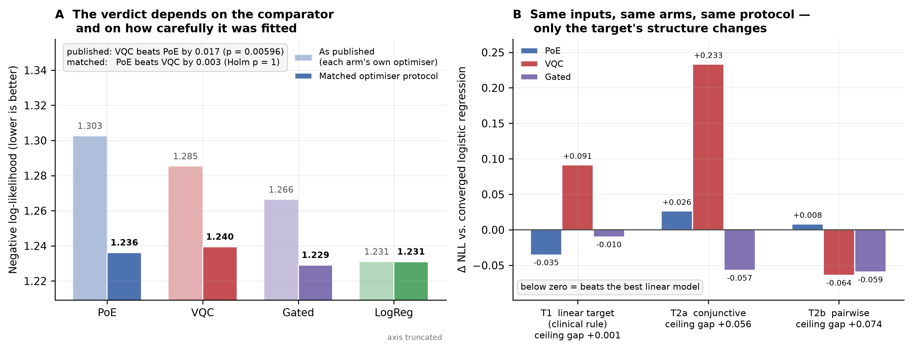
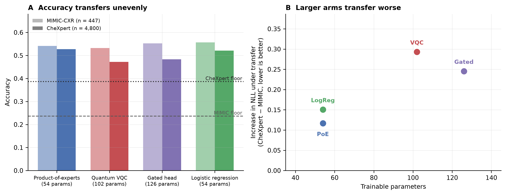

# Auditing quantum machine learning in digital health: one deployed system and four published studies under symmetric evaluation

Sivaguru R. M.

Independent researcher. Correspondence: sivagurumurugan1@gmail.com
Code, artifacts and pre-registrations: github.com/Sivaguru-2008/aura

## Abstract

**Background.** The most rigorous synthesis of quantum machine learning (QML) in digital health found quantum–classical differences negligible in 16 of 4,915 screened records, and found comparators often unjustified and code and data rarely released. This cannot distinguish *no advantage exists* from *no advantage was measurable*.

**Methods.** We built AURA, an offline decision-support system for chest radiography and brain MRI with a production quantum layer, and applied a seven-rule comparison protocol to every quantum claim it made: per-arm calibration, matched capacity, disjoint splits, significance before ranking, publication of negative outcomes, artifact-derived reporting, and source-level audit. Data were MIMIC-CXR (patient-disjoint 1,338/446/447 studies), CheXpert (4,800 test studies, pre-registered) and BraTS-2020 (369 subjects). We also re-tested five published claims from four studies.

**Results.** None of six claims of quantum benefit survived. A calibration advantage (expected calibration error 0.020 versus 0.276) was an artifact of calibrating only the quantum arm. Under a matched optimiser, the quantum circuit and the product-of-experts did not differ (Δ negative log-likelihood 0.0033, Holm p = 1.0), though equivalence within ±0.01 nats was not established; on evidence the image model never saw, the circuit was borderline worse (Δ 0.008, Holm p = 0.04). Removing entanglement improved likelihood in ten of ten seeds, but only marginally over patients (95% CI +0.002 to +0.048), and out-of-sample it was not detected (95% CI −0.005 to +0.012), though not shown to be zero. For glioma grading, a quantum kernel did not differ detectably from an RBF kernel (111 held-out subjects: ΔAUROC −0.022, 95% CI −0.054 to +0.011). Frozen and transferred to a second institution, the circuit ranked last of four on every metric, falsifying one of our own pre-registered hypotheses. None of the five published claims was supported, and one reversed significantly. Our proposed shot-budget mechanism was retracted on source audit.

**Conclusions.** In this system and these four studies, no quantum component showed a benefit that survived a second baseline, matched optimisation, or a second institution. A positive control shows the comparison detects nonlinear advantage when present. The results concern a few encoding families at 7–10 qubits under exact simulation, and do not rule out advantage elsewhere.

**Keywords:** quantum machine learning; negative results; benchmarking methodology; clinical decision support; calibration; external validation; pre-registration; reproducibility

---

## 1. Introduction

Quantum machine learning applied to medical data has produced a substantial applied literature, and the most rigorous synthesis of it reaches a null result. Gupta et al. [1] screened 4,915 records, identified 169 eligible studies, and synthesised 16, finding negligible quantum–classical differences. They also report ad-hoc comparator selection and that 81.7% of eligible studies used ideal simulation only.

That conclusion is accompanied by a methodological audit which, in our reading, explains why the literature is not in a position to have found otherwise. Comparator selection was "often ad-hoc rather than theoretically justified" [1]; 81.7% of eligible studies used ideal simulation only; 14 of the 16 synthesised studies compared hardware results against noiseless simulation; only 2 of 16 used real electronic health record data; and most released neither code nor data [1].

A literature with these properties cannot distinguish the hypothesis that no advantage exists from the hypothesis that no advantage was measurable. It is also poorly placed to detect the failure mode we consider most likely, which is not misconduct but **asymmetric care**: a researcher tunes, calibrates and iterates on a novel method, while the baseline is implemented once, correctly, and left alone. Neither arm is wrong; the comparison between them is not fair. The same mechanism is documented in recommender systems [2], metric learning [3], reinforcement learning [4], medical imaging [5], and learned partial-differential-equation solvers, where roughly 79% of surveyed studies compared against a weak baseline [6]. Within QML, reported kernel advantages have been attributed to unequal hyperparameter optimisation [7,8], and Bowles, Ahmed and Schuld [9] show at benchmark scale that apparent advantages largely dissolve under matched tuning.

There is a second reason for caution: at 8 to 10 qubits no established theoretical mechanism predicts an asymptotic advantage. Theorists know that $2^8$ to $2^{10}$ statevectors are classically simulable in milliseconds on commodity hardware, and classical intractability of the represented function class is insufficient for a learning advantage [10]; generic hyperparameter tuning drives quantum kernels toward well-approximated classical ones [11]; kernel values concentrate exponentially with width [12]; and provable absence of barren plateaus tends to imply classical simulability [13]. 

Empirical advantage claims are nonetheless made at this scale. In our PubMed screen (§2.1), 41 of 129 health-related records claim a quantum-over-classical benefit in the abstract. Only 7 of the 41 state a qubit count there: 4 use 4–12 qubits and 3 use 13–21. That is too sparse to show how common the regime is, and we do not rest the argument on prevalence. Classical simulability also helps: at 8–10 qubits, exact statevector simulation evaluates quantum models without shot noise, gate infidelity, readout error or decoherence.

We tested this proposition from a position that favours a false positive. We built a complete clinical decision-support system containing a genuine quantum layer, served the quantum backend in production, and published — in earlier versions of this project's documentation — a quantum calibration advantage of a factor of 13.8 and a measurement-budget mechanism advanced as the project's principal novelty. We then specified a comparison protocol strict enough that a demonstrated advantage would be credible, and applied it to every quantum claim in the system, supplemented by a field-wide multi-study audit (§2.1) across published medical QML benchmarks.

None survived. One pointed opposite to the field's central premise without being established: removing entanglement improved likelihood in every seed and every re-split, but over patients the evidence is marginal, and on evidence the image model never saw it was not detected. One was invalidated not by an experiment but by reading the implementation. And one of our own null results was falsified by our own external validation.

Our contribution is complementary to [1], which establishes a field-level null by aggregation, and to [9], which does so by systematic benchmarking of model pairs: a single deployed system examined in depth, supplying the methodological elements those studies found absent, together with three they do not consider — calibration symmetry, optimiser symmetry, and source-level capability audit. We make no clinical claims of primary diagnostic efficacy. Our empirical investigations deliberately span three distinct grounding tiers: (i) **pathology-derived glioma grade** as distributed with BraTS 2020 across 369 brain MRI subjects (§2.7), with a label-integrity check against contrast enhancement ($p = 4.0 \times 10^{-21}$); (ii) **clinical laboratory assays and diagnostic criteria** across external medical cohorts in our field audit (§2.1); and (iii) **controlled analytical benchmarks** on chest radiography fusion, where a known deterministic generating rule allows calculating the exact theoretical Bayes-optimal linear ceiling (§2.4), providing a positive control that tests apparatus sensitivity before evaluating empirical nulls.

---

## 2. Results

### 2.1 Field-wide audit: published medical QML advantages fail under symmetric evaluation

To determine whether the null and negative findings in AURA represent an idiosyncratic property of our architecture or a general property of applied medical QML, we conducted an empirical literature audit under a written protocol (`docs/FIELD_AUDIT_PROTOCOL.md`; its registration status is stated in Methods). We screened 231 PubMed records for peer-reviewed studies claiming quantum superiority on a clinical prediction task with a pipeline specified well enough to re-implement on openly accessible data.

The screen ran in three stages, each logged in `bench/field_audit/search/`. S1, a scripted medical-relevance and not-a-review filter, kept 129 of 231. S2, on abstracts, kept 41 that claim a quantum-over-classical benefit on a patient-level health outcome. Of the 88 excluded at S2, 27 were molecular or cell-line tasks, 27 had no patient-level outcome, 19 reported no quantum-over-classical superiority, 8 had no quantum circuit or were quantum-inspired, 6 were general benchmarks rather than medical tasks, and 1 had no abstract. S3, on full text, found 8 eligible, excluded 29 (most often because the quantum head sat inside a deep CNN, or the data were private) and could not assess 4 behind publisher logins. **We ran 4 of the 8 eligible studies, yielding five claims, because one paper makes two (PMID 42286086).** The other four are eligible but not run. A heart-disease QNN (PMID 41513819) is implemented but unfinished for compute reasons. A 3-million-parameter hybrid (PMID 40865268) has no released code. Two need large deferred downloads: PROSTATEx (PMID 42046760) and INCOV omics (PMID 41966795). We chose among eligible studies by feasibility (data size, code availability), not by expected outcome. The five claims are a feasibility-selected set, not a random sample of the digital-health QML literature, and say little about the field's base rate.

Each study was audited under two arms: (1) a **reproduction arm** implementing the study's own claimed pipeline, and (2) a **symmetric arm** evaluating the quantum model against a nested-selected classical comparator (5 families, 16 configurations: logistic regression, RBF-SVM, random forest, histogram gradient boosting, MLP) across 25 outer cross-validation folds under leak-free preprocessing and Nadeau–Bengio corrected resampling tests [14].

Across the audited cohorts, spanning chronic disease laboratory assays, clinical neurological exams, and neuro-oncology (Table 1), **zero of five published claims of quantum advantage survived symmetric evaluation**:

1. **Chronic Kidney Disease (CKD)** (*PeerJ Comput Sci* 2025; PMID 40567645) [15]. The authors claimed that a variational quantum classifier (VQC) achieved 99.2% accuracy, significantly outperforming classical SVM (92.8%), Random Forest (90.7%), and MLP (94.8%) on serum creatinine, blood urea, and urinalysis biomarkers. Re-implemented under the paper's own protocol, the VQC reached 83.5% (not 99.2%) and the classical baselines 96.0%–97.8%, above the reported figures. Under our symmetric protocol the VQC reached 87.7%. The claimed quantum advantage **reversed with high statistical significance in favour of classical models** (Δ = −9.65%, 95% CI: −14.9% to −4.4%, t = −3.78, p = 0.000915).
2. **Glioma Grading (TCGA)** (*Sci Rep* 2025; PMID 40676161) [16]. The study reported that a VQC outperformed classical algorithms (KNN, SVC, DTC, RFC) with a cross-validated accuracy of 0.83 on 20 molecular and clinical features. Under symmetric cross-validation and matched tuning, Quantum VQC achieved 85.6% accuracy against 85.4% for classical models (Δ = +0.19%, 95% CI: −1.2% to +1.6%, t = 0.28, p = 0.7824); the claim is **not supported**.
3. **Parkinson's Disease** (*Sci Rep* 2026; PMID 42286086) [17]. The study claimed an adaptive quantum-kernel stack increased diagnostic specificity from 58.5% (classical RBF-SVM) to 81.3% on the UCI Parkinson's acoustic voice measures. The paper states that PCA was applied globally before cross-validation, and its baseline is an untuned RBF-SVM. Under that protocol the claim reproduces: stack specificity 87.5% against 60.4%. Under our symmetric protocol, with PCA fitted inside training folds and a nested-selected comparator, quantum and classical specificities were identical (43.3% versus 43.0%, Δ = +0.33%, 95% CI: −25.0% to +25.6%, t = 0.027, p = 0.9785); the claim is **not supported**. The two protocol changes were applied together and not separated, so which of them removes the advantage is not determined. The paper itself reports that fitting PCA within each outer fold left Parkinson's accuracy unchanged.
4. **Type-2 Diabetes (Pima)** (*Sci Rep* 2026; PMID 42286086). The same quantum-kernel stacking framework claimed to increase recall from 55.3% to 62.1% on glucose tolerance and metabolic criteria. As for Parkinson's, the claim reproduces under the paper's protocol (stack sensitivity 69.8% against 56.7%). Under leak-free symmetric evaluation, classical models attained 74.6% sensitivity while the quantum stack attained 69.3% (Δ = −5.30%, 95% CI: −11.0% to +0.39%, t = −1.92, p = 0.0666); the claim is **not supported**.
5. **Adolescent Schizophrenia EEG** (*J Med Syst* 2024; PMID 38441727) [18]. The authors reported 100.0% classification accuracy using a Pauli-feature-map QSVM across EEG sensor channels. The 100% did not reproduce. On per-recording features (one row per subject), 200 random 70/30 splits gave the QSVM a mean of 52%, none reaching 100%, and logistic regression 69%. Our harness has no epoch-level rows, so it cannot test whether repeated epochs crossing the split produced the published figure; the cause is not determined. Under symmetric evaluation the result was (59.1% quantum vs 66.7% classical, Δ = −7.60%, 95% CI: −23.0% to +7.8%, t = −1.02, p = 0.3187); the claim is **not supported**.

**Table 1.** Field-wide literature audit of published medical QML claims evaluated under symmetric benchmarking across 25 outer folds (`bench/field_audit/results/`).

| Study & Cohort | Target & Ground Truth | Reported Claim | Failure mechanism (from reproduction arm) | Symmetric Quantum | Symmetric Classical (nested-selected: 5 families, 16 configs) | Δ (Quantum − Classical) | Nadeau–Bengio *p* | Audit Verdict |
|---|---|---|---|---:|---:|---:|---:|---|
| **CKD** (*PeerJ* 2025) | Chronic kidney disease (biochemical assays) | VQC 99.2% vs SVM 92.8% | VQC not reproduced (83.5%); classical reproduced above reported | 87.70% | **97.35%** | −9.65% [−14.9, −4.4] | **0.000915** | **REVERSED** |
| **Glioma** (*Sci Rep* 2025) | Histological grade (TCGA molecular pathology) | VQC 83.0% vs SVM 75.0% | Classical reproduced above reported (SVC 85.3%); not determined | 85.60% | 85.41% | +0.19% [−1.2, +1.6] | 0.7824 | **NOT SUPPORTED** |
| **Parkinson's** (*Sci Rep* 2026) | Parkinson's diagnosis (acoustic voice measures) | Stack spec. 81.3% vs SVM 58.5% | Reproduces under paper protocol; full-data PCA and untuned comparator not separated | 43.33% | 43.00% | +0.33% [−25.0, +25.6] | 0.9785 | **NOT SUPPORTED** |
| **Diabetes** (*Sci Rep* 2026) | Oral glucose tolerance test (Pima) | Stack recall 62.1% vs SVM 55.3% | Reproduces under paper protocol; full-data PCA and untuned comparator not separated | 69.34% | **74.64%** | −5.30% [−11.0, +0.39] | 0.0666 | **NOT SUPPORTED** |
| **Schizophrenia** (*J Med Syst* 2024) | Psychiatric DSM clinical EEG | QSVM 100% vs classical 100% | 100% not reproduced (QSVM 52%); not determined | 59.10% | **66.71%** | −7.60% [−23.0, +7.8] | 0.3187 | **NOT SUPPORTED** |

---

### 2.2 A calibration advantage that was an artifact of the comparison

The project's first published quantum claim was a calibration advantage: expected calibration error (ECE) 0.020 for the quantum backend against 0.276 for the classical product-of-experts, a factor of 13.8. An audit of the harness that produced it found that temperature scaling was applied to the quantum logits and not to the classical ones, so the comparison contrasted a calibrated model with an uncalibrated one. Giving the classical arm its own temperature on the same predictions reduced the gap from 0.256 to 0.007.

Those figures come from the models and split served at the time — a 100-study synthetic-evidence split, before the fusion heads were refitted on real MIMIC-CXR evidence. **Re-running the same audit against the current served models on the real 447-study split reproduces the finding at different magnitudes**: quantum 0.0896, classical with its own temperature 0.1266, classical uncalibrated 0.2289. The ECE gap attributable to the confound alone is 0.139 raw against 0.037 fair — that is, **three-quarters of the originally published difference was calibration and not architecture**. The direction and the diagnosis are unchanged; the size is smaller on real data.

The headroom available to this confound is not small and is measurable: the temperatures the three served backends require differ by a factor of **1.89** (`backend_calibration.json`). Any comparison that calibrates one arm and not another has that factor available to it. This is the observation that became protocol rule P1, and every subsequent result in this paper is reported with per-arm calibration.

### 2.3 The verdict depends on the comparator — and on how carefully it was fitted

On the primary 447-study patient-disjoint split, four fusion backends were compared: a Bayesian product-of-experts (54 trainable parameters), an 8-qubit 3-layer CNOT-ring variational circuit (102), a learnable gated head (126), and a multinomial logistic regression (54). Against a majority-class floor of 0.2371, the published comparison produced an ordering that depends entirely on which classical model is chosen (Table 2, upper block).

Placed against the product-of-experts alone, the quantum circuit wins on negative log-likelihood (Δ = 0.0173, Wilcoxon *p* = 0.006) and on calibration (ECE 0.0896 versus 0.1266). Placed against the gated head, it is not distinguishable (*p* = 0.052). Placed against a converged logistic regression — the model class the target's structure makes correctly specified, at half the circuit's parameter count — it loses with significance (Δ = 0.0543, Holm *p* = 0.036). **A study reporting any one of these three comparisons in isolation would have a defensible and opposite finding.**

The arms differed in optimiser as well as in model class: the product-of-experts was fitted by 400 steps of fixed-rate gradient descent, the gated and quantum arms by Adam at different epoch counts, and the logistic regression by L-BFGS to optimality. We therefore refitted **every** arm under one protocol — the same optimiser, batch size, epoch cap, early-stopping rule, weight decay, seed, and the same learning-rate grid searched per arm on the same calibration split (Methods; `fusion_matched_optimiser.json`).

Under matched optimisation, the entire ordering dissolves (Table 2, lower block; Figure 1A). Every arm improves. **No pairwise accuracy comparison reaches significance** (all Holm *p* ≥ 0.91), and only one likelihood comparison survives Holm correction — the gated head over the product-of-experts, Δ = 0.0071, Holm *p* = 0.044. The quantum circuit's published advantage over the product-of-experts disappears (Δ = 0.0033 in the product-of-experts' favour, Holm p = 1.0). We do not interpret this as a reversal; the estimate is compatible with zero. A two one-sided test (TOST) with a margin of ±0.010 nats, fixed in `PREREGISTRATION_ADDENDUM_2026-10.md` before the test was run but after this point estimate was published, **does not establish equivalence**. The paired mean difference is +0.0034 (SE 0.0184), the 90% CI is −0.027 to +0.034, and *p*_TOST = 0.36. A percentile bootstrap gives the same interval. The interval is three times wider than the margin. At *n* = 447 this comparison cannot resolve likelihood differences smaller than about 0.03 nats in either direction, so we say only that no difference was detected, not that the arms are equivalent (`revision_v51.json`, analysis A). Its significant deficit against the logistic regression also disappears (Δ = 0.0085, Holm *p* = 1.0).

Two further observations bear on interpretation. First, the quantum circuit's final **training** negative log-likelihood is 1.2598, against 1.2142 for the 54-parameter product-of-experts and 1.1961 for the gated head: at 102 parameters it fits this task's training data *worse* than a model with half as many. That reflects unfavourable inductive bias or incomplete optimisation; our design cannot separate them. Second, under matched optimisation the quantum arm has the best calibration of any arm (ECE 0.0486 against 0.0804–0.0862). It also leads on calibration on out-of-sample evidence (§2.8), but not in the published block, and under frozen transfer it is the worst-calibrated arm (ECE 0.1586, Table 4).

This control has a limit. The shared budget's adequacy is measurable on the one arm whose optimum is knowable: the Adam-fitted linear arm reaches negative log-likelihood 1.2362 against the L-BFGS optimum of 1.2310, a residual gap of **0.0052**. That gap is of the same order as the one comparison surviving Holm correction (0.0071), so Table 2's lower block should be read as showing that no ordering is resolvable under matched optimisation, not that the gated head's margin is established.

**Table 2.** Fusion backend comparison on 447 patient-disjoint MIMIC-CXR test studies, as published and under a matched optimiser protocol. Majority-class floor 0.2371. Best value in each block in bold. Sources: `fusion_baselines_n447.json`, `fusion_matched_optimiser.json`.

| | Backend | Params | *T* | Accuracy | NLL | ECE | Macro AUROC |
|---|---|---:|---:|---:|---:|---:|---:|
| **As published** | Product-of-experts | 54 | 0.479 | 0.5414 | 1.3026 | 0.1266 | 0.8045 |
| (each arm's own optimiser) | Quantum VQC | 102 | 0.906 | 0.5324 | 1.2853 | 0.0896 | 0.8014 |
| | Gated head | 126 | 0.887 | 0.5526 | 1.2663 | 0.0902 | 0.8056 |
| | Logistic regression | 54 | 1.072 | **0.5570** | **1.2310** | **0.0862** | **0.8227** |
| **Matched optimiser** | Product-of-experts | 54 | 1.054 | 0.5593 | 1.2362 | 0.0810 | 0.8219 |
| (one protocol, all arms) | Quantum VQC | 102 | 1.003 | 0.5436 | 1.2395 | **0.0486** | 0.8009 |
| | Gated head | 126 | 1.007 | **0.5682** | **1.2291** | 0.0804 | **0.8252** |
| | Logistic regression | 54 | 1.072 | 0.5570 | 1.2310 | 0.0862 | 0.8227 |

### 2.4 The comparison detects a nonlinear advantage when one exists

The result in §2.3 is open to an objection that must be answered rather than conceded. The six-way target is derived from the report by a fixed weighted score (Methods), so its Bayes-optimal decision rule is linear in the evidence vector. A reviewer may reasonably say that we have shown a nonlinear model failing to beat a linear model on a task we have proved is linear — a theorem restated, not an experiment.

We therefore ran a positive control that holds everything fixed except the structure of the target: the same real evidence vectors, the same patient-disjoint splits, the same four arms, the same matched optimiser protocol, the same calibration and the same tests. Only the label-generating rule changes (Figure 1B; `nonlinear_control.json`).

Three targets were used. **T1** reproduces the clinical target's own generating rule. **T2a** assigns categories by conjunction and negated conjunction of binarised findings — a constellation rather than a weighted sum. **T2b** is a generic pairwise-interaction target, `argmax_k (a_k·x + xᵀM_kx)` with fixed random symmetric `M_k` and zero diagonal.

For each target we first measured the **linear ceiling** — the accuracy a multinomial logistic regression attains against the noise-free target on the whole corpus — and the **interaction ceiling** from a model with explicit pairwise features. This makes "higher-order structure" a measured quantity rather than an assertion. On T1 the linear ceiling is **0.9991** against an interaction ceiling of 1.0000: this confirms empirically that the clinical target is linear in the evidence vector, as the labeller's source implies. On T2a the ceilings are 0.8740 and 0.9301, and on T2b 0.9081 and 0.9821 — gaps of 0.056 and 0.074 that no linear model can close.

**The control passes, on the paper's primary metric.** Table 3 gives the result. On T1, the product-of-experts attains the lowest NLL (0.0382), ahead of the gated head (0.0636, Δ vs logistic −0.010, Holm p < 10⁻⁴) and the logistic regression (0.0736); the quantum circuit is worst (0.1651, Δ vs logistic +0.092, Holm p < 10⁻⁴). The pairwise likelihood differences on T1 show the product-of-experts leading all arms: Δ vs logistic −0.035, Δ vs gated −0.025, and Δ vs quantum −0.127 (all Holm p < 10⁻⁴). On T2a and T2b the gated head improves on logistic regression by 0.057 and 0.060, against 0.010 on T1. Additional file 3, Table S6c, reports all pairwise differences across all targets. The comparison has the sensitivity the objection questions.

**The quantum circuit's one genuine win in this paper is here.** On T2b it beats the converged logistic regression on negative log-likelihood by Δ = **−0.064** (Holm *p* = 2.7 × 10⁻⁴) — having lost to the same arm on T1 by +0.092 and on T2a by +0.233. The entangling ansatz *can* capture inter-channel structure that a linear model cannot, when the structure is generic pairwise interaction. It does not capture T2a's conjunctive structure, where it finishes worst of four. And it does not help on the clinical target, because that target has no such structure to capture.

The scope of this result is limited. T2a and T2b are **semi-synthetic**: real evidence vectors, constructed labels, no clinical meaning whatsoever, and T2b leaves one of the six categories unreachable. The result is not evidence of quantum utility in medicine. What it establishes is the property the objection turns on: these nulls measure the task, not the apparatus — and the same apparatus that reports no quantum advantage on the clinical target reports one, with significance, on a target built to contain it.

**Table 3.** Positive control. Same evidence vectors, splits, arms, protocol and tests; only the target's structure changes. Δ NLL is against the converged logistic regression, so a negative value means the arm beats the best linear model. Best NLL per target in bold. Source: `nonlinear_control.json`.

| Target | Linear ceiling | Interaction ceiling | Arm | Accuracy | NLL | Δ NLL vs. logistic | Holm *p* |
|---|---:|---:|---|---:|---:|---:|---:|
| **T1** clinical (linear) | 0.9991 | 1.0000 | Product-of-experts | 0.9843 | **0.0382** | −0.035 | <10⁻⁴ |
| | | | Logistic regression | 0.9799 | 0.0736 | — | — |
| | | | Gated head | 0.9821 | 0.0636 | −0.010 | <10⁻⁴ |
| | | | Quantum VQC | 0.9441 | 0.1651 | **+0.092** | <10⁻⁴ |
| **T2a** conjunctive | 0.8740 | 0.9301 | Product-of-experts | 0.8345 | 0.5911 | +0.027 | <10⁻⁴ |
| | | | Logistic regression | 0.8501 | 0.5646 | — | — |
| | | | Gated head | 0.8345 | **0.5075** | **−0.057** | 7.5×10⁻⁴ |
| | | | Quantum VQC | 0.7539 | 0.7980 | +0.233 | <10⁻⁴ |
| **T2b** pairwise | 0.9081 | 0.9821 | Product-of-experts | 0.8971 | 0.3238 | +0.008 | 0.220 |
| | | | Logistic regression | 0.8971 | 0.3155 | — | — |
| | | | Gated head | 0.9195 | 0.2560 | −0.060 | <10⁻⁴ |
| | | | Quantum VQC | 0.8971 | **0.2515** | **−0.064** | 2.7×10⁻⁴ |

**Figure 1.** **A**, Negative log-likelihood of four fusion backends on the same 447-study split, under the published heterogeneous optimisers and under one shared optimiser protocol. The quantum circuit's likelihood advantage over the product-of-experts disappears (Δ NLL = 0.0033 in PoE's favour, Holm p = 1.0; no difference detected). **B**, Accuracy of the same four arms under the same protocol on three targets built from the same evidence vectors, differing only in structure; dashed and dotted lines mark each target's measured linear and interaction ceilings.

### 2.5 Entanglement did not help

We ablated the entangling block directly. The CNOT ring is replaced by no two-qubit gates at all, holding qubit count, layer count, trainable parameter count, encoding, readout, data, seed and training function identical, so that any difference is attributable to entangling topology and to nothing else. Positive Δ means the entangled arm has the higher (worse) negative log-likelihood.

**(a) The first result was confounded.** An initial ten-seed ablation at 8 qubits found the ring worse on negative log-likelihood in ten of ten seeds. But the eighth evidence channel, `prior_risk`, is identically zero in all 2,231 studies, so the entangled arm couples data qubits to a constant register while the product arm does not. *A significant, ten-seed, capacity-matched effect was an artifact of an input we had not inspected.*

**(b) On seven informative channels, the penalty is marginal over patients.** Entanglement was again worse in ten of ten seeds (mean Δ +0.025, 95% CI +0.013 to +0.037), but those seeds vary initialisation on a fixed test set. Over the 447 test patients: patient bootstrap +0.025, 95% CI +0.002 to +0.048 (*p* = 0.036), widening to −0.001 to +0.052 once initialisation variance is included. Five fresh patient-disjoint re-splits all pointed the same way (mean Δ +0.032; descriptive at K = 5). Neither accuracy (*p* = 0.29) nor calibration (*p* = 0.43) differed. *The direction is consistent; the size is not distinguishable from zero once all variance is counted.*

**(c) Under data re-uploading, the penalty was larger in-sample.** Because RY(πx) encoding without re-uploading limits each output to a low-degree Fourier series in the inputs [19], we repeated the ablation with a data re-uploading ansatz [20] at matched parameter count: +0.049, patient 95% CI +0.023 to +0.076. *This ablation ran on in-sample evidence only and is unreplicated.*

**(d) On out-of-sample evidence, the penalty was not detected.** On CheXpert evidence the image model never saw (§2.8): mean Δ +0.0035, worse in 8 of 10 seeds, patient 95% CI −0.005 to +0.012; a post hoc equivalence test at ±0.01 nats fails (90% CI −0.004 to +0.011). The corpus and label map also changed, so the smaller estimate need not reflect the removal of in-sample evidence alone. *Neither a penalty nor its absence is shown.*

Taken together, **no entanglement penalty is established**, and we claim neither a penalty nor that entanglement is harmless. Decision rules (Additional file 1), per-seed results, both bootstraps and the full analysis are in Additional file 2.

### 2.6 Sensitivity across 48 architectural configurations

A 48-cell sweep over width, depth and entangling topology did not support the served design: the best cell by negative log-likelihood carries zero entanglement, and three of the five best configurations by negative log-likelihood are at zero entanglement. It was run on one split, at one seed, at 8 qubits with the constant channel, so it cannot establish that zero entanglement is optimal (Additional file 2).

### 2.7 The quantum kernel did not differ detectably from a classical kernel

A 10-qubit fidelity kernel was compared against a radial basis function (RBF) kernel for glioma histological grade classification from brain-MRI encoder embeddings.

**Held-out cohort (pre-specified sensitivity analysis, reported first).** The pre-specification (`PREREGISTRATION_QKL_BRATS2020.md`) named the 369-subject analysis as primary. We lead instead with the 111 subjects held out from encoder training, because the encoder saw about 258 of the 369. This change was made after both results were known, and we report it as a deviation. The 111 are 55 validation and 56 test subjects whose segmentations never influenced any weight (`qkl_brats2020_official_heldout111.json`). This cohort comprises 23 Lower-Grade Glioma (LGG) and 88 High-Grade Glioma (HGG) subjects. Because the LGG count (23) is small, this analysis is statistically underpowered. On this held-out cohort, the quantum kernel's AUROC was 0.0217 below an RBF kernel: quantum AUROC **0.9407** against RBF **0.9625**, Δ = **−0.0217**, 95% CI −0.0543 to +0.0109, DeLong *p* = 0.191 (fold-level Wilcoxon p = 1.000; subject-level bootstrap median −0.0197, 95% CI −0.0577 to +0.0063 across 2,000 resamples). The confidence interval does not exclude a difference in either direction and admits an AUROC deficit of up to 0.054 for the quantum kernel. The pooled out-of-fold DeLong test should be read as approximate because Platt scaling [21] parameters differ across folds.

**Pre-specified primary, 369-subject cohort.** The 369-subject nested cross-validation across all official BraTS 2020 subjects (`qkl_brats2020_official.json`; 76 LGG, 293 HGG) was the pre-specified primary analysis, and we read it as compromised: the feature encoder was trained on roughly 258 of these subjects, so embeddings for those subjects are not strictly independent of the labels used in grading. Under 5-fold nested subject-level cross-validation with symmetric 5 × 5 grids, the quantum kernel attains subject-level AUROC **0.9422** against the RBF kernel's **0.9405**: Δ = **+0.0017**, 95% CI −0.0099 to +0.0132, DeLong *p* = 0.777 (subject-level bootstrap median +0.0016, 95% CI −0.0107 to +0.0126; fold-level Wilcoxon *p* = 0.875). Accuracy is 0.867 versus 0.865 and F1 is 0.723 versus 0.719.

Both models show poor probability calibration at the subject level (ECE 0.308 and 0.284), which is likely an artifact of averaging slice probabilities within a subject rather than a defect of either kernel.

### 2.8 External validation falsifies one of our own hypotheses

Every result above is from one centre. Under a pre-registration deposited before any CheXpert image was scored — fixing the hypotheses, sampling rule, freeze/refit boundary, label map, uncertainty policy and test family (`docs/PREREGISTRATION_CHEXPERT.md`) — all four backends were frozen and transferred to 8,000 patient-disjoint frontal studies from a second institution, of which 4,800 form the test split. Only one temperature per arm was refitted, as P1 requires. No weights were updated.

One category is not derivable on the external cohort: the diagnosis map reaches COPD only through hyperinflation, which CheXpert does not label. The external cohort therefore has five reachable categories and a majority-class floor of 0.3867, and its accuracy is **not comparable** with the internal figure.

Four conclusions follow, and the first is a correction to this paper (Table 4, Figure 2).

**H1 was falsified — by our own result.** Five of six pairwise accuracy comparisons survive Holm externally. §2.3's finding that the backends are indistinguishable on accuracy was a statement about power, not about architecture: at *n* = 447 the minimum detectable difference is 9.3 accuracy points and the true differences are 4 to 6. A reader of the internal experiment alone would have concluded that fusion architecture does not matter. It does.

**H2 was confirmed more decisively than internally.** The quantum circuit finishes **last of four on accuracy, negative log-likelihood, calibration and macro AUROC**. Its likelihood deficit against the logistic regression grows from 0.054 internally to 0.197 externally — 3.6 times the internal gap.

**H3 was confirmed, and how it fails is the finding.** Every arm degrades, but degradation tracks capacity: the two 54-parameter linear arms lose 1.4 and 3.6 accuracy points, the 102-parameter circuit 6.0 and the 126-parameter gated head 7.0. The gated head's internal advantage over the product-of-experts — the result §2.3 used to retire the quantum claim — **reverses under transfer**. Selecting an architecture on the internal split would have selected one of the two worst-transferring arms. Part of this capacity-tracking pattern may come from the in-sample evidence the internal arms were trained on (Methods, Data), which higher-capacity arms can fit more closely, rather than from site shift alone.

**H4 was confirmed.** `prior_risk` is identically zero across all 8,000 CheXpert studies, establishing that the constant channel of §2.5 is a property of the evidence encoder rather than of MIMIC.

A pre-specified sensitivity analysis mapping uncertain labels to positive changes every accuracy by 1 to 2 points and changes no conclusion.

**Out-of-sample evidence (pre-registered addendum b).** The internal fusion experiments use evidence the image model produced for its own training images (Methods, Data). To test whether that drove the internal conclusions, we trained and tested all four arms and the entanglement ablation entirely within the 8,000 CheXpert evidence vectors, which the image model never saw. This is a workaround and a deviation from the obvious design: the MIMIC validation split has only 500 patients, too few to replace the internal set, so the corpus was changed instead (`PREREGISTRATION_ADDENDUM_2026-10b_CHEXPERT_INTERNAL.md`, committed before the run). It is therefore a replication on different data, not the same experiment. The labels come from a different source and map to five categories rather than six, and the image model faces a domain shift. Any difference from the MIMIC results may reflect those changes as well as the removal of in-sample evidence. The split was 60/20/20 (4,800/1,600/1,600 patients), with the §2.3 protocol and code unchanged (`chexpert_internal.json`). No accuracy comparison was significant (all Holm *p* = 1.0). On likelihood, the quantum circuit was slightly and borderline worse than the product-of-experts: 0.0076 nats, Wilcoxon Holm *p* = 0.042, with a paired-mean 90% CI of −0.001 to +0.016 and equivalence within ±0.01 nats not established. At *n* = 1,600 the same test also flags a 0.0005-nat difference between the two linear arms, so significance here says little about size, and differences of this order are not clinically meaningful. The quantum arm again had the lowest ECE (0.047 against 0.054–0.058). The L-BFGS logistic arm has 45 parameters here because one category (COPD) is absent. The entanglement penalty was not detected (§2.5(d)).

**Table 4.** External validation on CheXpert, *n* = 4,800 patient-disjoint test studies, all models frozen, one temperature refit per arm. Majority-class floor 0.3867. Δ columns are against the internal split and are shown for direction only. Source: `chexpert_external.json`.

| Backend | Params | *T* | Accuracy | NLL | ECE | Macro AUROC | COPD errors | Δ acc. | Δ NLL |
|---|---:|---:|---:|---:|---:|---:|---:|---:|---:|
| Product-of-experts | 54 | 0.431 | **0.5273** | 1.4193 | 0.1346 | 0.7366 | 393 | −0.0141 | +0.1167 |
| Quantum VQC | 102 | 1.309 | 0.4721 | 1.5782 | 0.1586 | 0.7259 | 279 | −0.0603 | +0.2929 |
| Gated head | 126 | 1.200 | 0.4829 | 1.5116 | 0.1424 | **0.7367** | 216 | −0.0697 | +0.2453 |
| Logistic regression | 54 | 1.109 | 0.5210 | **1.3815** | **0.1078** | 0.7298 | 209 | −0.0360 | +0.1505 |

Pairwise: quantum versus logistic, Δ accuracy −0.0489 (McNemar Holm < 10⁻¹⁰), Δ NLL +0.1967 (Wilcoxon Holm < 10⁻¹⁰). All six comparisons are in Additional file 3, Table S6.

**Figure 2.** External validation. Left, accuracy on each corpus against that corpus's own majority-class floor. Right, increase in negative log-likelihood under transfer against trainable parameter count.

### 2.9 A capability claim retracted on source-level audit

This project's proposed principal novelty was a quantum measurement-budget agent: the claim that a variational circuit can *type* an abstention, distinguishing a case that more measurement would resolve from one that no amount of measurement would, because the top two diagnoses are tied at infinite measurement precision. We advanced this as something classical inference cannot do, having no measurement budget to vary.

Applying rule P7 — that a claim about what a system can express is a claim about its implementation, and is verified at the source level — to our own mechanism invalidated it. The shot-budget loop computes the expectation **analytically** and then adds synthetic Gaussian noise scaled by the nominal shot count. It never executes the circuit at finite shots. The typing of an abstention therefore reduces to a threshold on the analytic margin, and any classical model with an analytic margin can apply the same threshold.

We retract the claim. Metrics could not have falsified it, because the mechanism produced exactly the numbers a working implementation would produce; only reading the code could. This is why P7 exists, and it was written after the audit rather than before it. The artifact carrying the retracted interpretation has been annotated in place rather than silently regenerated.

**Table 5.** The six claims, diagnostic mechanisms, and final audit outcomes.

| # | Claim | Diagnostic mechanism | Outcome |
|---|---|---|---|
| 1 | Better calibrated | Symmetric evaluation of post-processing calibration (P1) | **Withdrawn** (harness confound) |
| 2 | Beats classical on likelihood | Standardised Adam optimiser protocol across all backends | **Withdrawn**; no difference detected under matched optimiser; on out-of-sample evidence the quantum arm is slightly, borderline worse (Δ NLL 0.008, Holm *p* = 0.042; equivalence not established) |
| 3 | Entanglement helps | Capacity-matched 10-seed ablation, 7 informative channels | **Not supported**; worse NLL in 10/10 seeds; patient bootstrap 95% CI +0.002 to +0.048; under re-uploading (in-sample, unreplicated) +0.023 to +0.076; not detected on out-of-sample evidence (−0.005 to +0.012); no penalty established |
| 4 | Served design is good | 48-cell sweep across width, depth, and topology | **Not supported** (single-split sweep) |
| 5 | Kernel beats classical kernel | Clean held-out 111-subject imaging benchmark | **Not supported**; 111-subject Δ −0.022 [−0.054, +0.011] |
| 6 | Abstention typing by shot budget | Source-level code and measurement protocol audit (P7) | **Retracted** on source audit (analytic expectation plus synthetic Gaussian noise; never executes at finite shots) |

## 3. Discussion

Under a protocol designed so that a demonstrated advantage would be credible, no quantum component of this system provided a benefit that survived a second classical baseline, a second metric, a matched optimiser, or a second institution. One effect pointed opposite to the field's premise but was not established: at matched capacity, entanglement worsened likelihood in ten of ten seeds and five of five re-splits, yet over patients the evidence is marginal, it is larger only under a re-uploading encoding tested in-sample, and on out-of-sample evidence it was not detected (§2.5, §2.8).

The mechanism our results most directly implicate is not the quantum model but the **comparison**. Three findings isolate it. Calibrating one arm and not another moved ECE by 0.256 where the honest difference is 0.007 (§2.2). Choosing the comparator moved the verdict between "quantum wins with significance", "no difference", and "quantum loses with significance" on one split with one set of predictions (§2.3). And converging the baseline moved it further than the quantum effect the project opened with — under one optimiser protocol, the published quantum advantage vanishes (Δ = 0.0033, Holm p = 1.0; §2.3). None of these involves a wrong implementation of either arm. Each is a defensible choice that a reviewer would not see and a reader could not check without the artifacts.

This is why we regard optimiser symmetry as belonging in the protocol alongside calibration symmetry. The literature's convention — implement the baseline correctly, once — is not sufficient when the novel arm has been iterated on. "Correctly implemented" and "equally carefully fitted" are different standards, and only the second supports a comparison.

Two of our results caution against reading nulls as findings. §2.8's external cohort falsified our own pre-registered claim that the backends are indistinguishable on accuracy: at ten times the sample size, five of six comparisons are significant. A null from a few hundred studies is a statement about power. And §2.5's ablation was significant, replicated across ten seeds, and capacity-matched — and still confounded by an input channel that was identically zero, which we found only by inspecting the released tensor. Both failures were ours, and both were found by the protocol rather than despite it.

### 3.1 Prediction targets: Histopathology, clinical laboratory outcomes, and analytical positive controls

A frequent and valid critique of digital health machine learning is reliance on rule-derived report proxies rather than clinical outcomes. A model evaluated solely on text-derived labels might simply learn transcription artifacts or keyword heuristics rather than true pathology. Our investigation addresses this by evaluating across three distinct grounding tiers:

1. **Pathology-derived grade (BraTS 2020, §2.7).** For brain MRI the target is the LGG/HGG grade distributed with BraTS 2020, which the challenge reports as pathologically confirmed; we did not re-ascertain it. We checked that the labels are attached to the right images: in the expert segmentations, 27 of 76 LGG subjects and 0 of 293 HGG subjects lack an enhancing component (one-sided Fisher $p = 4.0 \times 10^{-21}$; enhancing-fraction AUROC 0.907; `grade_mapping_check.json`). That is a label-integrity check, not a biological validation. The primary kernel result is on the 111 subjects held out from encoder training (23 LGG): $\Delta$ AUROC −0.0217, 95% CI −0.0543 to +0.0109, DeLong $p = 0.191$. With 23 minority-class subjects the interval is wide, and it excludes neither a small quantum deficit nor a small advantage. The pre-specified primary 369-subject analysis ($\Delta = +0.0017$, $p = 0.777$) is compromised, because the encoder saw about 258 of those subjects; §2.7 reports this deviation.
2. **Clinical Laboratory & Diagnostic Assays (§2.1).** In our field-wide literature audit, the prediction targets were real biochemical assays (eGFR, serum creatinine, and urinalysis staging in CKD; 2-hour oral glucose tolerance tests in Pima diabetes) and clinical diagnoses (Parkinson's disease status from acoustic voice measures; psychiatric diagnosis in the schizophrenia EEG cohort). Across the five claims, none was supported under symmetric evaluation and one reversed.
3. **Controlled Analytical Positive Controls (§2.4).** On the chest radiography fusion task, the target is derived from the report by a fixed weighted score. Because the rule is deterministic, it also serves as an analytical control. Because the label-generating function was fully known, we could analytically calculate the exact Bayes-optimal linear ceiling (0.9991) and interaction ceiling (1.0000). This allowed us to construct positive controls (T1, T2a, T2b) with provable non-linear structure. If an evaluation relies exclusively on noisy real-world clinical labels, a null result can easily be dismissed as data noise or poor signal-to-noise ratio. Because the quantum circuit failed to outperform classical baselines on T1 (where the linear ceiling was provably reachable) and on T2a (conjunctive structure), but successfully captured generic pairwise interactions on T2b ($\Delta = −0.064$, $p = 2.7 \times 10^{-4}$), the comparison is shown to be able to detect a non-linear advantage where the target contains one. That makes apparatus insensitivity an unlikely explanation for the clinical nulls; it does not establish their cause.

### 3.2 The 8–10 qubit regime: Asymptotic complexity versus empirical literature practice

Quantum computing theorists may be tempted to dismiss experiments at 8–10 qubits: the Hilbert space ($2^8 = 256$ to $2^{10} = 1024$ dimensions) is simulable on a laptop in milliseconds, and no asymptotic complexity separation over classical algorithms can exist at this scale. 

That dismissal is correct about asymptotics and silent about what is published. Of the 41 screened records that claim a quantum-over-classical benefit on a health task (§2.1), none reports an asymptotic complexity separation, though two motivate their method by the exponential dimension of the Hilbert space and one claims hardware "quantum advantage" from a geometric-difference score; each reports an empirical result on a clinical dataset. Abstracts rarely state the width — 7 of 41 do, 4 of them in the 4–12 qubit range — so we make no claim about how prevalent the regime is, only that empirical claims exist at small, simulable widths and are testable there.

Exact statevector simulation also removes shot noise, gate infidelity, readout error and decoherence. Under it, the failure of quantum models to beat classical models cannot be blamed on the limitations of NISQ hardware. Instead, our results are consistent with the arguments of [10–12], which we did not test directly: quantum feature maps in low dimensions can suffer from unfavorable inductive biases, geometric concentration of measure, and rapid convergence toward classical kernels under hyperparameter tuning.

### 3.3 Governance, verification limits, and empirical recommendations

Protocol P6 guarantees that manuscript numbers equal the released artifacts. It does not guarantee the artifacts are correct: defect D14, in which real-trained models were evaluated on synthetic evidence while a validated verdict was printed, passed the drift test. We have since added an input-provenance assertion (`aura/ml/evaluation/provenance.py`). The SHA-256 of every array in the fusion evidence cache and the matched-optimiser predictions is pinned in `evidence_ledger.json`. The evidence loader refuses any cache that differs from the ledger or whose source is not the real corpus, and a CI test checks that a one-element perturbation is caught. The limit is that the ledger was pinned after the results it protects, so it guarantees those tensors have not changed since, not that they were correct before. That rests on the source field and on the exact reproduction of the published per-seed results (§2.5).

What remains is narrow. The quantum arm is the best-calibrated backend under matched optimisation (§2.3) and on out-of-sample evidence (§2.8). It is not an advantage: it does not survive into accuracy, likelihood, or discrimination, it reverses under frozen transfer, where the quantum arm is the worst calibrated (Table 4), and it is available more cheaply from any arm by temperature scaling.

For the field, we draw three recommendations. Calibrate every arm before comparing any of them, and report the temperature each required — the spread bounds the confound available. Fit every arm to convergence under a common budget, and report the residual gap on an arm whose optimum is knowable. And audit capability claims at source: our own principal contribution was invalidated by about ten lines of code that no metric could have contradicted.

### 3.4 Limitations

**Scope.** All quantum results come from one system, a few encoding families at 7–10 qubits, and exact statevector simulation. The five field-audit claims come from four studies chosen by feasibility from eight eligible ones (§2.1). They are not a sample of the field, and they say nothing about its base rate.

**Construct.** We operationalise quantum advantage as superiority on a stated metric under matched parameter count, per-arm calibration and a matched optimiser. Parameter-count matching is a weak proxy for capacity in quantum models, and we did not match effective dimension. Other constructs, such as sample efficiency or robustness under shift, are not tested.

**Prediction target.** The chest-radiograph target is a six-way category derived from reports by a fixed rule, not a clinician's diagnosis (§2.4, §3.1). The finding labels feeding it were checked against a 66-report reference read by one unblinded, non-radiologist reader. The glioma grade is taken as distributed with BraTS-2020 and was not re-ascertained.

**Statistical inference.** The entanglement penalty under the original encoding is marginal over patients and is not distinguishable from zero once initialisation variance is included (§2.5). The re-split analysis has K = 5 and is descriptive. The 447-study comparison has a minimum detectable accuracy difference of 9.3 points, and the equivalence test shows it cannot resolve likelihood differences below about 0.03 nats (§2.3). Its accuracy nulls are statements about power, as the external cohort later confirmed (§2.8). The same 447-study test split was used for more than sixty model evaluations, including a 48-cell sweep from which the best cells were read off. No untouched split remains to bound adaptive overfitting. The design sweep is single-seed, single-split and run at eight qubits with the constant channel (§2.6). The glioma analysis has 23 minority-class subjects, and its pooled DeLong test is approximate because Platt parameters differ across folds (§2.7).

**Pre-registration.** Only the external validation (`PREREGISTRATION_CHEXPERT.md`), the §2.5 re-split and re-uploading analyses (`PREREGISTRATION_ADDENDUM_2026-10.md`), and the out-of-sample-evidence analyses (`PREREGISTRATION_ADDENDUM_2026-10b_CHEXPERT_INTERNAL.md`) were registered by a repository commit before they ran. The field-audit and glioma protocols are pre-specified but not externally timestamped. The glioma analysis deviates from its pre-specification by reporting the sensitivity cohort first (§2.7). Everything else is post hoc (Methods).

**In-sample evidence.** The internal fusion experiments run on finding probabilities that the image model produced for its own training images (Methods, Data). Arm-to-arm comparisons are unaffected in kind, since all arms receive identical inputs, but absolute internal accuracy and likelihood are optimistic. Part of the internal-to-external degradation in §2.8 may reflect this rather than site shift alone. The MIMIC validation split (500 patients) is too small to replace the internal set, so we repeated the central comparisons within CheXpert evidence the model never saw (§2.8, last paragraph). There the quantum circuit was slightly and borderline worse than the product-of-experts, and the entanglement penalty was not detected. Because the corpus and label map changed too, this does not isolate the in-sample effect. Conclusions drawn only from the MIMIC fusion experiments should be read with this in mind. A finding extractor retrained without the fusion patients would remove the issue for MIMIC itself and was not done.

**Generalisation.** Development used one US tertiary academic centre. External validation covers the fusion comparison only, at one further US academic centre, and every arm degraded under transfer (§2.8). There is no prospective cohort, no reader study, no external brain cohort and no demographic subgroup analysis. The last cannot be run from the released evidence cache, which stores no patient identifiers.

**Verification.** The drift test guarantees that reported numbers equal the released artifacts, not that the artifacts are correct (§3.3). Additional file 3, §S7.3, registers fourteen defects found in this project's own artifacts and documentation, ten of them closed. One evaluated real-trained models on synthetic evidence from July until it was found, while printing a validated verdict (D14). Analyses identified as necessary and not performed are listed in Additional file 3, §S8.

## 4. Methods

**System.** AURA is an offline clinical decision-support system for chest radiography and brain MRI. A DenseNet-121 extracts per-finding probabilities from chest films; an evidence encoder assembles them into an eight-channel vector; a fusion backend maps that vector to a six-way diagnostic category. Five backends are interchangeable behind one interface. A separate 10-qubit quantum-kernel classifier predicts glioma grade from brain-MRI encoder embeddings. Quantum simulation used PennyLane `default.qubit`. Full architecture in Additional file 3, §S1.

**Data.** MIMIC-CXR [22] supplied two disjoint sets. The finding extractor was trained on the official training split and evaluated and calibrated on 2,099 held-out validation-split images (Additional file 3, Table S7). The fusion experiments use 2,231 training-split studies, one per patient, divided patient-disjointly into 1,338/446/447. One study per patient is enforced by the dataset builder, which takes the highest study identifier per patient and refuses a repeated patient identifier (unit-tested); the source training CSV has 64,586 rows and 64,586 distinct patient identifiers. **The fusion evidence vectors are therefore produced by the extractor on images it was trained on.** Every fusion arm sees the same vectors, so comparisons between arms remain symmetric. Absolute internal fusion performance is optimistic, however (§3.4). CheXpert [23] supplied 8,000 patient-disjoint frontal studies (3,200 calibration / 4,800 test) for external validation. BraTS-2020 [24] supplied 369 subjects for grading (76 LGG / 293 HGG) and 7,531 held-out slices for segmentation. Splits are patient-disjoint for fusion, volume-disjoint for segmentation, and subject-disjoint for grading, with resampling at the same unit.

**Prediction targets.** We distinguish three target modalities across our investigations:
1. *Chest radiography evidence fusion (§2.2–§2.6, §2.8)*: The six-way target is derived from free-text reports by a deterministic weighted score (heart failure = oedema 0.7 + cardiomegaly 0.5 + effusion 0.2; pneumonia = pneumonia 0.9 + consolidation 0.6 + opacity 0.3; and so on), with ties broken by clinical acuity. As detailed in §2.4 and Additional file 3, §S2, this linear rule is not an independently ascertained clinical diagnosis, but provides a positive control with a known Bayes-optimal ceiling. The finding labels feeding the evidence vector are validated against a hand-read 66-report reference standard (κ = 0.86, F1 = 0.89); the diagnostic-category map itself is not validated against clinician judgement.
2. *Glioma grade (§2.7)*: For brain MRI, the prediction target is the LGG/HGG grade distributed with BraTS-2020 for all 369 subjects [24], reported by the challenge as pathologically confirmed and not re-ascertained by us. A label-integrity check against contrast enhancement in the expert segmentations passed ($p = 4.0 \times 10^{-21}$; `grade_mapping_check.json`).
3. *Field audit clinical endpoints (§2.1)*: Targets comprise clinical laboratory assays (eGFR, serum creatinine, urinalysis staging in CKD; 2-hour oral glucose tolerance tests in Pima diabetes) and clinical diagnoses (Parkinson's disease status from acoustic voice measures; psychiatric diagnosis in the schizophrenia EEG cohort).

**Field audit protocol (§2.1).** Audited studies were screened from 231 PubMed records under a written protocol (`docs/FIELD_AUDIT_PROTOCOL.md`; see Comparison protocol for its registration status). Each study was evaluated across 25 outer folds (5 repeated 5-fold CV) with nested hyperparameter selection (3-fold inner CV, 16 candidate configurations per arm) against a nested-selected classical comparator (logistic regression, RBF-SVM, random forest, histogram gradient boosting, MLP) and tested using the Nadeau–Bengio corrected resampled t-test. Where code was available, it was checked for the leakage patterns catalogued by Kapoor and Narayanan [25].

**A constant evidence channel.** The eighth channel, `prior_risk`, is identically zero in all 2,231 MIMIC studies and all 8,000 CheXpert studies, because the encoder populates it from structured priors neither corpus supplies. The evidence vector is nominally eight-dimensional and effectively seven-dimensional; §2.5 reports the consequences.

**Comparison protocol.** P1, per-arm calibration: each backend fits its own temperature on its own calibration split before any metric is computed. P2, matched capacity within an ablation: compared arms have identical trainable parameter counts and are trained by the same function, data and seed. P3, disjoint splits at the correct unit. P4, significance before ranking: every ordering claim carries a test, an interval and a multiplicity policy. P5, publication of negative outcomes. P6, artifact-derived reporting, enforced by a drift test that fails the build when documentation and artifacts diverge. P7, audit of mechanisms and not only metrics. Provenance of the rules, including which were in force before which experiments, is stated in Additional file 3, §S3. **Analyses added in revision.** The patient bootstrap, re-splits, re-uploading ablation, equivalence tests and out-of-sample replication were all added after the earlier results were known, in response to critique of earlier versions. Each was specified in a committed protocol before it ran, but the choice to run them was not independent of what was already known, and readers should weigh them as a sequence of analyses rather than as one plan. Additional file 1 lists each protocol with its deposit and result commits and timestamps. **Registration status, as the repository history shows it.** Three protocols were committed to the repository before their analyses ran: the external validation (§2.8; `PREREGISTRATION_CHEXPERT.md`), the re-split and re-uploading analyses of §2.5 (`PREREGISTRATION_ADDENDUM_2026-10.md`), and the out-of-sample-evidence analyses (§2.8, §2.5(d); `PREREGISTRATION_ADDENDUM_2026-10b_CHEXPERT_INTERNAL.md`). The same addendum fixes the decision rules for the §2.3 equivalence test and the §2.5 patient bootstrap. Those point estimates were already published, so these are re-analyses with fixed rules, not blind tests. Two further protocols, for the field audit (§2.1; `FIELD_AUDIT_PROTOCOL.md`) and the glioma kernel re-analysis (§2.7; `PREREGISTRATION_QKL_BRATS2020.md`), state in their text that they were written before any model was run. Neither was committed before its results existed, so their timing cannot be verified from the repository; we call them *pre-specified*, not pre-registered. Everything else is post hoc.

**Matched optimiser protocol (§2.3).** Adam; batch size 50; maximum 150 epochs; early stopping on calibration cross-entropy with patience 20 and best-epoch weights restored; weight decay 0; seed 7; learning rate selected per arm from {0.01, 0.05, 0.1} on the calibration split by cross-entropy. The rate is searched per arm rather than fixed, because a single shared rate is not symmetry but a choice suiting whichever arm it was tuned on. All three trained arms converged by early stopping. A multinomial logistic regression fitted by L-BFGS (tol 10⁻⁸) serves as a convergence anchor, since it is the same model class as the linear arm with a knowable optimum.

**Positive control (§2.4).** Targets T1, T2a and T2b are computed from the same evidence vectors and evaluated on the same splits under the same protocol. T2a binarises channels at their corpus median — a property of the target's definition, computed once over the whole corpus and identical across splits, not a fitted parameter. Linear and interaction ceilings are fitted against the noise-free target on the whole corpus, since the question is representability rather than generalisation.

**Kernel comparison (§2.7).** Five outer subject-level folds stratified by grade over all 369 subjects, with an inner 75/25 split of each fold's training subjects for hyperparameter selection and Platt scaling. Both arms search a 5 × 5 grid of identical shape: five SVM regularisation values and five bandwidths. For the RBF arm the bandwidth is `gamma`; for the quantum arm it scales the projection feeding the feature map, following Shaydulin and Wild [7]. Grade is a subject-level property, so slice probabilities are averaged to one probability per subject before scoring. The pre-specification names the 369-subject analysis as primary and the 111 subjects held out from encoder training as its one sensitivity analysis.

**Reporting.** The study is reported following TRIPOD+AI [26], with the completed checklist provided as Additional file 4.

**Statistics.** Paired accuracy: McNemar's exact test. AUROC: DeLong [27,28], implemented once in `aura/ml/evaluation/delong.py` and validated against `sklearn.metrics.roc_auc_score`. Negative log-likelihood: Wilcoxon signed-rank with Shapiro–Wilk screening of the paired differences. Binomial intervals are Jeffreys intervals. Bootstrap resampling is at the unit of independence. Each table defines a test family and *p*-values within a family are Holm-adjusted; raw and adjusted values are both reported. ECE uses 10 equal-width bins and is bin-count dependent and biased at small *n*; differences of the magnitude reported here should not be read without their intervals. Following Gelman and Stern [29], we do not treat a significant and a non-significant result as evidence of a difference between the two.

**Reproducibility.** Every reported figure is read from a released artifact; Additional file 3, Table S9, maps each claim to its artifact. The audit harness records interpreter and package versions, git commit and working-tree state, hardware configuration, and SHA-256 checksums of every input. Environment: Python 3.12.10, NumPy 2.4.4, SciPy 1.18.0, scikit-learn 1.9.0, PyTorch 2.11.0 (CUDA 12.8), Windows 11.

**Limitations.** Summarised in §3.4. The full threats-to-validity analysis and the defect register are in Additional file 3, §S7.

---

## Declarations

**Ethics approval and consent to participate.** Three publicly available, de-identified research datasets were used. MIMIC-CXR was accessed under the PhysioNet credentialed-access process and its data use agreement, which requires human-subjects research training; the author completed that training, and the hand-annotation of 66 reports was performed by the author within the credentialed environment. CheXpert was obtained under the Stanford Machine Learning Group research use agreement. BraTS-2020 was obtained under the challenge's public data agreement. No identifiable patient data were accessed, no new data were collected from human participants, and no additional institutional review board approval was required.

**Consent for publication.** Not applicable.

**Patient and public involvement.** Patients and the public were not involved in the design, conduct or reporting of this study.

**Data availability.** MIMIC-CXR and CheXpert are available to credentialed users from PhysioNet and the Stanford Machine Learning Group respectively and are not redistributed. BraTS-2020 is available from the challenge organisers. Derived artifacts containing no patient data — calibration parameters, evaluation metrics, per-study model outputs and labels, significance tests, and the 8,000-study CheXpert evidence tensor — are released with the code.

**Code availability.** The complete system, evaluation harness, pre-registration and all artifacts underlying every table are at github.com/Sivaguru-2008/aura.

**Competing interests.** The author declares no competing interests.

**Funding.** This research received no specific grant from any funding agency.

**Author contributions.** S.R.M. conceived the study, designed and implemented the AURA system, developed the evaluation harness, performed all experiments and analyses, and wrote the manuscript.

**Acknowledgements.** None.

**Disclaimer.** AURA is a research system. It is not a medical device, has not received regulatory clearance, and is not intended or approved for autonomous primary diagnostic interpretation.

---

## Supplementary information

**Additional file 1.** Protocol registry: each protocol with its deposit and result commits, timestamps and decision rules (`docs/ADDITIONAL_FILE_1_PROTOCOL_REGISTRY.md`).

**Additional file 2.** Entanglement ablation and design sweep: full text, per-seed results, bootstraps and the 48-cell sweep (`docs/ADDITIONAL_FILE_2_ENTANGLEMENT_AND_SWEEP.md`).

**Additional file 3.** Supplementary information: system architecture (§S1), prediction-target derivation (§S2), protocol provenance (§S3), extended results (Tables S1–S6d), positive controls (Table S7), threats to validity and defect register (§S7), analyses not performed (§S8), and the claim-to-artifact map (Table S9) (`docs/RESEARCH_PAPER_v5_SUPPLEMENTARY.md`).

**Additional file 4.** Completed TRIPOD+AI checklist (`docs/REPORTING_CHECKLIST.md`).

---

## References

1. Gupta RS, Wood CE, Engstrom T, Pole JD, Shrapnel S. A systematic review of quantum machine learning for digital health. *npj Digital Medicine*. 2025;8:237.
2. Ferrari Dacrema M, Cremonesi P, Jannach D. Are we really making much progress? A worrying analysis of recent neural recommendation approaches. In: *Proceedings of the 13th ACM Conference on Recommender Systems*. 2019:101–109. doi:10.1145/3298689.3347058
3. Musgrave K, Belongie S, Lim S-N. A metric learning reality check. In: *Computer Vision – ECCV 2020*. Springer; 2020:681–699.
4. Henderson P, Islam R, Bachman P, Pineau J, Precup D, Meger D. Deep reinforcement learning that matters. In: *Proceedings of the AAAI Conference on Artificial Intelligence*. 2018;32(1). doi:10.1609/aaai.v32i1.11694
5. Varoquaux G, Cheplygina V. Machine learning for medical imaging: methodological failures and recommendations for the future. *npj Digital Medicine*. 2022;5:48.
6. McGreivy N, Hakim A. Weak baselines and reporting biases lead to overoptimism in machine learning for fluid-related partial differential equations. *Nature Machine Intelligence*. 2024. doi:10.1038/s42256-024-00897-5.
7. Shaydulin R, Wild SM. Importance of kernel bandwidth in quantum machine learning. *Physical Review A*. 2022;106:042407.
8. Egginger S, Sakhnenko A, Lorenz JM. A hyperparameter study for quantum kernel methods. *Quantum Machine Intelligence*. 2024;6:44.
9. Bowles J, Ahmed S, Schuld M. Better than classical? The subtle art of benchmarking quantum machine learning models. arXiv:2403.07059. 2024.
10. Huang H-Y, Broughton M, Mohseni M, Babbush R, Boixo S, Neven H, McClean JR. Power of data in quantum machine learning. *Nature Communications*. 2021;12:2631.
11. Kübler JM, Buchholz S, Schölkopf B. The inductive bias of quantum kernels. In: *NeurIPS*. 2021.
12. Thanasilp S, Wang S, Cerezo M, Holmes Z. Exponential concentration in quantum kernel methods. *Nature Communications*. 2024;15:5200.
13. Cerezo M, Larocca M, García-Martín D, et al. Does provable absence of barren plateaus imply classical simulability? *Nature Communications*. 2025;16:7907.
14. Nadeau C, Bengio Y. Inference for the generalization error. *Machine Learning*. 2003;52:239–281.
15. Parthasarathi P, Alshahrani HM, Venkatachalam K, Cho J. Variational quantum classifier-based early identification and classification of chronic kidney disease using sparse autoencoder and LASSO shrinkage. *PeerJ Comput Sci*. 2025;11:e2789. doi:10.7717/peerj-cs.2789
16. Akpinar E, Oduncuoglu M. Hybrid classical and quantum computing for enhanced glioma tumor classification using TCGA data. *Sci Rep*. 2025;15:25935. doi:10.1038/s41598-025-97067-3
17. Daga M, Naole S, Parikh D, et al. Adaptive quantum kernel selection via leakage-free stacking for clinical diagnostics on NISQ hardware. *Sci Rep*. 2026;16:26840. doi:10.1038/s41598-026-56928-1
18. Aksoy G, Cattan G, Chakraborty S, et al. Quantum machine-based decision support system for the detection of schizophrenia from EEG records. *J Med Syst*. 2024;48:29. doi:10.1007/s10916-024-02048-0
19. Schuld M, Sweke R, Meyer JJ. Effect of data encoding on the expressive power of variational quantum-machine-learning models. *Phys Rev A*. 2021;103:032430.
20. Pérez-Salinas A, Cervera-Lierta A, Gil-Fuster E, Latorre JI. Data re-uploading for a universal quantum classifier. *Quantum*. 2020;4:226.
21. Platt J. Probabilistic outputs for support vector machines and comparisons to regularized likelihood methods. In: *Advances in Large Margin Classifiers*. MIT Press; 1999:61–74.
22. Johnson AEW, Pollard TJ, Berkowitz SJ, et al. MIMIC-CXR, a de-identified publicly available database of chest radiographs with free-text reports. *Scientific Data*. 2019;6:317.
23. Irvin J, Rajpurkar P, Ko M, et al. CheXpert: a large chest radiograph dataset with uncertainty labels and expert comparison. In: *AAAI*. 2019.
24. Menze BH, Jakab A, Bauer S, et al. The Multimodal Brain Tumor Image Segmentation Benchmark (BRATS). *IEEE Transactions on Medical Imaging*. 2015;34(10):1993–2024.
25. Kapoor S, Narayanan A. Leakage and the reproducibility crisis in machine-learning-based science. *Patterns*. 2023;4(9):100804.
26. Collins GS, Moons KGM, Dhiman P, et al. TRIPOD+AI statement: updated guidance for reporting clinical prediction models that use regression or machine learning methods. *BMJ*. 2024;385:e078378. doi:10.1136/bmj-2023-078378
27. DeLong ER, DeLong DM, Clarke-Pearson DL. Comparing the areas under two or more correlated receiver operating characteristic curves: a nonparametric approach. *Biometrics*. 1988;44(3):837–845.
28. Sun X, Xu W. Fast implementation of DeLong's algorithm for comparing the areas under correlated receiver operating characteristic curves. *IEEE Signal Process Lett*. 2014;21(11):1389–1393.
29. Gelman A, Stern H. The difference between "significant" and "not significant" is not itself statistically significant. *The American Statistician*. 2006;60(4):328–331.
