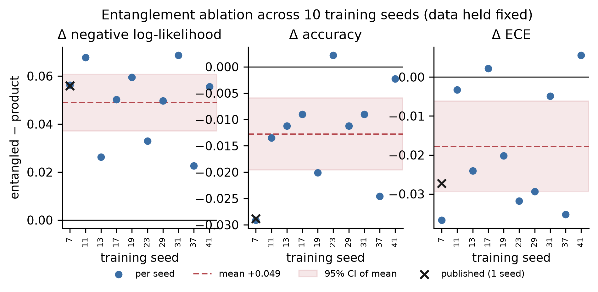
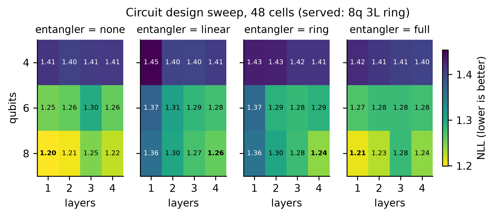
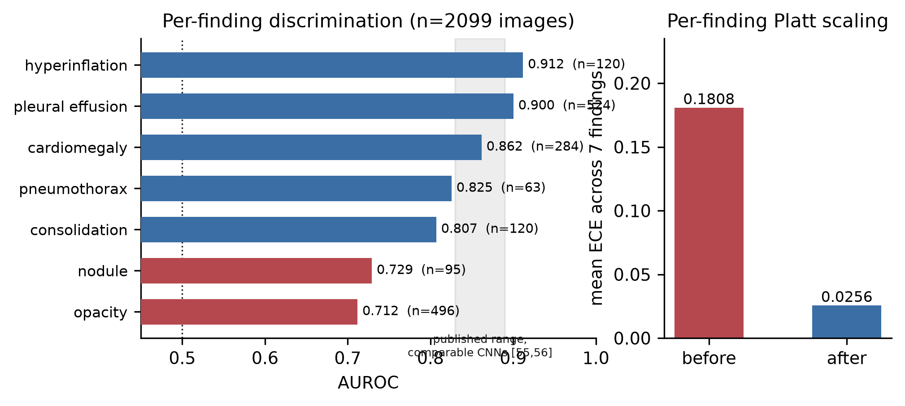
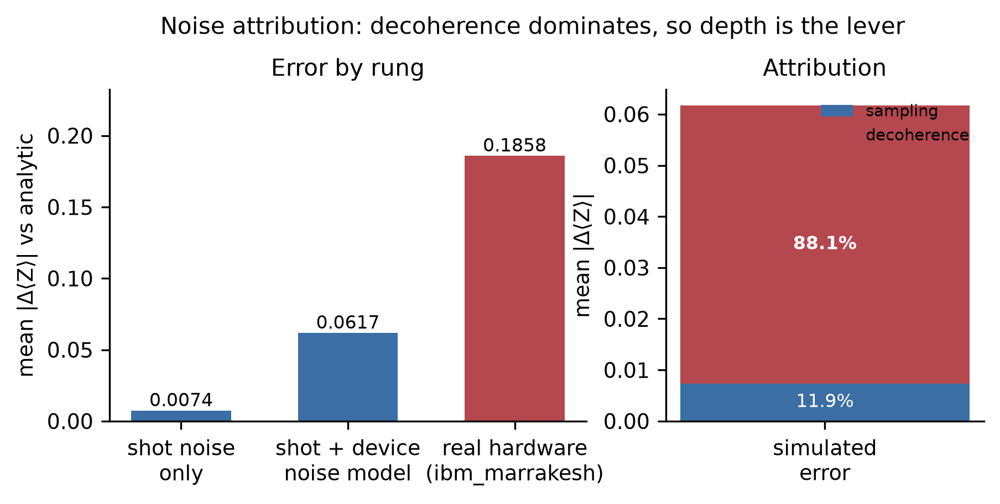

# Evaluating quantum machine learning in a clinical decision-support system: a pre-specified comparison protocol and five negative results

Sivaguru R. M.

AURA Project. Correspondence: sivagurumurugan1@gmail.com
Code and artifacts: github.com/Sivaguru-2008/aura

Preprint, version 3. 6 August 2026.

---

## Abstract

**Background.** A recent systematic review of quantum machine learning (QML) in digital health screened 4,915 records, retained 169 as eligible, and synthesised 16, and found the measured differences between quantum and classical methods to be negligible, with no consistent trend supporting empirical quantum utility [1]. The same review reports that classical comparators were commonly selected without theoretical justification, that 81.7% of eligible studies used ideal simulation only, that 7 of 138 simulation-only studies modelled noise, that 14 of 16 studies reporting hardware results compared them against noiseless simulation without characterising noise, that 2 of 16 used real electronic health record data, and that most studies released neither code nor data.

**Objective.** To determine whether quantum advantage claims in a clinical decision-support setting survive a comparison protocol fixed in advance, and to supply the methodological elements identified as absent from the existing literature.

**Methods.** We developed AURA, an offline clinical decision-support system for chest radiography and brain magnetic resonance imaging. Four evidence-fusion backends are interchangeable behind a single interface: a Bayesian product-of-experts model, an 8-qubit variational quantum circuit, a learnable linear head, and an ensemble of the first two. A separate 10-qubit quantum-kernel classifier predicts glioma grade. Before running comparisons we fixed a seven-rule protocol covering per-arm calibration, capacity matching, split disjointness, significance testing, publication of negative outcomes, artifact-derived reporting, and source-level audit of capability claims. Evaluation used MIMIC-CXR (n = 2,099 images for finding extraction; patient-disjoint splits of 1,338/446/447 studies for fusion) and BraTS-2020 (7,531 held-out slices, volume-disjoint; 111/37/37 subjects for grading).

**Results.** None of the five quantum claims survived. An earlier reported calibration advantage (expected calibration error 0.020 versus 0.276, a factor of 13.8) was traced to temperature scaling applied only to the quantum arm; with per-arm calibration the classical arm reached 0.027 and the difference fell from 0.256 to 0.007. The temperature spread across backends was 1.89. On the 447-study patient-disjoint split the three backends were indistinguishable on accuracy (all pairwise McNemar p ≥ 0.18), but the quantum circuit significantly outperformed the Bayesian product-of-experts on negative log-likelihood (Δ = 0.017, Wilcoxon p = 0.006) and calibration (ECE 0.090 versus 0.127). That advantage disappeared once a second classical baseline was included: an ordinary gated linear head attained lower negative log-likelihood than the quantum circuit (p = 0.052) and beat the product-of-experts decisively (p = 7.3 × 10⁻⁶). The apparent quantum result was therefore a property of comparator selection, not of the quantum model. In an entanglement ablation at matched parameter count (102), replicated across ten training seeds with data held fixed, the CNOT ring was worse on negative log-likelihood in ten of ten seeds (mean Δ = +0.049, 95% CI +0.037 to +0.061) and worse on accuracy in nine of ten (mean Δ = −0.013, p = 0.002), while being *better* calibrated in eight of ten (mean Δ = −0.018, p = 0.007); since negative log-likelihood is a proper scoring rule and moves unfavourably in every seed, the loss of refinement exceeds the calibration gain. A 48-cell design sweep placed four of its five best configurations by negative log-likelihood at zero entanglement. The quantum kernel did not differ from a classical radial basis function kernel (ΔAUROC = −0.0051, 95% CI −0.0141 to +0.0042, p = 0.27, subject-clustered bootstrap), and its significance was unstable across re-runs. Applying the source-audit rule to our own proposed mechanism, we found that its shot-budget loop perturbs an analytically computed expectation with synthetic noise rather than executing the circuit at finite shots, so the capability it claimed reduces to a threshold on the analytic margin; we retract that claim in Section 10.6.

**Conclusions.** Under a symmetric protocol, no quantum component of this system provided a benefit that survived the introduction of a second classical baseline or a second metric, and entanglement measurably degraded discrimination while improving calibration by less than it cost. These findings corroborate the field-level null of [1] from within a deployed system, and supply hardware execution, noise attribution, capacity-matched controls, inferential statistics, and full artifact release. The intervention that improved clinical performance most was classical: abstaining on 8% of cases raised accuracy among committed cases by 7 percentage points.

**Keywords:** quantum machine learning; negative results; evaluation methodology; clinical decision support; calibration; conformal prediction; selective prediction

---

## 1. Introduction

### 1.1 Background

Quantum machine learning applied to medical data has produced a substantial applied literature over the past six years, and the most rigorous synthesis of it reaches a null result. Gupta and colleagues [1] screened 4,915 records published between 2015 and October 2024, identified 169 eligible studies, and synthesised 16. They report that the measured differences between quantum and classical methods are negligible, and conclude that these results "show no consistent trend to support empirical quantum utility in digital health" [1].

That conclusion is accompanied by a methodological audit which, in our reading, explains why the literature is not currently in a position to have found otherwise. The review reports that comparator selection was "often ad-hoc rather than theoretically justified" [1]; that 81.7% of eligible studies used ideal simulations only; that of 138 simulation-only studies, 7 employed noisy simulation; that 14 of the 16 synthesised studies compared hardware results to noiseless simulation without characterising device noise; that only 2 of 16 used real electronic health record data, with input dimensionality typically of order 10; and that most studies did not make code or data accessible [1].

A literature with these properties cannot distinguish the hypothesis that no advantage exists from the hypothesis that no advantage was measurable. It is also poorly placed to detect the failure mode we consider most likely, which is not misconduct but asymmetric care. A researcher developing a novel method tunes it, calibrates it, examines its failure cases, and iterates; the comparison baseline is typically implemented once, correctly, and left alone. Neither arm is incorrectly implemented, but the comparison between them is not fair. This mechanism has been documented in recommender systems [2], metric learning [3], and deep reinforcement learning [4]. In clinical machine learning specifically, Wolfrath et al. [73] argue that omitting baselines or comparing against a weak one obscures the value of proposed methods, and that stronger baselines are a precondition for demonstrating clinical utility. In machine learning for partial differential equations, McGreivy and Hakim [5] found that approximately 79% of studies comparing learned solvers against standard numerical methods compared against a weak baseline, alongside evidence of outcome reporting bias. It appears in the catalogue of 44 questionable research practices assembled by Leech et al. [6], in the leakage taxonomy Kapoor and Narayanan traced across 17 fields and 329 papers [7], and in the model of Saidi et al. [8], who attribute the observed inverse relationship between sample size and reported accuracy to the joint action of overfitting and publication bias. Within QML specifically, several authors have shown that reported kernel advantages can be attributable to unequal hyperparameter optimisation rather than to properties of the kernel [9,10].

### 1.2 Theoretical expectations at current scale

There is a second reason to treat small-scale advantage claims cautiously, which is that no established mechanism predicts them.

At 8 to 10 qubits the state space has dimension 256 to 1,024 and the circuits simulate in milliseconds on commodity hardware. Huang et al. [11] show that classical intractability of the function class a quantum model represents is not sufficient for a learning advantage, since a classical learner can approximate the quantum predictor given adequate data. Kübler et al. [12] characterise the inductive bias of quantum kernels and find that generic hyperparameter tuning drives them toward well-approximated classical kernels. Slattery et al. [13] report numerical evidence against fidelity-kernel advantage on classical data, and Thanasilp et al. [72] identify exponential concentration of kernel values as a mechanism that limits quantum kernels as qubit count grows. Shaydulin and Wild [9] show that kernel bandwidth alone can dominate the observed comparison. From the trainability side, Cerezo et al. [14] argue that provable absence of barren plateaus [15,16] tends to imply classical simulability, so a circuit sufficiently well-conditioned to train is typically one that can be simulated.

Taken together, at the scale where medical QML currently operates, a reported advantage is more plausibly explained by an asymmetry in the comparison than by a physical effect.

### 1.3 Approach

We tested this proposition from a position that favours a false positive. We built a complete clinical decision-support system containing a genuine quantum layer, intended it to demonstrate an advantage, and then specified a comparison protocol strict enough that a demonstrated advantage would be credible (Section 6). We applied that protocol to every quantum claim in the system. Five claims were examined. Four were claims we had already made or expected to make. The fifth was a mechanism we had proposed as the system's principal novelty.

None survived. One failed with statistical significance in the direction opposite to the field's central premise: at matched capacity, entanglement degraded probabilistic prediction quality. One was invalidated not by an experiment but by reading the implementation, which is why the protocol as reported here includes a rule requiring source-level audit of capability claims.

### 1.4 Contribution and structure

Gupta et al. [1] establish a field-level null by aggregation. The present work is complementary in method and concordant in conclusion: a single deployed system examined in depth, supplying the methodological elements that review found largely absent, together with one it does not consider.

Section 2 reviews related work. Section 3 states the research gap and our response to it. Section 4 describes the system, Section 5 the data and setup, and Section 6 the protocol. Section 7 measures the size of the confound the protocol is designed to prevent. Section 8 reports four negative results, Section 9 the positive controls establishing that the apparatus functions, and Section 10 the discussion, including the retraction of our own claim in Section 10.6. Sections 11 and 12 cover threats to validity and limitations.

We make no clinical claim. There is no prospective cohort, no external site, no reader study, and no regulatory clearance. The findings are scoped to 8 to 10 qubits operating on low-dimensional evidence and embedding vectors, which is the regime in which most current medical QML operates [1], and do not bear on structured-data regimes or fault-tolerant scale.

---

## 2. Related work

### 2.1 Quantum machine learning and its qualifications

Variational quantum classifiers [18] and quantum kernel methods [19] motivate advantage arguments from high-dimensional feature maps, and parameterised circuits are now an established model class [20,21]. Preskill's characterisation of the NISQ era [22] sets the resource context, in which circuits are shallow, error correction is unavailable, and noise is a first-order constraint.

The qualifying literature is substantial. Huang et al. [11] establish that data can substitute for quantum access. Kübler et al. [12] characterise quantum-kernel inductive bias and find the conditions for advantage restrictive. Slattery et al. [13] report numerical evidence against fidelity-kernel advantage on classical data, and Thanasilp et al. [72] show that quantum kernel values concentrate exponentially with qubit count. Shaydulin and Wild [9] and Egginger et al. [10] show that hyperparameter choices dominate observed differences. Dequantization results extend this line, showing that certain quantum neural networks admit classical approximation through random Fourier features [23]. Recent benchmarking studies describe the evidence for quantum kernel advantage on tabular data as mixed at best [24,25], and a unified empirical comparison across seven model pairs reported that quantum models did not surpass classical baselines on predictive performance, policy stability, or training time [26]. On trainability, barren plateaus constrain scaling [15,16], and Cerezo et al. [14] connect the absence of barren plateaus to classical simulability.

The results reported in Section 8 are consistent with this literature and inconsistent with the applied medical QML work it critiques.

### 2.2 Quantum machine learning in health

Applied work spans quantum support vector machines, quantum convolutional networks, and hybrid architectures, across radiology, oncology, and neuroimaging [27,28,29]. Gupta et al. [1] provide the most rigorous synthesis and the direct motivation for the present study; Section 3.1 tabulates their methodological findings against ours. Other reviews reach broadly similar conclusions regarding hardware limits, encoding bottlenecks, and the dimensionality reduction that qubit budgets impose [28,29,30].

### 2.3 Measurement as a resource

Shot-frugal optimisation is well developed in variational quantum eigensolvers, where adaptive allocation minimises measurements per unit of progress toward an objective [31,32,33]. This is the nearest prior art to the mechanism we proposed and subsequently retract. The relationship is relevant to Section 10.6: prior work allocates measurements in order to optimise an objective, whereas we proposed allocating them in order to type a decision.

### 2.4 Calibration, selective prediction, and conformal methods

Modern networks are systematically overconfident [34], and calibration degrades further under dataset shift, where post-hoc methods alone are insufficient and methods that marginalise over models perform comparatively well [35]. Deep ensembles [36] and Monte Carlo dropout [37] provide epistemic uncertainty estimates; energy-based [38] and maximum-softmax [39] scores support out-of-distribution detection. That calibration is a per-model property is the fact on which the confound reported in Section 8.1 turns.

Selective prediction, or classification with a reject option [40,41], is the classical framing for abstention. It has been extended in clinical settings through learning-to-defer formulations and complementarity-driven arbitration between model and clinician [42,43,44]. Conformal prediction [45,46] provides distribution-free coverage under exchangeability, with class-conditional variants [47] and adaptive set constructions [48,49] addressing per-class validity. Exchangeability is the assumption clinical deployment violates, and adaptive conformal inference [50] removes it by treating the threshold as an online control variable. Conformal triage has been proposed for clinical imaging deployment specifically, exchanging abstention on uncertain cases for guarantees on predictive value [51].

AURA integrates these components. We claim no novelty for any of them, and Section 9 is presented as a set of positive controls rather than as a contribution.

### 2.5 Imaging baselines and label provenance

MIMIC-CXR [52] and CheXpert [53] are the standard chest radiograph corpora and share a rule-based natural language labeler that produces silver-standard labels with known noise characteristics [53,54]. Reported area under the receiver operating characteristic curve (AUROC) for comparable convolutional architectures on these corpora falls broadly in the range 0.83 to 0.89 [55,56], with representative per-finding values near 0.90 for pleural effusion, 0.84 for pneumothorax, 0.81 for consolidation, and 0.80 for cardiomegaly [55]. For brain tumour segmentation, the BraTS benchmark [57,58] is standard, and nnU-Net won the 2020 challenge with per-case three-dimensional Dice coefficients of 88.95, 85.06, and 82.03 for whole tumour, tumour core, and enhancing tumour respectively [59]. Section 9.4 explains why the segmentation results reported here should not be compared with those figures.

Generalisation remains the dominant practical failure mode in clinical imaging AI. Models exploit shortcut features and data-acquisition biases, with performance overestimated by as much as 20% in the absence of external validation [60], and algorithmic fairness corrections have been shown not to transfer to new settings [61]. These findings bound every claim made here from a single centre.

### 2.6 Positioning

We are not aware of prior work that applies a pre-specified quantum-versus-classical protocol within a deployed clinical system, reports a capacity-matched entanglement ablation with bootstrap intervals on a clinical corpus, attributes hardware error between sampling and decoherence for a medical model, or retracts a capability claim on the basis of a source-level audit. Each of these responds to a gap identified in [1].

---

## 3. Research gap and response

### 3.1 Gap analysis

The middle column of Table 1 is not our characterisation of the field. It reproduces the methodological findings of the most rigorous available review [1].

**Table 1.** Methodological state of the medical QML literature as reported by Gupta et al. [1], with the corresponding element supplied by this work.

| | Dimension | Reported state of the field [1] | This work |
|---|---|---|---|
| G1 | Quantum advantage | Measured differences negligible; no consistent supporting trend | Corroborated within a deployed system, with effect sizes, intervals, and significance tests for five claims |
| G2 | Classical comparators | Selected without stated theoretical justification | Capacity-matched at 102 parameters; one training function, one seed, one split; additional linear control |
| G3 | Simulation versus hardware | 81.7% used ideal simulation only | Execution on `ibm_marrakesh` (156 qubits), job `d9js49rjf64c739haeg0` |
| G4 | Noise characterisation | 7 of 138 simulation-only studies modelled noise; 14 of 16 hardware studies compared to noiseless simulation | Three-rung attribution: sampling 0.0074, device 0.0544, hardware 0.1858 mean absolute error in ⟨Z⟩ |
| G5 | Clinical data realism | 2 of 16 used real EHR data; dimensionality typically order 10 | MIMIC-CXR and BraTS-2020, patient- and volume-disjoint splits, deployed pipeline |
| G6 | Reproducibility | Most studies released neither code nor data | Artifact release with SHA-256 manifests, fixed seeds, environment capture, drift test |
| G7 | Calibration symmetry | Not assessed | Per-arm calibration required by protocol; confound headroom measured at 1.89 |
| G8 | Statistical inference | Not reported as present | McNemar, DeLong, Wilcoxon with normality screening, clustered bootstrap |
| G9 | Capability claims | Not considered | Source-level audit, introduced after it invalidated our own contribution |

G7 to G9 are gaps we identified rather than inherited. G7 is the mechanism underlying our own retracted result. G9 arises because a claim about what a system is able to express is a claim about its implementation, and is therefore not falsifiable from reported metrics.

### 3.2 Contributions

**C1. Five negative results with complete inferential reporting** (addresses G1, G8). Sections 8.1 to 8.5 report effect size, interval, sample size, and test for each. One result is significant in the direction opposite to the field's premise. For each null we also state the effect size that would have been detectable, so that absence of evidence is not read as evidence of absence.

**C2. A pre-specified symmetric comparison protocol** (G2, G7). Seven rules, fixed before the comparisons were run, together with a worked demonstration of the confound the first rule prevents and a measurement of the headroom available to that confound. The protocol is transferable to other quantum-versus-classical clinical comparisons.

**C3. Hardware execution with error attributed to physical source** (G3, G4). Beyond reporting that the circuit ran on a quantum processor, we decompose the observed error, finding 88.1% attributable to decoherence and 11.9% to sampling. This identifies circuit depth rather than shot count as the binding constraint, and we act on it, reducing two-qubit gate count by 20% through transpilation.

**C4. A documented self-retraction** (G9). Section 10.6 withdraws the mechanism this project had advanced as its principal novelty, and reports the source-level evidence on which the withdrawal rests.

**C5. Clinical validation infrastructure subjected to the same scrutiny** (G5, G6). A two-axis design validates rule-derived labels against a hand-read reference standard and cross-checks the model against independently trained public weights. The design localises a genuine model failure (nodule detection) to the image model rather than the labels.

**C6. An account of what carried clinical performance** (G1). Selective prediction rather than architecture: abstention on 8% of cases raised accuracy among committed cases by 7 percentage points, exceeding the effect of any backend choice tested.

---

## 4. System under evaluation

The system is described to the depth required to make the comparisons interpretable.

**Pipeline.** A three-stage modality router (DICOM metadata, then pixel geometry, then plain-image signature) admits frontal chest radiographs and complete four-sequence brain MRI studies, and rejects all other inputs with a typed refusal. Chest studies are processed by a DenseNet-121 [62] producing seven findings. Brain studies are processed by a multi-task residual U-Net [63] producing segmentation, tumour presence, lesion size, image quality, and a supervised contrastive embedding [64]. Findings are assembled into an eight-channel evidence vector x ∈ [0,1]⁸ comprising opacity, consolidation, pleural effusion, cardiomegaly, nodule, hyperinflation, pneumothorax, and prior risk, which is fused into a posterior over six diagnoses. A safety layer applies per-backend temperature scaling [34], class-conditional conformal prediction [47], online adaptive conformal inference [50], energy-score out-of-distribution detection [38], and a four-criterion abstention policy. Attribution maps are produced with Grad-CAM++ [65].

**Fusion backends.** Four backends consume the same evidence vector and emit logits over the same six diagnoses (Table 2).

**Table 2.** Fusion backends compared in Sections 8.2 to 8.4.

| Backend | Description | Trainable parameters |
|---|---|---:|
| Classical product-of-experts | Per-channel log-likelihoods summed with a prior; per-evidence contribution is inspectable | 54 |
| Quantum variational circuit | 8 qubits, 3 layers, RY(π·xᵢ) encoding, ring entangler, ⟨Zᵢ⟩ readout into a linear head; PennyLane [66] | 102 |
| Learnable head | Linear map on the raw evidence vector; control for whether the circuit contributes beyond a linear model | 54 |
| Ensemble | Probability-space average of quantum and classical | — |

**Quantum kernel classifier.** A 10-qubit IQP feature map (Hadamard, RZ, ring ZZ) induces the fidelity kernel |⟨φ(x)|φ(x′)⟩|² over a 1,024-dimensional Hilbert space. This is used in a support vector machine with 1,680 support vectors and Platt calibration [67] to classify glioma grade from brain-encoder embeddings. The matched control is a radial basis function support vector machine on the same embeddings.

**Implementation note.** The entangler topology must be stored on the model instance rather than inferred from the parameter vector. The parameter vector alone does not identify the circuit, so loading a product-trained model through the ring ansatz evaluates a different unitary and returns plausible but incorrect expectation values without raising an error. We record this because it would silently corrupt any attempt to reproduce the ablation in Section 8.3.

---

## 5. Data and experimental setup

### 5.1 Data

Chest radiography used MIMIC-CXR [52], a de-identified corpus of radiographs with free-text reports from a single tertiary academic medical centre in the United States. Brain MRI used BraTS-2020 [57,58], comprising preoperative studies of high- and low-grade glioma with four co-registered sequences (FLAIR, T1, T1 contrast-enhanced, T2).

**Table 3.** Data splits.

| Analysis | Train | Calibration | Test | Unit of disjointness |
|---|---:|---:|---:|---|
| Fusion, primary (Sections 7, 8.2, 8.3, 8.4, 10.6) | 1,338 | 446 | 447 | Patient |
| Deployment benchmark (secondary, Section 8.2) | — | — | 69 | Held-out validation studies |
| Quantum kernel grading (Section 8.5) | 111 subjects | 37 subjects | 37 subjects | Subject |
| Finding extraction (Section 9.2) | — | — | 2,099 images | — |
| Cross-model check (Section 9.3) | — | — | 700 images | — |
| Labeler reference standard (Section 9.3) | — | — | 66 reports | — |
| Brain segmentation (Section 9.4) | — | — | 7,531 slices | Volume |

All primary comparisons use the 447-study patient-disjoint split. The 69-study benchmark is the split the deployed system reports; it is retained as a secondary result in Section 8.2 to preserve correspondence between this paper and the running artifact, and because the disagreement between the two splits is itself evidence about statistical power. Saidi et al. [8] show that reported accuracy correlates inversely with sample size across published machine learning, and we apply that caution to our own splits in Section 12.1.

### 5.2 Computing environment

Python 3.12.10, NumPy 2.4.4, SciPy 1.18.0, scikit-learn 1.9.0, PyTorch 2.11.0 with CUDA 12.8, on Windows 11 with an AMD Ryzen processor (16 threads, 16.4 GB RAM) and an NVIDIA RTX 5050 Laptop GPU. All experiments used seed 7. Quantum simulation used PennyLane `default.qubit` [66]. Transpilation and noise modelling used Qiskit [68] against the `FakeMarrakesh` backend model. Hardware execution used IBM `ibm_marrakesh` (156 qubits), job `d9js49rjf64c739haeg0`.

### 5.3 Statistical methods

Paired accuracy comparisons used McNemar's test [69]. AUROC comparisons used the DeLong test [70]. Negative log-likelihood comparisons used the Wilcoxon signed-rank test, with the Shapiro-Wilk test applied to the paired differences to select between parametric and non-parametric procedures. Differences in paired metrics were assessed by bootstrap resampling, at the unit of independence appropriate to each analysis: study-level for fusion, subject-level for the quantum kernel comparison. Binomial proportion intervals are Jeffreys intervals. The bootstrap used 2,000 resamples for the entanglement ablation and 1,000 for the kernel comparison.

---

## 6. Comparison protocol

The following rules were fixed before the comparisons reported in Section 8 and applied to both arms of every comparison.

**P1. Per-arm calibration.** Each backend fits its own temperature on its own calibration split before any metric is computed. This is the rule violated by the result reported in Section 8.1.

**P2. Matched capacity.** Compared architectures have identical trainable parameter counts and are trained by the same function, on the same data, with the same seed, so that a difference in topology cannot be a difference in capacity. This addresses the ad-hoc comparator finding of [1] and the unequal-tuning critique of [9,10].

**P3. Disjoint splits at the correct unit.** Splits are patient-disjoint for fusion, volume-disjoint for brain segmentation, and subject-disjoint for grading. Resampling is performed at the same unit. The kernel comparison bootstraps over subjects rather than slices, since slices from one patient are not independent observations and slice-level resampling would overstate precision by approximately the square root of the number of slices per subject. This corresponds to non-independence of training and test samples in the taxonomy of [7].

**P4. Significance before ranking.** Every ordering claim is accompanied by an appropriate test and interval.

**P5. Publication of negative outcomes.** Every comparison run is reported regardless of its direction [17].

**P6. Artifact-derived reporting.** Every published figure is read from the artifact that produced it, and a test fails the build when documentation and artifacts diverge.

**P7. Audit of mechanisms, not only metrics.** A claim about what a system is able to express is a claim about its implementation and is verified at the source level. Metrics cannot falsify a capability that holds by construction. This rule was added during preparation of the present manuscript, as a consequence of the finding reported in Section 10.6, and was not in force when the mechanism was originally proposed.

---

## 7. Size of the confound

Before running the comparisons we measured the headroom available to a violation of P1. Each backend's temperature was fitted on the same 446-study calibration split (Table 4).

**Table 4.** Per-backend calibration parameters and test performance, n = 447.

| Backend | Temperature | Accuracy | NLL | ECE | Coverage | Mean set size |
|---|---:|---:|---:|---:|---:|---:|
| Classical | 0.479 | 0.5414 | 1.3026 | 0.1266 | 0.904 | 3.54 |
| Quantum | 0.906 | 0.5324 | 1.2853 | 0.0896 | 0.915 | 3.54 |
| Learnable | 0.887 | 0.5526 | 1.2663 | 0.0902 | 0.908 | 3.42 |

The spread across backends is a factor of 1.89. This is the multiplicative factor by which serving one backend under another backend's calibration distorts every downstream probability, conformal set, and abstention decision, and it exceeds the margin claimed by most published quantum-advantage results in this domain.

The same quantity has an operational consequence in this codebase. The served calibration artifact carries the quantum fit, so changing the fusion backend without refitting silently disables the divergence guard. A protocol violation and a production defect are, in this instance, the same object.

---

## 8. Results: five negative findings

### 8.1 A calibration advantage attributable to asymmetric preprocessing

An earlier version of this project's benchmark reported that the quantum fusion backend was substantially better calibrated than the classical backend (ECE 0.020 versus 0.276), more accurate (0.96 versus 0.93), and superior in AUROC. A reproducible audit regenerated these figures from source (Table 5).

**Table 5.** Audit of previously published fusion claims, n = 100.

| Original claim | Regenerated result | Verdict |
|---|---|---|
| Calibration better by factor 13.8 | Quantum 0.020; classical with own temperature 0.0274; classical uncalibrated 0.2755 | Confounded |
| Accuracy 0.96 versus 0.93 | Δ = 0.03, 95% CI 0.00 to 0.07; McNemar p = 0.25 | Not validated |
| AUROC advantage | DeLong significant in 0 of 6 classes | Not validated |

The published value of 0.276 was the uncalibrated classical ECE. When each arm was given its own temperature, the difference fell from 0.256 to 0.007, a reduction by a factor of 36 achieved by changing only the symmetry of the preprocessing. The accuracy claim rested on three discordant pairs, all of which favoured the classical arm.

We report this result first because it motivated the protocol, and because it is the one failure that was not the target of a designed experiment. It surfaced only when the numbers were regenerated from source. It belongs to the class of error catalogued in [6,7], and it is not detectable by the aggregation methods available to [1].

### 8.2 Any quantum advantage depends on which classical model is chosen as the comparator

Table 6 reports the primary comparison on the 447-study patient-disjoint split, with each backend temperature-scaled on its own 446-study calibration split.

**Table 6.** Fusion backend comparison, n = 447 patient-disjoint studies. Intervals are Jeffreys intervals on the accuracy column.

| Backend | Temperature | Accuracy | Correct | 95% CI | NLL | ECE | Macro AUROC |
|---|---:|---:|---:|---|---:|---:|---:|
| Classical product-of-experts | 0.479 | 0.5414 | 242/447 | 0.495–0.587 | 1.3026 | 0.1266 | 0.8045 |
| Quantum variational circuit | 0.906 | 0.5324 | 238/447 | 0.486–0.578 | 1.2853 | **0.0896** | 0.8014 |
| Learnable gated head | 0.887 | **0.5526** | 247/447 | 0.506–0.598 | **1.2663** | 0.0902 | **0.8056** |

**Table 7.** Pairwise tests, n = 447. McNemar is the exact binomial test on discordant pairs; NLL is compared by Wilcoxon signed-rank on the 447 paired per-study values.

| Comparison | Δ accuracy | Discordant | McNemar p | Δ NLL | Wilcoxon p |
|---|---:|---:|---:|---:|---:|
| Classical vs. quantum | +0.0090 | 50 | 0.672 | +0.0173 | **0.0060** |
| Classical vs. learnable | −0.0112 | 43 | 0.542 | +0.0363 | **7.3 × 10⁻⁶** |
| Quantum vs. learnable | −0.0202 | 35 | 0.176 | +0.0190 | 0.052 |

Two findings follow, and they point in different directions.

**On accuracy, the three backends are indistinguishable.** No pairwise comparison approaches significance (p = 0.18 to 0.67), and the ordering places the *linear* head first. At n = 447 the minimum detectable accuracy difference at 80% power is 9.3 points, so these remain statements about undetectability rather than about equality; but the spread between best and worst is 2.0 points, well inside that bound.

**On negative log-likelihood, the quantum circuit significantly outperforms the classical product-of-experts** (Δ = +0.0173 in favour of quantum, Wilcoxon p = 0.0060), and is better calibrated (ECE 0.0896 against 0.1266). Read in isolation, this is a quantum advantage on the metric that matters most for a system whose output is a calibrated probability.

It does not survive the introduction of a second classical baseline. The learnable gated head — a model of the same order of complexity, trained by gradient descent on the same evidence vector — attains lower NLL than the quantum circuit (Δ = +0.0190, p = 0.052), better accuracy, and equivalent calibration. Against the product-of-experts the same head is better by a wide margin (p = 7.3 × 10⁻⁶).

The apparent quantum advantage is therefore a property of comparator selection rather than of the quantum model. Choosing the Bayesian product-of-experts as the sole classical arm yields a significant, publishable quantum result on NLL and calibration. Including a second, unremarkable classical model removes it. This is the mechanism described by Wolfrath et al. [73] and by the weak-baseline literature [2–5], occurring in our own headline comparison, and it is the reason protocol rule P2 requires more than one classical arm.

We note that the n = 69 deployment benchmark reported in earlier versions of this work gave the opposite accuracy ordering, placing the product-of-experts first at 0.6957 against 0.6377, on four discordant cases (McNemar p ≥ 0.125 under any assignment). Across the two splits the three backends exchange rank order on accuracy, which is what a null looks like when read at insufficient power.

Per-class support remains uneven and per-class figures are directional only. Two classes show essentially no discriminative signal in any arm: malignancy and pneumothorax as a diagnosis. These are reported rather than excluded.

### 8.3 Entanglement trades discrimination for calibration, and the trade is unfavourable

Under P2, an entangled ring circuit was compared with a product-state circuit at identical parameter count (102), trained by the same function on the same data. Because a single training run cannot separate an architectural effect from an initialisation effect, the comparison was replicated across ten training seeds with the evidence set held byte-identical, so that the observed spread is attributable to initialisation and optimisation alone (Figure 1, Table 8).

**Table 8.** Entanglement ablation replicated across ten training seeds, n = 447 patient-disjoint studies, 30 epochs. Differences are entangled minus product-state. Intervals are on the mean across seeds; the *t* test is one-sample against zero, and the Wilcoxon test is the signed-rank equivalent.

| Metric | Mean Δ | SD across seeds | 95% CI of mean | *t* p | Wilcoxon p | Seeds favouring entanglement |
|---|---:|---:|---|---:|---:|---:|
| Negative log-likelihood | +0.0490 | 0.0164 | +0.0372 to +0.0607 | < 0.001 | 0.002 | **0 of 10** |
| Accuracy | −0.0128 | 0.0096 | −0.0196 to −0.0059 | 0.0023 | 0.0039 | 1 of 10 |
| Expected calibration error | −0.0178 | 0.0162 | −0.0294 to −0.0062 | 0.0070 | 0.0195 | 8 of 10 |



**Figure 1.** Per-seed differences between the entangled and product-state circuits, with the mean and its 95% interval. The cross marks the previously published single-seed value at seed 7, which this replication reproduces exactly. All three metrics are significant, and the direction is not uniform: entanglement is worse on likelihood and accuracy and better on calibration.

All three differences are now statistically resolvable, and they do not point the same way.

**Entanglement degrades discrimination.** Negative log-likelihood is worse in every one of the ten seeds, without a single reversal, and accuracy is worse in nine of ten. Because parameter count is held constant, neither can be attributed to capacity: the ring alters the reachable function class, and on an eight-channel evidence vector the alteration removes more signal than it adds.

**Entanglement improves calibration.** Expected calibration error is lower for the entangled circuit in eight of ten seeds, with the mean difference excluding zero (p = 0.007). This favours entanglement and we report it as such. An earlier version of this manuscript declined to report the same effect because its single-seed interval contained zero; with adequate replication it is real.

The two findings are reconciled by the structure of the metrics rather than by preferring one. Negative log-likelihood is a proper scoring rule that decomposes into a calibration term and a refinement term. Entanglement improves the first and degrades the second, and because the net movement in negative log-likelihood is unfavourable in every seed, the loss of refinement exceeds the calibration gain. A system whose product is a calibrated probability would therefore still be worse off with the ring, notwithstanding the improvement in expected calibration error. This is consistent with the finding that entanglement does not automatically confer learning advantage [12,13] and with the trainability and simulability relationship described in [14].

A reader could construct a favourable quantum result from this table by reporting the calibration row alone. We note the availability of that reading explicitly, because the same manoeuvre — selecting the metric on which the novel method wins — is the practice this paper documents elsewhere.

The effect is not an artifact of training length. Repeating the ten-seed protocol at 20 rather than 30 epochs gives mean differences of +0.0335 for negative log-likelihood (95% CI +0.0228 to +0.0441, ten of ten seeds positive) and −0.0081 for accuracy (95% CI −0.0154 to −0.0007); the calibration difference weakens to −0.0062 and loses significance (p = 0.22). Discrimination loss is therefore stable across training length, while the calibration gain is not (`artifacts/entanglement_multiseed.epochs20.json`).

### 8.4 The design sweep optimum lies at zero entanglement

A sweep of 48 cells over qubit count, layer count, and entangler topology was run at 20 epochs with seed 7 and a single training function. Figure 2 shows the full grid; Table 9 reports the served configuration and Table 10 the five best cells by negative log-likelihood.



**Figure 2.** Negative log-likelihood across the 48-cell sweep, one panel per entangler topology. The dominant axis is qubit count, which under this encoding is also the number of evidence channels retained; within the eight-qubit row the entangled topologies are worse than the product state at every depth, and the penalty narrows with depth without reversing. Bold values mark the best cell in each panel.

**Table 9.** Entangler topology at the served width and depth (8 qubits, 3 layers).

| Topology | Accuracy | NLL | ECE | Two-qubit gates |
|---|---:|---:|---:|---:|
| Ring (served) | 0.5481 | 1.2794 | 0.0708 | 24 |
| Linear | 0.5302 | 1.2733 | 0.0756 | 21 |
| Full | 0.5213 | 1.2826 | 0.0386 | 84 |
| None | 0.5615 | 1.2489 | 0.0604 | 0 |

**Table 10.** Five best cells of 48 by negative log-likelihood.

| Qubits | Layers | Entangler | Accuracy | NLL |
|---:|---:|---|---:|---:|
| 8 | 1 | None | 0.5749 | 1.1996 |
| 8 | 2 | None | 0.5593 | 1.2052 |
| 8 | 1 | Full | 0.5638 | 1.2078 |
| 8 | 4 | None | 0.5593 | 1.2237 |
| 8 | 2 | Full | 0.5548 | 1.2282 |

Four of the five best configurations use no entanglement, and the best is also the shallowest. The sweep was not designed to test entanglement and recovers the conclusion of Section 8.3 independently.

One property of the encoding constrains interpretation of the qubit axis. Because each evidence channel occupies one qubit, any cell with fewer than eight qubits discards evidence channels. The qubit axis is therefore an evidence ablation as well as a width sweep, and eight qubits is determined by the input dimension rather than chosen for expressivity. A reader concluding from this sweep that additional qubits improve performance would be observing a data-availability effect.

### 8.5 The quantum kernel does not differ from a classical kernel

Glioma grade was classified from learned embeddings under a subject-disjoint split with subject-clustered bootstrap resampling (Tables 11 and 12).

**Table 11.** Quantum and classical kernel performance on glioma grading, 37 held-out subjects.

| Model | AUROC | AUPRC | Accuracy | ECE | Brier |
|---|---:|---:|---:|---:|---:|
| Quantum kernel (IQP, 10 qubits) | 0.6348 | 0.5950 | 0.5995 | 0.0545 | 0.2392 |
| Classical radial basis function | 0.6399 | 0.5933 | 0.5930 | 0.0454 | 0.2381 |

**Table 12.** Paired subject-clustered bootstrap, 1,000 resamples, quantum minus classical.

| Metric | Δ | 95% CI | p (two-sided) |
|---|---:|---|---:|
| AUROC | −0.0051 | −0.0141 to +0.0042 | 0.27 |
| Expected calibration error | −0.00003 | −0.0135 to +0.0175 | 0.998 |

A 1,024-dimensional feature map produced no measurable difference from a radial basis function kernel on identical embeddings, which is the outcome predicted by [11,12,13]. Both models are weak in absolute terms, with AUROC near 0.64, and we regard this as the more clinically relevant observation: glioma grade is poorly separated by these embeddings irrespective of the kernel.

An earlier run of the same experiment, on 669 test slices, gave ΔAUROC = −0.016 with p = 0.002, a significant result in favour of the classical kernel. That figure remains quoted in this repository's README and grading documentation. The current artifact, regenerated on 31 July 2026, gives −0.0051 with p = 0.27. The sign is stable across runs; the magnitude and the significance are not. With 37 test subjects, a difference in AUROC of 0.005 is not identifiable. We note that the significant result is the more striking of the two and that selecting it would strengthen the narrative of this paper; we report the current artifact for the same reason we would decline a significant result in the opposite direction.

### 8.6 Summary

Four experiments, four methods, two corpora, and three splits produce a consistent picture, though not a uniform one. On the metrics that determine whether a diagnosis is correct — accuracy, discrimination, and the proper scoring rule that combines them — every resolvable effect favours the classical arm. Where the field's central resource is varied systematically, the optimum lies at zero entanglement.

Two results complicate a simple reading, and we place them here rather than in a footnote. The quantum circuit does significantly beat the Bayesian product-of-experts on negative log-likelihood and calibration (Section 8.2), and entanglement does significantly improve expected calibration error (Section 8.3). Neither survives contact with the rest of the evidence: the first disappears against a second classical baseline, and the second is outweighed within the same proper scoring rule by a loss of refinement. A study reporting either result in isolation would have a defensible quantum finding. That is the point of the protocol, and the reason a single favourable comparison should not be treated as evidence of advantage.

This pattern is consistent with the theoretical literature at these scales [11–14] and inconsistent with the applied literature reviewed in [1].

---

## 9. Positive controls

A study reporting negative findings should establish that the apparatus producing them is competent. None of the results in this section is a quantum result.

### 9.1 Selective prediction

The largest measured performance gain in this system comes from declining to answer (Table 13).

**Table 13.** Effect of abstention on accuracy among committed cases.

| Backend | Abstention rate | Accuracy, all cases | Accuracy, committed cases | Difference |
|---|---:|---:|---:|---:|
| Quantum | 8.28% | 0.6272 | 0.6968 | +7.0 pts |
| Learnable | 2.96% | 0.6036 | 0.6951 | +9.2 pts |
| Classical | 0.59% | 0.6627 | 0.7024 | +4.0 pts |

All three backends converge to approximately 0.70 accuracy among committed cases by different routes. The abstention machinery rather than the fusion model accounts for the improvement, which is consistent with the finding in Section 8.2 that the backends are not distinguishable. This reproduces the classical selective prediction result [40,41] in a deployed clinical setting and is consistent with conformal triage findings that abstention on uncertain cases purchases guarantees elsewhere [51].

The safety layer is composed of established methods: per-arm temperature scaling [34], class-conditional conformal prediction [47], online adaptive conformal inference [50], energy-score out-of-distribution detection [38], and an abstention policy that triggers when epistemic mutual information exceeds 0.15, the out-of-distribution energy z-score exceeds 2.5, the conformal set contains more than four labels, or the maximum calibrated probability falls below 0.30. A test fails the build if the documented thresholds diverge from those the server applies.

The provenance of those thresholds is worth recording. They were originally tuned against a synthetic fusion model with temperature 0.77. When fusion was calibrated against real data at temperature 0.94, the same thresholds abstained on approximately 91% of real radiographs. This is a specific instance of the shift sensitivity documented by [35].

### 9.2 Chest finding extraction

Table 14 reports performance on 2,099 held-out MIMIC-CXR images.

**Table 14.** Per-finding performance, DenseNet-121, n = 2,099.

| Finding | AUROC | AUPRC | Sensitivity | Specificity | Positives |
|---|---:|---:|---:|---:|---:|
| Hyperinflation | 0.912 | 0.430 | 0.808 | 0.865 | 120 |
| Pleural effusion | 0.900 | 0.703 | 0.884 | 0.769 | 524 |
| Cardiomegaly | 0.862 | 0.476 | 0.852 | 0.710 | 284 |
| Pneumothorax | 0.825 | 0.114 | 0.460 | 0.866 | 63 |
| Consolidation | 0.807 | 0.200 | 0.808 | 0.660 | 120 |
| Nodule | 0.729 | 0.165 | 0.358 | 0.874 | 95 |
| Opacity | 0.712 | 0.416 | 0.677 | 0.635 | 496 |
| Macro average | 0.821 | 0.358 | 0.693 | 0.768 | — |

Macro AUROC was 0.821 against first-generation labels and 0.837 against second-generation labels. Per-finding Platt scaling [67] reduced mean expected calibration error from 0.181 to 0.026. Throughput was 252 images per second; single-image latency was 29.1 ms on GPU and 83.2 ms on CPU.

Reported AUROC for comparable convolutional architectures on these corpora falls broadly in the range 0.83 to 0.89 [55,56], with representative per-finding values near 0.90 for effusion, 0.84 for pneumothorax, 0.81 for consolidation, and 0.80 for cardiomegaly [55]. On shared findings the present model is competitive, and it is weak on two, opacity and nodule (Figure 4). Differences in label sets, splits, and uncertainty handling mean this comparison is indicative only, and we do not convert it into a ranking, for the reason given in Section 9.4.



**Figure 4.** Left: per-finding discrimination with positive counts, against the range reported for comparable architectures on these corpora [55,56]. Opacity and nodule, shown in red, fall below that range; nodule is also the finding that fails independent corroboration in Section 9.3. Right: mean expected calibration error across the seven findings before and after per-finding Platt scaling.

A third training run reached macro AUROC 0.8365 against the second-generation labels, compared with 0.8372 for its predecessor, which is no change. We record the null outcome because it is decision-relevant for anyone considering the same computation [17].

### 9.3 Label provenance and circularity

Chest labels are derived from radiology reports by rule [53,54], which raises the question of whether the reported AUROC measures anything beyond the model reproducing its own label noise. We address this on two independent axes.

The first axis assesses the labeler. Sixty-six MIMIC-CXR reports were read by hand, comprising 45 drawn uniformly at random with seed 20260722 and 21 supplementary reports selected by keyword screen for rare findings, with stratum recorded per report. Against this reference standard the served labeler achieved macro Cohen's kappa 0.861, macro F1 0.894, and micro cell accuracy 0.957.

The reference standard has a stated ceiling. It was produced by a single annotator applying CheXpert conventions [53] through full-text reading, and that annotator is not a board-certified radiologist. There is no second-reader agreement statistic on the reference standard itself, no image review was performed, and rare-finding cells contain six or fewer positives, so their intervals are wide. Radiologist over-reading, corresponding to the majority-vote design used for CheXpert's own validation partitions [53], is the appropriate next step, and until it is performed the value of 0.861 should not be treated as adjudicated ground truth.

The second axis assesses the image model against an independently trained one. Seven hundred images were scored by both AURA and the public `torchxrayvision densenet121-res224-mimic_ch` model [71], whose training labels are independent of ours. Both models were prevalence-matched so that agreement statistics reflect agreement on which images are positive rather than a difference in absolute calibration (Table 15).

**Table 15.** Cross-model agreement, n = 700 images.

| Finding | Spearman ρ | AUROC of AURA score against independent label | Kappa | Interpretation |
|---|---:|---:|---:|---|
| Pleural effusion | 0.745 | 0.870 | 0.513 | Moderate |
| Consolidation | 0.738 | 0.898 | 0.315 | Fair |
| Opacity | 0.679 | 0.806 | 0.355 | Fair |
| Cardiomegaly | 0.661 | 0.763 | 0.126 | Slight |
| Pneumothorax | 0.535 | 0.879 | 0.060 | Slight |
| Nodule | 0.097 | 0.439 | −0.031 | No agreement |

Six findings of seven corroborate. Nodule does not, on any axis: rank correlation is near zero and AUROC is below chance. This failure is disclosed on the model card, in the user interface, and in the generated report.

Running both axes localises the failure. Nodule is the labeler's strongest finding, at kappa 0.933 on the first axis, and the image model's weakest, at kappa −0.031 on the second. Text extraction is adequate; image discrimination is not. A single-axis validation would have attributed the failure to the wrong component, and single-axis designs are what the shortcut-learning literature identifies as inadequate [60].

### 9.4 Brain segmentation, and the comparability of segmentation metrics

On 7,531 held-out BraTS-2020 slices with volume-disjoint splitting, pooled two-dimensional Dice coefficients were 0.915 for whole tumour, 0.846 for tumour core, and 0.835 for enhancing tumour, with composite mean 0.865 and 95th-percentile Hausdorff distances of 7.08, 6.15, and 4.53 pixels respectively. The tumour presence head reached AUROC 0.987, with Platt calibration reducing expected calibration error from 0.095 to 0.018.

Table 16 places these beside the BraTS-2020 challenge winner.

**Table 16.** Segmentation results against nnU-Net [59]. The two columns are not comparable; see text.

| Region | This work, pooled 2D | nnU-Net, per-case 3D [59] |
|---|---:|---:|
| Whole tumour | 0.915 | 0.8895 |
| Tumour core | 0.846 | 0.8506 |
| Enhancing tumour | 0.835 | 0.8203 |
| 95th-percentile Hausdorff, whole tumour | 7.08 px | 8.498 |

Our figures exceed the reference on every row, and the comparison is not valid. The values reported here are pooled over all voxels in the evaluation split and computed slice-wise in two dimensions, whereas the challenge convention computes Dice per case in three dimensions and averages across cases. Pooled scoring weights a large tumour more heavily than a small one and does not penalise per-case catastrophic failure in the way per-case averaging does, and two-dimensional slice scoring removes through-plane errors from the metric entirely. No ranking can be extracted from Table 16.

We include the table because the same failure appears here as in Section 8.1, in an unrelated subsystem: a comparison that appears favourable and does not survive examination of the convention on which it rests. Printing only our own column would have passed without comment. This repository's `docs/benchmark_report.md` contains a table of this kind in which the external baseline rows are hardcoded constants that were never measured on these data; that table is void and is not cited here (Section 12.4).

Sequence dependence was measured separately. Whole-tumour Dice was 0.58 with all four sequences present, 0.52 with FLAIR alone, 0.28 with T2 alone, 0.02 with T1 alone, and 0.00 with T1 contrast-enhanced alone. These five values share a scoring basis with one another but not with the pooled figures above and should not be read against them. The model is predominantly FLAIR-driven, which is the reason the system refuses incomplete studies rather than returning a degraded result: with T1 alone the segmentation is absent, and a confidence calibrated under four-sequence conditions would be misleading.

### 9.5 Circuit execution, compilation, and noise

The results in this section concern hardware and compilation rather than learning, and are separated from Section 8 for that reason.

The circuit was implemented independently in Qiskit [68] and PennyLane [66]; the two implementations agree to 6.7 × 10⁻¹⁶ across all eight expectation values.

Hardware execution on `ibm_marrakesh` used job `d9js49rjf64c739haeg0` on a pneumothorax case. The analytic posterior assigns 0.978 to the correct class; the hardware result assigns 0.864, at a mean absolute error in ⟨Z⟩ of 0.186. The top-ranked diagnosis is preserved and the posterior flattens, which is the expected behaviour under device noise.

Transpilation against the published coupling map reduced circuit depth from 185 to 146 and two-qubit gate count from 75 to 60 between optimisation levels 1 and 3, a reduction of 20% in the gate class that dominates the error budget. The logical circuit contains 24 two-qubit gates; gates beyond that count are routing overhead imposed by the heavy-hex lattice on an eight-qubit ring.

Noise attribution used a three-rung ladder at 4,096 shots (Figure 3). Sampling contributed a mean absolute error in ⟨Z⟩ of 0.0074 and device noise contributed 0.0544, so 88.1% of simulated error is attributable to decoherence rather than sampling.



**Figure 3.** Left: deviation from the analytic expectation at each rung of the noise ladder, with the real-hardware measurement for reference. Right: decomposition of the simulated error into sampling and decoherence components. Because the decoherence term does not decrease with shot count, reducing circuit depth rather than increasing measurements is the effective intervention. Shot noise decreases as the inverse square root of shot count while the device contribution does not, so increasing shot count is not the effective intervention and reducing circuit depth is. This motivated the transpilation work above. Hardware measurement lands at 0.1858, approximately three times the static noise model, consistent with drift and crosstalk that a calibration snapshot does not capture.

Against a literature in which 14 of 16 studies reporting hardware results compared them to noiseless simulation without characterising noise [1], this decomposition is the methodological element of the present work that is least represented elsewhere. It also bears on Section 10.6: a measurement-budget mechanism executed on real hardware would operate in a decoherence-dominated regime, in which the closed-form shot variance is not the binding constraint.

---

## 10. Discussion

### 10.1 Summary of findings

Five attempts to establish a quantum contribution to a clinical decision-support system, under a protocol fixed in advance, produced no surviving claim. One failed with statistical significance in the direction opposite to the field's premise. One corroborated that result independently. One produced a null so narrow that its significance changed between re-runs. One was an effect of a factor of 13.8 produced entirely by an asymmetric preprocessing step. One was a mechanism of our own, which did not survive examination of its implementation.

### 10.2 Relationship to the field-level null

Gupta et al. [1] establish by aggregation that the medical QML literature shows no consistent trend toward quantum utility. The present study is complementary in method and concordant in conclusion, examining a single deployed system in depth and supplying the specific evidence their review found largely absent: hardware execution against 81.7% simulation-only, noise attribution against 7 of 138, capacity-matched controls against ad-hoc comparators, inferential statistics, and artifact release.

The convergence is informative in a way neither result is alone. A meta-analysis can demonstrate that a field's positive findings do not cohere, but it cannot identify the mechanism. Section 8.1 supplies one such mechanism: a single omitted normalisation, worth an order of magnitude in expected calibration error and invisible in every reported metric.

### 10.3 Generality of the failure mode

Two properties of these failures suggest they are not specific to this project.

The confounds were not visible in the metrics. The result reported in Section 8.1 was clean, reproducible, and computed honestly on real data. The mechanism retracted in Section 10.6 produced a partition of cases that had the appearance of a finding. Neither is detectable from reported outputs; both required regeneration from source. Any review process operating on reported numbers would have passed both, which is consistent with the observation that leakage and questionable practices are typically identified only on re-analysis [6,7].

The asymmetry was not adversarial. No decision was taken to leave the classical baseline uncalibrated. It occurred because the quantum arm was the object of attention and the classical arm was the thing it was compared against. Asymmetry of attention is structural in novel-method research [2–5,9,10], which is the argument for writing a protocol down rather than intending one.

The temperature spread reported in Section 7 quantifies the available headroom at a factor of 1.89, which exceeds most published quantum-advantage margins in this domain.

### 10.4 Recommendations

For quantum-versus-classical comparisons in clinical machine learning we suggest, at minimum, per-arm calibration fitted on per-arm splits; matched parameter counts under a single training function; resampling at the unit of independence; a significance test attached to every ordering claim; and source-level audit of any claim concerning what a method is able to express, on the grounds that capability claims are frequently satisfied by construction and are therefore not falsifiable from metrics.

We would add one non-technical recommendation. Both of the errors described here were identified by regenerating a result from source rather than by inspecting it, and neither would have been found otherwise.

### 10.5 What the results leave standing

The clinically effective component of this system is classical. Abstention on 8% of cases raised accuracy among committed cases by 7 percentage points, and the choice of fusion backend had no detectable effect on delivered performance.

### 10.6 Retraction of the measurement-budget capability claim

The first version of this manuscript advanced a mechanism termed quantum measurement-budgeted abstention as its principal contribution. We withdraw that claim here.

The claim was as follows. On a quantum device an expectation value is estimated rather than computed, with variance

$$\mathrm{Var}[\langle Z\rangle] = \frac{1 - \langle Z\rangle^{2}}{n_{\text{shots}}} \tag{1}$$

so precision is purchased with measurements. Sequencing that budget was proposed to divide unresolved cases into two states carrying opposite clinical instructions: measurement-limited, where the decision margin is genuine and the run had not purchased sufficient precision, and model-limited, where the leading two diagnoses are tied at infinite precision. We asserted that this distinction had no classical analogue, on the grounds that classical inference has no measurement budget to vary. The proposal extended shot-frugal allocation in variational algorithms [31–33] from optimising an objective to typing a decision.

The measurements were as follows. Across 447 patient-disjoint studies, the policy committed on 86.35% of cases (386 of 447) and abstained on 13.65% (61 of 447), at a median of 128 shots against a fixed budget of 512 and a mean of 916. Of the 61 abstentions, 1 was typed measurement-limited and 60 model-limited, with a median predicted requirement of 8,433 shots to resolution.

Under rule P7 we examined the implementation rather than the outputs. The estimation step at `aura/services/fusion/qmba.py`, lines 377 to 380, is:

```python
rng   = np.random.default_rng(self.seed + shots)
std_z = np.sqrt(np.clip((1.0 - z_exp ** 2) / max(shots, 1), 0.0, None))
draws = z_exp[None, :] + rng.normal(0.0, 1.0, size=(self.mc_samples, ...))
```

The routine takes the analytically computed expectation `z_exp` and adds Gaussian perturbations at the closed-form shot variance of equation (1). It does not execute the circuit at finite shot count. The serving path documents its use of analytic expectations, so this was not concealed, but the consequence for the capability claim was not drawn.

Three consequences follow. First, the measurement-limited state cannot meaningfully arise, because the exact posterior is available before the loop begins and the system is at no point short of precision; the observation that this state occurred once in 447 cases is close to a property of the design rather than a finding about clinical data. Second, the typing reduces to a threshold on the analytic margin: a case is typed model-limited when the analytic margin falls below a clinical floor or the extrapolated shot requirement exceeds the ceiling, and both conditions are deterministic functions of that margin. Any classical model equipped with a margin threshold and a variance model computes the same partition, so the assertion that no classical analogue exists is incorrect as stated. Third, the ratio of 60 to 1 reflects the fact that the abstention set is dominated by small analytic margins, which is a property of abstention sets in general.

What survives is narrower. Shot count is a well-founded unit in which to express a decision margin, because its variance has the closed form of equation (1) rather than an empirical estimate. A statement that a case requires approximately 8,433 measurements to resolve is more directly actionable to an operator than a statement that its margin is 0.03, and is equally rigorous. This is a contribution to the interpretability of a threshold rather than a new form of uncertainty quantification, and we scope it accordingly.

The claim would become substantive on hardware, where the analytic expectation is genuinely inaccessible and sampling is the only route to the observable, so that the measurement-limited state describes a real operational condition. We executed the circuit on hardware (Section 9.5) but did not run the shot-allocation loop there. That experiment is listed in Section 12.5. We note that the attribution in Section 9.5 predicts a decoherence-dominated regime in which shot statistics would not be the binding constraint.

This finding, like that in Section 8.1, arose from regenerating a claim from source rather than from a designed experiment.

---

## 11. Threats to validity

**Construct validity.** Quantum advantage is operationalised here as per-metric superiority under matched capacity and per-arm calibration. A reader preferring a different construct, such as expressivity, sample efficiency, or robustness under distribution shift, would require different experiments; none of those is tested.

**Internal validity.** The ablation in Section 8.3 is replicated across ten training seeds with the data held fixed, so its effect is not an initialisation artifact. The sweep in Section 8.4 and the kernel comparison in Section 8.5 remain single-seed, and the cross-run instability reported in Section 8.5 is direct evidence that this concern is live for that result.

**External validity.** Data are drawn from a single centre for chest radiography and from a single challenge corpus for brain MRI; see Section 12.3.

**Conclusion validity.** Five of six diagnosis classes have single-digit support, and the comparison in Section 8.2 is powered only to approximately 15 accuracy points. We report the minimum detectable effect alongside each null so that absence of a detected effect is not read as demonstration of no effect.

---

## 12. Limitations

**12.1 Statistical power.** The served benchmark comprises 69 studies, at which no difference below approximately 15 accuracy points is detectable. This bounds the comparison in both directions, and we do not treat the classical lead as established. The 37 test subjects in the kernel comparison cannot resolve a difference in AUROC of 0.005, which accounts for the instability of that result between runs. Saidi et al. [8] show that reported accuracy correlates inversely with sample size across published machine learning; our small splits are exposed to the same inflation.

**12.2 Metric conventions.** Segmentation results are pooled two-dimensional and are not comparable to challenge leaderboard figures, as demonstrated in Section 9.4. Chest AUROC is measured against rule-derived labels [53,54] validated to macro kappa 0.861 against a reference standard produced by a non-radiologist annotator, and that ceiling bounds the claim.

**12.3 Generalisation.** MIMIC-CXR originates from a single tertiary academic centre in the United States, and BraTS-2020 comprises preoperative glioma only. There is no external site, no prospective cohort, no reader study, and no demographic subgroup analysis. Shortcut learning of acquisition biases has been shown to overestimate performance by up to 20% in the absence of external validation [60], and fairness corrections have been shown not to transfer across settings [61]; both apply directly to Sections 9.2 and 9.4. The brain model is not validated for postoperative monitoring, differentiation of radiation necrosis, or non-glial tumours. The modality router cannot distinguish an axial head computed tomography study from an axial brain MRI on pixel data alone once DICOM metadata has been removed.

**12.4 Documentation drift within this project.** Applying rule P6 to our own repository identifies two defects, which we report rather than correct silently. First, the README and grading documentation quote the superseded kernel result of ΔAUROC = −0.016 at p = 0.002 from the 669-slice run, against the current artifact value of −0.0051 at p = 0.27; the drift test does not cover this artifact. Second, `docs/benchmark_report.md` contains nnU-Net, SwinUNETR, and MONAI comparison rows that are hardcoded constants never measured on these data, duplicated across two copies of the evaluation pipeline; that table is void.

**12.5 Experiments not performed.** Two would materially strengthen these findings. First, external validation: CheXpert [53], comprising 223,415 studies, and BraTS-2021 are both available locally and were not used in this work; replicating Sections 8.2 to 8.4 on a second cohort would broaden the claim and address [60] directly. Second, execution of the shot-allocation loop on quantum hardware, which is the experiment bearing on the retraction in Section 10.6.

A third limitation, insufficient statistical power in the primary comparison, was addressed during revision by moving Section 8.2 from the 69-study deployment benchmark to the 447-study patient-disjoint split, and by replicating the ablation of Section 8.3 across ten training seeds. The minimum detectable accuracy difference remains 9.3 points at 80% power, so accuracy nulls continue to be statements about undetectability.

---

## 13. Conclusion

We set out to demonstrate a quantum advantage in clinical evidence fusion, built the system, ran the experiments, and specified a comparison protocol strict enough to make such a demonstration credible. The protocol invalidated every claim we held, including one we had proposed for the purpose.

The most informative failure was not the target of any experiment. A calibration advantage of a factor of 13.8, reproducible and computed honestly on real data, was produced entirely by scaling the logits of one arm and not the other. No reported metric could have revealed this; regenerating the result from source did. The temperature spread across backends in this system is a factor of 1.89, which exceeds most published quantum-advantage margins in this domain.

The second was our own. We proposed that a quantum measurement budget allows a system to distinguish an under-measured case from an undecidable one, and asserted that no classical model could express the distinction. Reading the implementation rather than its outputs showed that the shot-allocation loop perturbs an analytically computed expectation, so the distinction reduces to a threshold on the analytic margin, which is computable classically and holds by construction. The claim was not overstated so much as untestable from metrics, and the protocol reported here now requires that capability claims be audited at the source.

The substantive findings are these. At matched capacity, replicated across ten training seeds, entanglement degrades likelihood in every seed and accuracy in nine of ten, while improving calibration in eight of ten by less than the discrimination it costs. A 1,024-dimensional quantum feature map does not differ measurably from a radial basis function kernel on identical embeddings. Three fusion backends spanning a variational circuit, a Bayesian model, and a linear map exchange rank order across splits, and the one comparison in which the quantum circuit does win significantly is decided by which classical model was placed opposite it. The intervention that improved clinical performance most, abstention on 8% of cases for a gain of 7 accuracy points, required no quantum computation.

Gupta et al. [1] concluded from 16 studies that medical quantum machine learning shows no consistent trend toward quantum utility. We reach the same conclusion from within a single system and supply the hardware execution, noise attribution, capacity-matched controls, inferential statistics, and artifact release that review found absent. Every artifact required to contradict these findings is released with them.

---

## Ethics approval and consent to participate

This study used two publicly available, de-identified research datasets. MIMIC-CXR [52] was accessed under the PhysioNet credentialed access process and its associated data use agreement, which requires completion of human subjects research training. BraTS-2020 [57,58] was obtained under the challenge's public data agreement. No identifiable patient data were accessed, no new data were collected from human participants, and no additional institutional review board approval was required. No patient contact occurred at any stage.

## Data availability

MIMIC-CXR is available from PhysioNet to credentialed users under a data use agreement, and is not redistributed with this work. BraTS-2020 is available through the challenge organisers. CheXpert [53] is available from the Stanford Machine Learning Group. Derived artifacts that do not contain patient data, including calibration parameters, benchmark outputs, evaluation metrics, and significance test results, are released with the code.

## Code availability

The complete system, evaluation harness, and all artifacts underlying the tables in this paper are available at github.com/Sivaguru-2008/aura. Table 17 maps each reported claim to the artifact from which it is read.

**Table 17.** Claim-to-artifact map.

| Section | Claim | Artifact |
|---|---|---|
| 8.1 | Audit of previously published fusion claims | `audit_artifacts/run_20260719T175647Z/metrics/claim_verdicts.json` |
| 8.2 | Fusion backend comparison, n = 447, with pairwise tests | `artifacts/fusion_headline_n447.json` |
| 8.2 | Deployment benchmark, n = 69 (secondary) | `artifacts/benchmark.json` |
| 8.3 | Entanglement ablation across 10 seeds | `artifacts/entanglement_multiseed.json` |
| 8.3 | Same, at 20 epochs (epoch-robustness check) | `artifacts/entanglement_multiseed.epochs20.json` |
| 8.3 | Single-seed ablation and test-set bootstrap | `artifacts/quantum_study.json`, key `q1_q2_ablation` |
| 8.4 | Design sweep, 48 cells | `artifacts/design_sweep.json` |
| 8.5 | Quantum kernel against radial basis function | `artifacts/brain/qkl_training_report.json` |
| 10.6 | Measurement budget statistics | `artifacts/quantum_study.json`, key `q3_measurement_budget` |
| 10.6 | Estimation step under audit | `aura/services/fusion/qmba.py`, lines 377–380 |
| 7 | Per-backend calibration and 1.89 spread | `artifacts/backend_calibration.json` |
| 9.1 | Abstention effect on accuracy | `artifacts/fusion_ablation.json` |
| 9.2 | Per-finding chest metrics | `artifacts/evaluation_retrain_v2/metrics.json` |
| 9.2 | Platt calibration, ECE 0.181 to 0.026 | `artifacts/vision_serving_calibration.json` |
| 9.3 | Labeler reference standard, 66 reports | `artifacts/labeler_validation.json` |
| 9.3 | Cross-model agreement, 700 images | `artifacts/kappa_crosscheck.json` |
| 9.4 | Brain segmentation | `artifacts/brain/reports/test_report.json` |
| 9.4 | Presence calibration and sequence ablation | `artifacts/brain/presence_calibration.json` |
| 9.5 | Hardware execution | `artifacts/ibm_hardware_run.json` |
| 9.5 | Transpilation study | `artifacts/transpile_study.json` |
| 9.5 | Noise attribution | `artifacts/noise_rung.json` |
| 5.2 | Environment and artifact checksums | `audit_artifacts/run_20260719T175647Z/environment.json` |

The benchmark is regenerated with `py -m aura.aura_cli bench`, significance tests with `python audit_all.py`, and the full system is started with `py -m aura.aura_cli serve`. The audit harness records interpreter and package versions, git commit and working-tree state, hardware configuration, and SHA-256 checksums of every input artifact, so that a divergent re-run can be attributed to a specific changed input.

## Competing interests

The author declares no competing interests.

## Funding

This research received no specific grant from any funding agency in the public, commercial, or not-for-profit sectors.

## Author contributions

S.R.M. conceived the study, implemented the system and evaluation harness, performed all experiments and analyses, and wrote the manuscript.

## Acknowledgements

Quantum hardware access was provided through IBM Quantum. The views expressed are the author's own.

## Disclaimer

AURA is a research system. It is not a medical device, has not received regulatory clearance, and is not intended or approved for autonomous primary diagnostic interpretation.

---

## References

> *Editorial note, to be removed before submission.* Entries 1–3, 5–17, 23, 26, 28, 30, 31–33, 35, 42–44, 47, 51, 52, 53, 55–61, and 72 were checked against primary sources during preparation of this manuscript, as were the review statistics quoted in Sections 1.1 and 3.1. Entries 25, 27, and 29 are cited by title and venue because the author list could not be confirmed; they support background statements only and may be removed without affecting any result. The remaining entries are standard works in their fields whose bibliographic details follow established citation practice and were not independently re-checked.

1. Gupta RS, Wood CE, Engstrom T, Pole JD, Shrapnel S. A systematic review of quantum machine learning for digital health. *npj Digital Medicine*. 2025;8:237.
2. Ferrari Dacrema M, Cremonesi P, Jannach D. Are we really making much progress? A worrying analysis of recent neural recommendation approaches. In: *Proceedings of RecSys*. 2019.
3. Musgrave K, Belongie S, Lim S-N. A metric learning reality check. In: *Computer Vision – ECCV 2020*. Springer; 2020:681–699.
4. Henderson P, Islam R, Bachman P, Pineau J, Precup D, Meger D. Deep reinforcement learning that matters. In: *AAAI*. 2018.
5. McGreivy N, Hakim A. Weak baselines and reporting biases lead to overoptimism in machine learning for fluid-related partial differential equations. *Nature Machine Intelligence*. 2024. doi:10.1038/s42256-024-00897-5. arXiv:2407.07218.
6. Leech G, Vazquez JJ, Kupper N, Yagudin M, Aitchison L. Questionable practices in machine learning. arXiv:2407.12220. 2024.
7. Kapoor S, Narayanan A. Leakage and the reproducibility crisis in machine-learning-based science. *Patterns*. 2023;4(9):100804.
8. Saidi P, Dasarathy G, Berisha V. Unraveling overoptimism and publication bias in ML-driven science. arXiv:2405.14422. 2024.
9. Shaydulin R, Wild SM. Importance of kernel bandwidth in quantum machine learning. *Physical Review A*. 2022;106:042407.
10. Egginger S, Sakhnenko A, Lorenz JM. A hyperparameter study for quantum kernel methods. *Quantum Machine Intelligence*. 2024;6:44.
11. Huang H-Y, Broughton M, Mohseni M, Babbush R, Boixo S, Neven H, McClean JR. Power of data in quantum machine learning. *Nature Communications*. 2021;12:2631.
12. Kübler JM, Buchholz S, Schölkopf B. The inductive bias of quantum kernels. In: *NeurIPS*. 2021.
13. Slattery L, Shaydulin R, Chakrabarti S, Pistoia M, Khairy S, Wild SM. Numerical evidence against advantage with quantum fidelity kernels on classical data. *Physical Review A*. 2023;107:062417. arXiv:2211.16551.
14. Cerezo M, Larocca M, García-Martín D, Diaz NL, Braccia P, Fontana E, Rudolph MS, Bermejo P, Ijaz A, Thanasilp S, Anschuetz ER, Holmes Z. Does provable absence of barren plateaus imply classical simulability? *Nature Communications*. 2025;16:7907. arXiv:2312.09121.
15. McClean JR, Boixo S, Smelyanskiy VN, Babbush R, Neven H. Barren plateaus in quantum neural network training landscapes. *Nature Communications*. 2018;9:4812.
16. Larocca M, Thanasilp S, Wang S, Sharma K, Biamonte J, Coles PJ, Cincio L, McClean JR, Holmes Z, Cerezo M. Barren plateaus in variational quantum computing. *Nature Reviews Physics*. 2025;7:174–189. arXiv:2405.00781.
17. Karl F, Kemeter LM, Dax G, Sierak P. Position: embracing negative results in machine learning. arXiv:2406.03980. 2024.
18. Havlíček V, Córcoles AD, Temme K, Harrow AW, Kandala A, Chow JM, Gambetta JM. Supervised learning with quantum-enhanced feature spaces. *Nature*. 2019;567:209–212.
19. Schuld M, Killoran N. Quantum machine learning in feature Hilbert spaces. *Physical Review Letters*. 2019;122:040504.
20. Benedetti M, Lloyd E, Sack S, Fiorentini M. Parameterized quantum circuits as machine learning models. *Quantum Science and Technology*. 2019;4:043001.
21. Cerezo M, Arrasmith A, Babbush R, et al. Variational quantum algorithms. *Nature Reviews Physics*. 2021;3:625–644.
22. Preskill J. Quantum computing in the NISQ era and beyond. *Quantum*. 2018;2:79.
23. Sahebi M, Barthe A, Suzuki Y, Holmes Z, Grossi M. On dequantization of supervised quantum machine learning via random Fourier features. arXiv:2505.15902. 2025.
24. Quantum kernel methods under scrutiny: a benchmarking study. *Quantum Machine Intelligence*. 2025;7.
25. Benchmarking quantum kernel support vector machines against classical baselines on tabular data. arXiv:2604.18837. 2026.
26. Yu C, Liu J, Ge Z, Wu X, Zhu L, Zhao P, Zhao J. Quantum vs. classical machine learning: a unified empirical comparison. arXiv:2607.01197. 2026.
27. Quantum machine and deep learning for medical image classification: a systematic review of trends, methodologies, and future directions. *International Journal of Computing and Statistical Methods*. 2025;6(2).
28. Marengo A, Santamato V. Quantum algorithms and complexity in healthcare applications: a systematic review with machine learning-optimized analysis. *Frontiers in Computer Science*. 2025;7:1584114.
29. Quantum computing in medical diagnostics and treatment: a systematic review of trends, challenges and future directions. *Informatics and Health*. 2026.
30. Tanner J, Kam C-F, Wang J. Non-variational supervised quantum kernel methods: a review. arXiv:2604.07896. 2026.
31. Kübler JM, Arrasmith A, Cincio L, Coles PJ. An adaptive optimizer for measurement-frugal variational algorithms. *Quantum*. 2020;4:263.
32. Arrasmith A, Cincio L, Somma RD, Coles PJ. Operator sampling for shot-frugal optimization in variational algorithms. arXiv:2004.06252. 2020.
33. Gu A, Lowe A, Dub PA, Coles PJ, Arrasmith A. Adaptive shot allocation for fast convergence in variational quantum algorithms. arXiv:2108.10434. 2021.
34. Guo C, Pleiss G, Sun Y, Weinberger KQ. On calibration of modern neural networks. In: *ICML*. 2017.
35. Ovadia Y, Fertig E, Ren J, et al. Can you trust your model's uncertainty? Evaluating predictive uncertainty under dataset shift. In: *NeurIPS*. 2019;32:13991–14002.
36. Lakshminarayanan B, Pritzel A, Blundell C. Simple and scalable predictive uncertainty estimation using deep ensembles. In: *NeurIPS*. 2017.
37. Gal Y, Ghahramani Z. Dropout as a Bayesian approximation: representing model uncertainty in deep learning. In: *ICML*. 2016.
38. Liu W, Wang X, Owens J, Li Y. Energy-based out-of-distribution detection. In: *NeurIPS*. 2020.
39. Hendrycks D, Gimpel K. A baseline for detecting misclassified and out-of-distribution examples in neural networks. In: *ICLR*. 2017.
40. El-Yaniv R, Wiener Y. On the foundations of noise-free selective classification. *Journal of Machine Learning Research*. 2010;11:1605–1641.
41. Geifman Y, El-Yaniv R. Selective classification for deep neural networks. In: *NeurIPS*. 2017.
42. Mozannar H, Sontag D. Consistent estimators for learning to defer to an expert. In: *Proceedings of the 37th International Conference on Machine Learning*. PMLR 119; 2020:7076–7087.
43. Verma R, Nalisnick E. Calibrated learning to defer with one-vs-all classifiers. In: *Proceedings of the 39th International Conference on Machine Learning*. PMLR 162; 2022:22184–22202.
44. Dvijotham KD, et al. Enhancing the reliability and accuracy of AI-enabled diagnosis via complementarity-driven deferral to clinicians. *Nature Medicine*. 2023;29(7):1814–1820. doi:10.1038/s41591-023-02437-x.
45. Vovk V, Gammerman A, Shafer G. *Algorithmic Learning in a Random World*. New York: Springer; 2005.
46. Angelopoulos AN, Bates S. Conformal prediction: a gentle introduction. *Foundations and Trends in Machine Learning*. 2023;16(4):494–591.
47. Vovk V, Lindsay D, Nouretdinov I, Gammerman A. Mondrian confidence machine. Technical report, Royal Holloway, University of London; 2003.
48. Romano Y, Sesia M, Candès EJ. Classification with valid and adaptive coverage. In: *NeurIPS*. 2020.
49. Angelopoulos AN, Bates S, Malik J, Jordan MI. Uncertainty sets for image classifiers using conformal prediction. In: *ICLR*. 2021.
50. Gibbs I, Candès EJ. Adaptive conformal inference under distribution shift. In: *NeurIPS*. 2021.
51. Angelopoulos AN, Pomerantz SR, Do S, Bates S, et al. Conformal triage for medical imaging AI deployment. medRxiv 2024.02.09.24302543. 2024.
52. Johnson AEW, Pollard TJ, Berkowitz SJ, et al. MIMIC-CXR, a de-identified publicly available database of chest radiographs with free-text reports. *Scientific Data*. 2019;6:317.
53. Irvin J, Rajpurkar P, Ko M, et al. CheXpert: a large chest radiograph dataset with uncertainty labels and expert comparison. In: *AAAI*. 2019.
54. Smit A, Jain S, Rajpurkar P, Pareek A, Ng AY, Lungren MP. CheXbert: combining automatic labelers and expert annotations for accurate radiology report labeling using BERT. In: *EMNLP*. 2020.
55. Kuo P-C, Tsai CC, López DM, Karargyris A, Pollard TJ, Johnson AEW, Celi LA. Recalibration of deep learning models for abnormality detection in smartphone-captured chest radiograph. *npj Digital Medicine*. 2021;4:25.
56. Bressem KK, Adams LC, Erxleben C, Hamm B, Niehues SM, Vahldiek JL. Comparing different deep learning architectures for classification of chest radiographs. *Scientific Reports*. 2020;10:13590.
57. Menze BH, Jakab A, Bauer S, et al. The multimodal brain tumor image segmentation benchmark (BRATS). *IEEE Transactions on Medical Imaging*. 2015;34(10):1993–2024.
58. Bakas S, Reyes M, Jakab A, et al. Identifying the best machine learning algorithms for brain tumor segmentation. arXiv:1811.02629. 2018.
59. Isensee F, Jäger PF, Full PM, Vollmuth P, Maier-Hein KH. nnU-Net for brain tumor segmentation. In: *BrainLes, MICCAI*. 2020. arXiv:2011.00848.
60. Ong Ly C, Unnikrishnan B, Tadic T, Patel T, Duhamel J, Kandel S, Moayedi Y, Brudno M, Hope A, Ross H, McIntosh C. Shortcut learning in medical AI hinders generalization: method for estimating AI model generalization without external data. *npj Digital Medicine*. 2024;7:124.
61. Yang Y, Zhang H, Gichoya JW, Katabi D, Ghassemi M. The limits of fair medical imaging AI in real-world generalization. *Nature Medicine*. 2024;30(10):2838–2848. doi:10.1038/s41591-024-03113-4.
62. Huang G, Liu Z, van der Maaten L, Weinberger KQ. Densely connected convolutional networks. In: *CVPR*. 2017.
63. Ronneberger O, Fischer P, Brox T. U-Net: convolutional networks for biomedical image segmentation. In: *MICCAI*. 2015.
64. Khosla P, Teterwak P, Wang C, et al. Supervised contrastive learning. In: *NeurIPS*. 2020.
65. Chattopadhay A, Sarkar A, Howlader P, Balasubramanian VN. Grad-CAM++: generalized gradient-based visual explanations for deep convolutional networks. In: *WACV*. 2018.
66. Bergholm V, Izaac J, Schuld M, et al. PennyLane: automatic differentiation of hybrid quantum-classical computations. arXiv:1811.04968. 2018.
67. Platt J. Probabilistic outputs for support vector machines and comparisons to regularized likelihood methods. In: *Advances in Large Margin Classifiers*. 1999.
68. Javadi-Abhari A, Treinish M, Krsulich K, et al. Quantum computing with Qiskit. arXiv:2405.08810. 2024.
69. McNemar Q. Note on the sampling error of the difference between correlated proportions or percentages. *Psychometrika*. 1947;12(2):153–157.
70. DeLong ER, DeLong DM, Clarke-Pearson DL. Comparing the areas under two or more correlated receiver operating characteristic curves: a nonparametric approach. *Biometrics*. 1988;44(3):837–845.
71. Cohen JP, Viviano JD, Bertin P, et al. TorchXRayVision: a library of chest X-ray datasets and models. In: *MIDL*. 2022.
72. Thanasilp S, Wang S, Cerezo M, Holmes Z. Exponential concentration in quantum kernel methods. *Nature Communications*. 2024;15:5200.
73. Wolfrath N, Wolfrath J, Hu H, Banerjee A, Kothari AN. Stronger baseline models – a key requirement for aligning machine learning research with clinical utility. arXiv:2409.12116. 2024.
