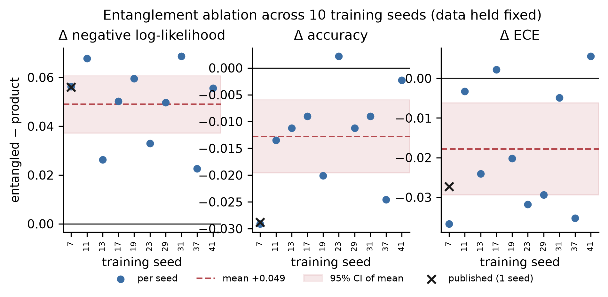
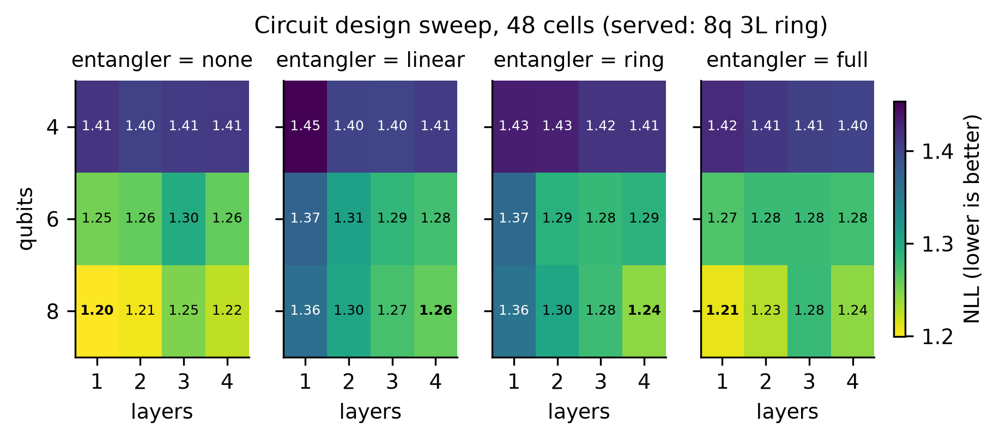
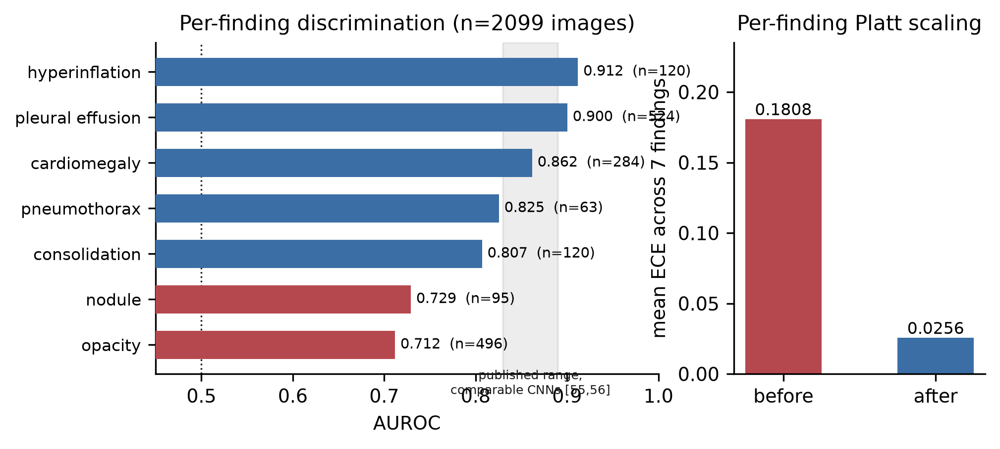
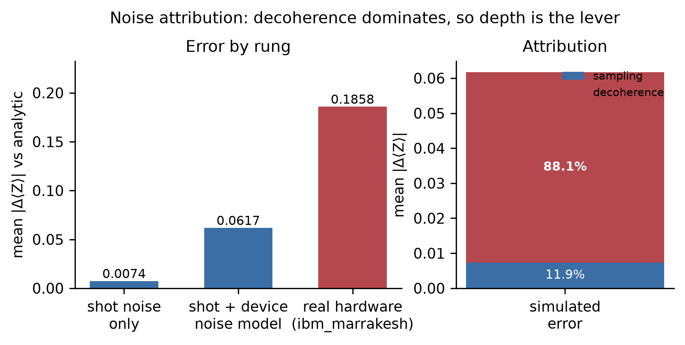

# Evaluating quantum machine learning in a clinical decision-support system: a comparison protocol and five negative results

Sivaguru R. M.

AURA Project. Correspondence: sivagurumurugan1@gmail.com
Code and artifacts: github.com/Sivaguru-2008/aura

Preprint, version 4. 7 August 2026.

> **Revision note (v3 → v4).** This version corrects errors identified in an internal review of v3 and adds disclosures that the review found missing. No experimental result has been changed. The substantive changes are: (i) the prediction target is now defined (§5.1.2) and its consequences for interpretation are drawn (§8.2, §8.3, §9.3); (ii) an evidence channel that is identically zero is disclosed and its confounding potential for §8.3 is stated (§5.1.3, §8.3, §12.6); (iii) two factual errors in v3's threats-to-validity section are corrected (class support and minimum detectable effect); (iv) trivial baselines and multiplicity-adjusted *p*-values are added; (v) provenance is stated for the abstention analysis (§9.1), the quantum-kernel embeddings (§8.5), and the noise attribution (§9.5), each of which v3 reported without the qualification it required; (vi) the claim that the protocol was fixed in advance is now scoped to what can be evidenced (§6). A complete change log is in Appendix A.

---

## Abstract

**Background.** The most rigorous synthesis of quantum machine learning (QML) in digital health screened 4,915 records, retained 169 as eligible, synthesised 16, and found the measured differences between quantum and classical methods negligible, with no consistent trend supporting empirical quantum utility [1]. The same review reports that classical comparators were commonly selected without theoretical justification, that 81.7% of eligible studies used ideal simulation only, that 7 of 138 simulation-only studies modelled noise, that 14 of 16 hardware studies compared against noiseless simulation, and that most studies released neither code nor data.

**Objective.** To determine whether quantum advantage claims in a clinical decision-support setting survive a symmetric comparison protocol, and to supply the methodological elements identified as absent from that literature.

**Methods.** We developed AURA, an offline decision-support system for chest radiography and brain MRI. Four evidence-fusion backends are interchangeable behind one interface: a Bayesian product-of-experts, an 8-qubit variational circuit, a learnable gated head, and an ensemble. A separate 10-qubit quantum-kernel classifier predicts glioma grade. A seven-rule protocol governs per-arm calibration, capacity matching, split disjointness, significance testing, publication of negative outcomes, artifact-derived reporting, and source-level audit of capability claims. Evaluation used MIMIC-CXR (2,099 images for finding extraction; patient-disjoint splits of 1,338/446/447 studies for fusion) and BraTS-2020 (7,531 held-out slices; 111/37/37 subjects for grading).

**Results.** None of five quantum claims survived. A previously reported calibration advantage (expected calibration error 0.020 versus 0.276) was traced to temperature scaling applied only to the quantum arm; with per-arm calibration the gap fell from 0.256 to 0.007. On the 447-study split the three backends were indistinguishable on accuracy (all pairwise McNemar *p* ≥ 0.18) against a majority-class rate of 0.237, but the quantum circuit beat the product-of-experts on negative log-likelihood (Δ = 0.017, Wilcoxon *p* = 0.006). That advantage did not survive a second classical baseline: a learnable gated head was not distinguishable from the quantum circuit (Δ = 0.019, *p* = 0.052) while beating the product-of-experts decisively (*p* < 10⁻⁵). Whether a quantum advantage is reported therefore depends on which classical model is placed opposite it. In a capacity-matched entanglement ablation across ten training seeds, the CNOT ring was worse on negative log-likelihood in ten of ten seeds (mean Δ = +0.049) and worse on accuracy in nine of ten, while being better calibrated in eight of ten. On discovering that one of the eight evidence channels is identically zero, so that the entangled arm couples data qubits to a constant register and the product arm does not, we repeated the ablation on the seven informative channels: **only the likelihood penalty survives** (mean Δ = +0.025, 95% CI +0.013 to +0.037 across seeds, ten of ten seeds, Wilcoxon *p* = 0.002, Holm *p* = 0.006), while the accuracy penalty (*p* = 0.29) and the calibration benefit (*p* = 0.43) both disappear. A 48-cell design sweep placed four of its five best configurations at zero entanglement. On converged embeddings with symmetric hyperparameter tuning, the quantum kernel did not differ from a radial basis function kernel (ΔAUROC = +0.0446, 95% CI −0.0576 to +0.1520, *p* = 0.55, 11 held-out subjects). Applying the source-audit rule to our own proposed mechanism showed that its shot-budget loop perturbs an analytically computed expectation rather than executing at finite shots, reducing the claimed capability to a threshold on the analytic margin; we retract it in §10.6.

**Conclusions.** Under a symmetric protocol, no quantum component provided a benefit that survived a second classical baseline or a second metric. We show that the fusion target is a deterministic weighted function of the fusion inputs (§5.1.2), which makes the observed null a *predicted* rather than merely an observed outcome for this task. These findings corroborate the field-level null of [1] from within a deployed system.

**Keywords:** quantum machine learning; negative results; benchmarking methodology; variational quantum circuits; quantum kernels; entanglement ablation; clinical decision support; calibration; selective prediction; reproducibility

---

## 1. Introduction

### 1.1 Background

Quantum machine learning applied to medical data has produced a substantial applied literature, and the most rigorous synthesis of it reaches a null result. Gupta and colleagues [1] screened 4,915 records published between 2015 and October 2024, identified 169 eligible studies, and synthesised 16. They report that measured differences between quantum and classical methods are negligible, and conclude that the results "show no consistent trend to support empirical quantum utility in digital health" [1].

That conclusion is accompanied by a methodological audit which, in our reading, explains why the literature is not in a position to have found otherwise. The review reports that comparator selection was "often ad-hoc rather than theoretically justified" [1]; that 81.7% of eligible studies used ideal simulations only; that of 138 simulation-only studies, 7 employed noisy simulation; that 14 of the 16 synthesised studies compared hardware results to noiseless simulation without characterising device noise; that only 2 of 16 used real electronic health record data, with input dimensionality typically of order 10; and that most studies did not make code or data accessible [1].

A literature with these properties cannot distinguish the hypothesis that no advantage exists from the hypothesis that no advantage was measurable. It is also poorly placed to detect the failure mode we consider most likely, which is not misconduct but asymmetric care. A researcher developing a novel method tunes it, calibrates it, examines its failure cases, and iterates; the comparison baseline is typically implemented once, correctly, and left alone. Neither arm is incorrectly implemented, but the comparison between them is not fair.

This mechanism has been documented in recommender systems [2], metric learning [3], and deep reinforcement learning [4]. In clinical machine learning, Wolfrath et al. [73] argue that omitting baselines or comparing against a weak one obscures the value of proposed methods; Varoquaux and Cheplygina [77] catalogue the same failure across medical imaging specifically and are, to our knowledge, the closest statement of the problem this paper instantiates. In machine learning for partial differential equations, McGreivy and Hakim [5] found that approximately 79% of studies comparing learned solvers against standard numerical methods compared against a weak baseline. The pattern appears in the catalogue of questionable research practices assembled by Leech et al. [6], in the leakage taxonomy of Kapoor and Narayanan [7], and in the model of Saidi et al. [8]. Within QML specifically, several authors have shown that reported kernel advantages can be attributable to unequal hyperparameter optimisation rather than to properties of the kernel [9,10], and Bowles, Ahmed and Schuld [74] show at benchmark scale that apparent quantum-model advantages largely dissolve under matched tuning and matched evaluation — the field-level analogue of what this paper reports for one system.

### 1.2 Theoretical expectations at current scale

There is a second reason to treat small-scale advantage claims cautiously: no established mechanism predicts them.

At 8 to 10 qubits the state space has dimension 256 to 1,024 and the circuits simulate in milliseconds on commodity hardware. Huang et al. [11] show that classical intractability of the represented function class is not sufficient for a learning advantage, since a classical learner can approximate the quantum predictor given adequate data. Kübler et al. [12] characterise the inductive bias of quantum kernels and find that generic hyperparameter tuning drives them toward well-approximated classical kernels. Slattery et al. [13] report numerical evidence against fidelity-kernel advantage on classical data, and Thanasilp et al. [72] identify exponential concentration of kernel values as a mechanism that limits quantum kernels as qubit count grows. Shaydulin and Wild [9] show that kernel bandwidth alone can dominate the observed comparison. From the trainability side, Cerezo et al. [14] argue that provable absence of barren plateaus [15,16] tends to imply classical simulability. Schuld and Killoran [75] question whether advantage is the right organising goal for the field at all.

These results give no mechanism that would predict an advantage at this scale. That shifts the burden of explanation onto the comparison design: where an advantage is reported, the design is the first thing to examine.

### 1.3 Approach

We tested this proposition from a position that favours a false positive, and we state what that means concretely rather than asserting it. We built a complete clinical decision-support system containing a genuine quantum layer; we served the quantum backend in production; we published, in earlier versions of this project's documentation, a quantum calibration advantage of a factor of 13.8 (§8.1) and a measurement-budget mechanism advanced as the project's principal novelty (§10.6). We then specified a comparison protocol strict enough that a demonstrated advantage would be credible (§6) and applied it to every quantum claim in the system. Five claims were examined: four we had already made or expected to make, and one we had proposed as the system's principal contribution.

None survived. One failed with statistical significance in the direction opposite to the field's central premise: at matched capacity, entanglement degraded probabilistic prediction quality. One was invalidated not by an experiment but by reading the implementation, which is why the protocol includes a rule requiring source-level audit of capability claims.

### 1.4 Contribution and structure

Gupta et al. [1] establish a field-level null by aggregation, and Bowles et al. [74] by systematic benchmarking of model pairs. The present work is complementary in method and concordant in conclusion: a single deployed system examined in depth, supplying the methodological elements those studies found absent in the applied medical literature, together with two they do not consider (calibration symmetry and source-level capability audit).

§2 reviews related work. §3 states the research gap. §4 describes the system, §5 the data, target and setup, and §6 the protocol. §7 measures the size of the confound the protocol prevents. §8 reports five negative results, §9 the positive controls establishing that the apparatus functions, and §10 the discussion, including the retraction in §10.6. §11 covers threats to validity and limitations.

We make no clinical claim. There is no prospective cohort, no external site, no reader study, and no regulatory clearance. The prediction target is a rule-derived radiographic-pattern proxy, not a clinical diagnosis (§5.1.2). The findings are scoped to 8 to 10 qubits operating on low-dimensional evidence and embedding vectors — the regime in which most current medical QML operates [1] — and do not bear on structured-data regimes or fault-tolerant scale.

---

## 2. Related work

### 2.1 Quantum machine learning and its qualifications

Variational quantum classifiers [18] and quantum kernel methods [19] motivate advantage arguments from high-dimensional feature maps, and parameterised circuits are an established model class [20,21]. Preskill's characterisation of the NISQ era [22] sets the resource context.

The qualifying literature is substantial. Huang et al. [11] establish that data can substitute for quantum access. Kübler et al. [12] find the conditions for kernel advantage restrictive; Slattery et al. [13] report numerical evidence against fidelity-kernel advantage on classical data; Thanasilp et al. [72] show exponential concentration of kernel values with qubit count. Shaydulin and Wild [9] and Egginger et al. [10] show that hyperparameter choices dominate observed differences. Dequantization results show that certain quantum neural networks admit classical approximation through random Fourier features [23]. Recent benchmarking describes the evidence for quantum kernel advantage on tabular data as mixed at best [24,25], and a unified empirical comparison across seven model pairs reported no quantum surpassing of classical baselines on predictive performance, policy stability, or training time [26]. On trainability, barren plateaus constrain scaling [15,16], and Cerezo et al. [14] connect their absence to classical simulability. Abbas et al. [78] argue that parameter count is a poor proxy for the capacity of a quantum model and propose effective dimension instead — a caveat that applies directly to our own matching rule (§6, P2).

Bowles, Ahmed and Schuld [74] are the closest methodological prior art to this paper: they benchmark quantum and classical model pairs under matched conditions and find that advantage claims are largely artifacts of evaluation choices. Our contribution is not to establish that conclusion, which they establish more broadly, but to instrument one deployed clinical system deeply enough to identify the specific mechanisms by which such artifacts arise, and to report a case in which the artifact was our own.

### 2.2 Quantum machine learning in health

Applied work spans quantum support vector machines, quantum convolutional networks, and hybrid architectures, across radiology, oncology, and neuroimaging [27,28,29]. Gupta et al. [1] provide the most rigorous synthesis and the direct motivation for the present study; §3.1 tabulates their methodological findings against ours. Other reviews reach broadly similar conclusions regarding hardware limits, encoding bottlenecks, and the dimensionality reduction that qubit budgets impose [28,29,30].

### 2.3 Measurement as a resource

Shot-frugal optimisation is well developed in variational quantum eigensolvers, where adaptive allocation minimises measurements per unit of progress toward an objective [31,32,33]. This is the nearest prior art to the mechanism we retract in §10.6, and the distinction matters there: prior work allocates measurements to optimise an objective, whereas we proposed allocating them to type a decision.

### 2.4 Calibration, selective prediction, and conformal methods

Modern networks are systematically overconfident [34], and calibration degrades under dataset shift [35]. Deep ensembles [36] and Monte Carlo dropout [37] provide epistemic uncertainty; energy-based [38] and maximum-softmax [39] scores support out-of-distribution detection. Proper scoring rules admit decompositions into calibration and refinement components [79,80,81], which §8.3 uses. Selective prediction [40,41] is the classical framing for abstention, extended in clinical settings through learning-to-defer and complementarity-driven arbitration [42,43,44]; Geifman et al. [82] give the risk–coverage summary statistics we identify as the correct evaluation for §9.1. Conformal prediction [45,46] provides distribution-free coverage under exchangeability, with class-conditional variants [47] and adaptive constructions [48,49]; adaptive conformal inference [50] removes the exchangeability assumption. Conformal triage has been proposed for clinical imaging deployment [51].

AURA integrates these components. We claim no novelty for any of them; §9 is presented as a set of positive controls, not as a contribution.

### 2.5 Imaging baselines and label provenance

MIMIC-CXR [52] and CheXpert [53] are the standard chest radiograph corpora and share a rule-based labeler producing silver-standard labels with known noise characteristics [53,54]. Reported AUROC for comparable convolutional architectures falls broadly in 0.83 to 0.89 [55,56]. For brain tumour segmentation, BraTS [57,58] is standard, and nnU-Net won the 2020 challenge with per-case three-dimensional Dice coefficients of 88.95, 85.06, and 82.03 for whole tumour, tumour core, and enhancing tumour [59]. §9.4 explains why our segmentation results must not be compared with those figures.

Generalisation remains the dominant practical failure mode in clinical imaging AI: models exploit shortcut features and acquisition biases, with performance overestimated by as much as 20% without external validation [60], and fairness corrections do not transfer across settings [61]. These findings bound every claim made here from a single centre.

### 2.6 Positioning

We are not aware of prior work that applies a symmetric quantum-versus-classical protocol within a deployed clinical system, reports a capacity-matched entanglement ablation replicated across seeds on a clinical corpus, attributes hardware error between sampling and decoherence for a medical model, or retracts a capability claim on the basis of a source-level audit. Each responds to a gap identified in [1]. We note that [74] covers adjacent ground at greater breadth and lesser depth, and that our claim is one of complementarity rather than priority.

---

## 3. Research gap and response

### 3.1 Gap analysis

The middle column of Table 1 is not our characterisation of the field. It reproduces the methodological findings of [1]. The right column states the literal scope of what this work supplies, including where that scope is a single instance.

**Table 1.** Methodological state of the medical QML literature as reported by Gupta et al. [1], with the corresponding element supplied by this work.

| | Dimension | Reported state of the field [1] | This work |
|---|---|---|---|
| G1 | Quantum advantage | Measured differences negligible; no consistent supporting trend | Corroborated within a deployed system, with effect sizes, intervals, and significance tests for five claims |
| G2 | Classical comparators | Selected without stated theoretical justification | Three classical arms plus majority-class floor; ablation arms capacity-matched at 102 parameters under one training function, one seed, one split |
| G3 | Simulation versus hardware | 81.7% used ideal simulation only | One case executed on `ibm_marrakesh` (156 qubits), job `d9js49rjf64c739haeg0`. A single-instance existence proof, not a hardware evaluation (§9.5, §11.8) |
| G4 | Noise characterisation | 7 of 138 simulation-only studies modelled noise; 14 of 16 hardware studies compared to noiseless simulation | Three-rung attribution on one evidence vector: sampling 0.0074, device 0.0544, hardware 0.1858 mean absolute error in ⟨Z⟩. n = 1 (§9.5, §11.8) |
| G5 | Clinical data realism | 2 of 16 used real EHR data; dimensionality typically order 10 | MIMIC-CXR and BraTS-2020, patient- and volume-disjoint splits, deployed pipeline. Target is rule-derived (§5.1.2) |
| G6 | Reproducibility | Most studies released neither code nor data | Artifact release with SHA-256 manifests, fixed seeds, environment capture, and a drift test covering five documents but not this manuscript (§6, P6) |
| G7 | Calibration symmetry | Not assessed as a dimension | Per-arm calibration required by protocol; confound headroom measured at 1.89 |
| G8 | Statistical inference | Not assessed as a dimension | McNemar, DeLong, Wilcoxon with normality screening, clustered bootstrap, Holm correction within families |
| G9 | Capability claims | Not considered | Source-level audit, introduced after it invalidated our own contribution |

G7 to G9 are dimensions we identified rather than inherited. We note that absence of a dimension from a systematic review is not evidence of its absence from the field.

### 3.2 Contributions

**C1. Five negative results with complete inferential reporting** (G1, G8). §8.1 to §8.5 report effect size, interval, sample size, test, and Holm-adjusted *p* for each. One result is significant in the direction opposite to the field's premise. For each null we state the effect size that would have been detectable.

**C2. A symmetric comparison protocol with its provenance stated** (G2, G7). Seven rules, together with a worked demonstration of the confound the first prevents and a measurement of the headroom available to it. §6 states which rules were in force before which experiments and which were not; we do not claim more than we can evidence.

**C3. Hardware execution with error attributed to physical source** (G3, G4). We decompose the simulated error for one representative case, finding 88.1% attributable to decoherence and 11.9% to sampling, which identifies circuit depth rather than shot count as the binding constraint. Acting on this, raising the transpiler optimisation level from 1 to 3 removes 20% of two-qubit gates at no cost, and the served path now does so. Both the attribution and the hardware run rest on a single case (§11.8).

**C4. A documented self-retraction** (G9). §10.6 withdraws the mechanism this project had advanced as its principal novelty, and reports the source-level evidence on which the withdrawal rests.

**C5. Clinical validation infrastructure subjected to the same scrutiny** (G5, G6). A two-axis design validates rule-derived finding labels against a hand-read reference standard and cross-checks the model against independently trained public weights. The design localises a genuine model failure (nodule detection) to the image model rather than the labels, and §8.2 shows that this failure propagates to the diagnosis level.

**C6. An account of what carried clinical performance** (G1). Selective prediction rather than architecture. The magnitude of this effect is reported with the provenance qualification stated in §9.1, and the analysis required to establish it properly is specified in §11.9.

---

## 4. System under evaluation

**Pipeline.** A three-stage modality router (DICOM metadata, then pixel geometry, then plain-image signature) admits frontal chest radiographs and complete four-sequence brain MRI studies, and rejects all other inputs with a typed refusal. Chest studies are processed by a DenseNet-121 [62] producing seven findings. Brain studies are processed by a multi-task residual U-Net [63] producing segmentation, tumour presence, lesion size, image quality, and a supervised contrastive embedding [64]. Findings are assembled into an eight-channel evidence vector **x** ∈ [0,1]⁸ comprising opacity, consolidation, pleural effusion, cardiomegaly, nodule, hyperinflation, pneumothorax, and prior risk, which is fused into a posterior over six diagnostic categories. A safety layer applies per-backend temperature scaling [34], class-conditional conformal prediction [47], online adaptive conformal inference [50], energy-score out-of-distribution detection [38], and a four-criterion abstention policy. Attribution maps use Grad-CAM++ [65].

**Fusion backends.** Four backends consume the same evidence vector and emit logits over the same six categories (Table 2). Writing **z** = (⟨Z₁⟩,…,⟨Z₈⟩) for the circuit readout, the three evaluated backends are

$$p_{\text{PoE}}(y\mid \mathbf{x}) \propto \pi(y)\prod_{i=1}^{8} \ell_i(x_i \mid y), \qquad
p_{\text{VQC}}(y\mid \mathbf{x}) = \operatorname{softmax}\!\big(W\mathbf{z}(\mathbf{x};\theta) + b\big), \qquad
p_{\text{head}}(y\mid \mathbf{x}) = \operatorname{softmax}\!\big(g(\mathbf{x}) \odot (A\mathbf{x} + c)\big)$$

where ℓᵢ are per-channel log-likelihoods, θ are the circuit rotation angles, and g is a learned elementwise gate. Each is scaled by its own temperature T fitted on the calibration split by minimising negative log-likelihood of softmax(logits/T).

**Table 2.** Fusion backends compared in §8.2 to §8.4.

| Backend | Description | Trainable parameters |
|---|---|---:|
| Classical product-of-experts | Per-channel log-likelihoods summed with a prior; per-evidence contribution is inspectable | 54 |
| Quantum variational circuit | 8 qubits, 3 layers, RY(π·xᵢ) encoding, ring entangler, ⟨Zᵢ⟩ readout into a linear head; PennyLane [66] | 102 |
| Learnable gated head | Gated linear map on the raw evidence vector; controls for whether the circuit contributes beyond a shallow classical model | 54 |
| Ensemble | Probability-space average of quantum and classical; implemented but not evaluated in this paper | — |

Note that capacity is *not* matched across the §8.2 comparison: the quantum arm carries roughly twice the trainable parameters of either classical arm and still does not win. Matched capacity is enforced only within the §8.3 ablation, where topology is the sole varying factor. Parameter count is in any case a weak proxy for capacity in quantum models [78]; we use it because it is verifiable, not because it is sufficient.

**Quantum kernel classifier.** A 10-qubit IQP feature map (Hadamard, RZ, ring ZZ) induces the fidelity kernel |⟨φ(x)|φ(x′)⟩|² over a 1,024-dimensional Hilbert space, used in a support vector machine with 1,680 support vectors and Platt calibration [67] to classify glioma grade from brain-encoder embeddings. The matched control is a radial basis function support vector machine on the same embeddings. Both arms use scikit-learn defaults with C = 1.0 and no bandwidth search; §8.5 and §11.5 state why this limits the comparison.

**Implementation note (reproducibility hazard).** The entangler topology must be stored on the model instance rather than inferred from the parameter vector. The parameter vector alone does not identify the circuit, so loading a product-trained model through the ring ansatz evaluates a different unitary and returns plausible but incorrect expectation values without raising an error. This would silently corrupt any attempt to reproduce §8.3.

---

## 5. Data, prediction target, and experimental setup

### 5.1 Data

#### 5.1.1 Corpora

Chest radiography used MIMIC-CXR [52], a de-identified corpus of radiographs with free-text reports from a single tertiary academic medical centre in the United States. Brain MRI used BraTS-2020 [57,58], comprising preoperative studies of high- and low-grade glioma with four co-registered sequences (FLAIR, T1, T1 contrast-enhanced, T2).

**Table 3.** Data splits.

| Analysis | Train | Calibration | Test | Unit of disjointness |
|---|---:|---:|---:|---|
| Fusion, primary (§7, §8.2, §8.3, §8.4, §10.6) | 1,338 | 446 | 447 | Patient |
| Deployment benchmark (secondary, §8.2) | — | — | 69 | Held-out validation studies |
| Quantum kernel grading (§8.5) | 33 subjects (1,951 slices) | 11 subjects (1,273 slices) | 11 subjects (1,269 slices) | Subject |
| Finding extraction (§9.2) | — | — | 2,099 images | — |
| Cross-model check (§9.3) | — | — | 700 images | — |
| Labeler reference standard (§9.3) | — | — | 66 reports | — |
| Brain segmentation (§9.4) | — | — | 7,531 slices | Volume |

Class support on the 447-study primary test split is: normal 102, pneumonia 98, heart failure 106, COPD 67, malignancy 59, pneumothorax 15. The **majority-class accuracy is therefore 106/447 = 0.2371**, which is the floor against which every accuracy in §8 should be read.

All primary comparisons use the 447-study patient-disjoint split. The 69-study benchmark is the split the deployed system reports; it is retained as a secondary result in §8.2 to preserve correspondence between this paper and the running artifact, and because the disagreement between the two splits is itself evidence about statistical power. Saidi et al. [8] show that reported accuracy correlates inversely with sample size across published machine learning, a caution we apply to our own splits in §11.4.

**Test-set reuse.** The same 447-study test split is used for §7, §8.2, §8.3, §8.4 and §10.6, across more than sixty model evaluations including all 48 cells of the design sweep. No held-out split remains for adaptive-overfitting control. The consequences are stated in §8.4 and §11.4.

#### 5.1.2 Prediction target and its derivation

The six-way target is not an independently ascertained clinical diagnosis. It is derived from the free-text report by rule, in `aura/mimic/labeling.py`. Report concepts are extracted with CheXpert-style negation and uncertainty scoping [53,54], and mapped to a category by a fixed weighted score:

| Category | Score contributions |
|---|---|
| Pneumothorax | pneumothorax 1.0 |
| Malignancy | nodule 1.0 |
| Heart failure | edema 0.7 + cardiomegaly 0.5 + effusion 0.2 |
| Pneumonia | pneumonia 0.9 + consolidation 0.6 + opacity 0.3 |
| COPD | hyperinflation 0.9 |
| Normal | assigned when no pathological concept is positive |

The highest-scoring category is taken, with ties broken by a fixed clinical-acuity priority (pneumothorax > malignancy > heart failure > pneumonia > COPD > normal). Patient-level labels aggregate concepts across studies and take the highest-acuity category observed.

Three consequences must be stated plainly, because they bound the interpretation of every result in §7 and §8.

**First, these are radiographic-pattern proxies, not clinical diagnoses.** "Malignancy" is assigned on a nodule mention; no histology, follow-up, or outcome data enter. "Heart failure" is a radiographic constellation; no echocardiography, natriuretic peptide, or clinical assessment enters. We use the term *diagnostic category* rather than *diagnosis* for this reason, and no result here should be read as evidence about diagnostic accuracy in the clinical sense.

**Second, the target is a deterministic function of the same concepts that generate the model's input features.** The fusion task is recovery of a known weighted-sum-then-argmax map from noisy estimates of its arguments. The only thing standing between input and target is the vision model's error. Accuracy figures in §8 measure that, and not more.

**Third — and this is the most informative consequence — the Bayes-optimal decision rule for this target is linear in the evidence vector up to the tie-break.** That has a direct bearing on the paper's central question and is developed in §8.2 and §8.3: a task whose optimal rule is linear in the given features contains no inter-channel nonlinearity for an entangling ansatz to exploit, so the theoretical expectation of §1.2 is not merely consistent with our null but derivable for this task. It also means our null is *scoped to targets of this kind*. A task with genuine higher-order structure among the evidence channels is not tested here, and we do not claim the result transfers to one.

The finding labels that feed the evidence vector are validated against a hand-read reference standard in §9.3. **The diagnostic-category map above is not validated.** Its weights are transparent clinical heuristics chosen by the author; no clinician reviewed them, and no agreement study was performed against clinician-assigned categories. §9.3's circularity defence therefore covers the seven evidence channels and does not cover the six-way target.

#### 5.1.3 A constant evidence channel

The eighth evidence channel, `prior_risk`, is **identically zero in all 2,231 studies** across the training, calibration and test splits (nonzero fraction 0.000 in each; `aura/artifacts/quantum_study_evidence.npz`). It carries no information. Under the RY(π·xᵢ) encoding, qubit 8 receives RY(0) = identity and is a constant register acted on only by the trainable rotations and, in entangled topologies, by the entangler.

This must be taken into account in three places. §4's evidence vector is nominally eight-dimensional and effectively seven-dimensional. §8.4's qubit axis is an ablation over seven informative channels plus one constant, so eight qubits is set by the *nominal* input dimension, not by information content. Most importantly, §8.3's ablation compares a topology that couples data qubits to a constant register against one that does not; parameter-count matching does not control for this, and it is an alternative explanation for the observed effect that we cannot presently exclude. §8.3 and §11.6 state the consequence and the experiment required to resolve it.

### 5.2 Computing environment and training configuration

Python 3.12.10, NumPy 2.4.4, SciPy 1.18.0, scikit-learn 1.9.0, PyTorch 2.11.0 with CUDA 12.8, on Windows 11 with an AMD Ryzen processor (16 threads, 16.4 GB RAM) and an NVIDIA RTX 5050 Laptop GPU. Quantum simulation used PennyLane `default.qubit` [66]. Transpilation and noise modelling used Qiskit [68] against the `FakeMarrakesh` backend model. Hardware execution used IBM `ibm_marrakesh` (156 qubits), job `d9js49rjf64c739haeg0`.

**Table 3b.** Training configuration by experiment. Experiments differ in training length, and results are therefore not directly comparable across these rows.

| Experiment | Seeds | Epochs | Artifact |
|---|---|---:|---|
| Backend comparison (§7, §8.2) | 7 | not recorded in artifact | `fusion_headline_n447.json` |
| Entanglement ablation (§8.3) | 7, 11, 13, 17, 19, 23, 29, 31, 37, 41 | 30 | `entanglement_multiseed.json` |
| Entanglement ablation, robustness (§8.3) | same ten | 20 | `entanglement_multiseed.epochs20.json` |
| Design sweep (§8.4) | 7 | 20 | `design_sweep.json` |
| Single-seed ablation with test bootstrap (§8.3) | 7 | 30 | `quantum_study.json` |
| Quantum kernel (§8.5) | 7 | n/a (SVM, C = 1.0) | `brain/qkl_training_report.json` |

The same 8-qubit, 3-layer ring circuit at seed 7 appears with accuracy 0.5324 (Table 6), 0.5414 (Table 8) and 0.5481 (Table 9) because of these differences in training length and calibration split; the rows are not intended to be read across, and we flag the discrepancy explicitly because a reader consulting the artifacts will otherwise encounter it unexplained. That the epoch count for the §8.2 arms is not recorded in the artifact is a reproducibility defect we report rather than conceal (§11.7).

### 5.3 Statistical methods

Paired accuracy comparisons used McNemar's exact test [69]. AUROC comparisons used DeLong [70]. Negative log-likelihood comparisons used the Wilcoxon signed-rank test, with Shapiro–Wilk applied to the paired differences to select between parametric and non-parametric procedures. Differences in paired metrics were assessed by bootstrap resampling at the unit of independence appropriate to each analysis: study-level for fusion, subject-level for the quantum-kernel comparison. Binomial proportion intervals are Jeffreys intervals. The bootstrap used 2,000 resamples for the entanglement ablation and 1,000 for the kernel comparison.

**Multiplicity.** Each table defines a test family, and *p*-values within a family are Holm-adjusted; both raw and adjusted values are reported. Under this policy every conclusion in §8.2 and §8.3 is unchanged. We note that pooling all fourteen tests into a single family would render the calibration result of Table 8 non-significant (0.0195 × 14 = 0.27); we regard the per-table family as the natural one but state the alternative so the reader can apply their own.

**Expected calibration error.** ECE is computed with 10 equal-width confidence bins. ECE is bin-count dependent and biased at small n, and differences in ECE of the magnitude reported here should not be interpreted without the accompanying interval. Where an argument depends on the calibration–refinement trade (§8.3), ECE is not sufficient and a proper-score decomposition is required; §11.9 states that this decomposition has not yet been computed and is the analysis needed to close the argument.

**Interpretation of *p*-values.** We follow Gelman and Stern [76] in not treating a significant result and a non-significant result as evidence of a difference between the two. Where §8.2 reports that one comparison reaches significance and another does not, the claim made is about which comparator was chosen, not about a demonstrated ordering between the non-significant pair.

---

## 6. Comparison protocol

The following rules govern the comparisons reported in §8 and are applied to both arms of every comparison.

**P1. Per-arm calibration.** Each backend fits its own temperature on its own calibration split before any metric is computed. This is the rule violated by the result reported in §8.1.

**P2. Matched capacity within an ablation.** Where an architectural factor is ablated, the compared arms have identical trainable parameter counts and are trained by the same function, on the same data, with the same seed, so that a difference in topology cannot be a difference in capacity. This governs §8.3 and §8.4. It does *not* govern §8.2, where the comparator set is deliberately heterogeneous. Parameter count is a verifiable but weak proxy for capacity in quantum models [78].

**P3. Disjoint splits at the correct unit.** Splits are patient-disjoint for fusion, volume-disjoint for brain segmentation, and subject-disjoint for grading. Resampling is performed at the same unit. The kernel comparison bootstraps over subjects rather than slices, since slices from one patient are not independent observations and slice-level resampling would overstate precision by approximately the square root of the number of slices per subject. This corresponds to non-independence of training and test samples in the taxonomy of [7].

**P4. Significance before ranking.** Every ordering claim is accompanied by an appropriate test, an interval, and a multiplicity policy.

**P5. Publication of negative outcomes.** Every comparison run is reported regardless of its direction [17].

**P6. Artifact-derived reporting.** Every published figure is read from the artifact that produced it. A drift test (`aura/tests/test_doc_numbers.py`) fails the build when documentation and artifacts diverge. **That test currently covers five repository documents and does not cover this manuscript**; extending it is listed in §11.9. Until it is extended, P6 is a practice we follow rather than a constraint the build enforces on this paper, and the defects listed in §11.7 are what that gap permitted.

**P7. Audit of mechanisms, not only metrics.** A claim about what a system is able to express is a claim about its implementation and is verified at the source level. Metrics cannot falsify a capability that holds by construction.

**Provenance of these rules.** We state what can be evidenced and no more. P7 was written during preparation of this manuscript, as a consequence of the finding in §10.6, and was not in force when the mechanism it invalidated was proposed. P1 was written in response to the audit reported in §8.1 and was in force for every comparison in §8.2 to §8.5. P2 to P6 were formulated during the same revision period as the experiments they govern. **We do not hold a timestamped pre-registration for P1 to P6, and the artifact timestamps establish only when experiments were run, not when the rules were written.** A reader is entitled to weight the pre-specification claim accordingly. For the external-validation work specified in §11.9 we will deposit a timestamped pre-registration before any run, which is the only way this claim can be made verifiable rather than asserted.

---

## 7. Size of the confound

Before running the comparisons we measured the headroom available to a violation of P1. Each backend's temperature was fitted on the same 446-study calibration split (Table 4).

**Table 4.** Per-backend calibration parameters and test performance, n = 447. Majority-class accuracy on this split is 0.2371.

| Backend | Temperature | Accuracy | NLL | ECE | Coverage | Mean set size |
|---|---:|---:|---:|---:|---:|---:|
| Classical | 0.479 | 0.5414 | 1.3026 | 0.1266 | 0.904 | 3.54 |
| Quantum | 0.906 | 0.5324 | 1.2853 | 0.0896 | 0.915 | 3.54 |
| Learnable | 0.887 | 0.5526 | 1.2663 | 0.0902 | 0.908 | 3.42 |

The spread across backends is a factor of 1.89. This is the multiplicative factor by which serving one backend under another backend's calibration distorts every downstream probability, conformal set, and abstention decision.

The same quantity has an operational consequence in this codebase. The served calibration artifact carries the quantum fit, so changing the fusion backend without refitting silently disables the divergence guard. A protocol violation and a production defect are, in this instance, the same object.

---

## 8. Results: five negative findings

### 8.1 A calibration advantage attributable to asymmetric preprocessing

An earlier version of this project's benchmark reported that the quantum fusion backend was substantially better calibrated than the classical backend (ECE 0.020 versus 0.276), more accurate (0.96 versus 0.93), and superior in AUROC. A reproducible audit regenerated these figures from source on a 100-study cohort held out during the audit run (Table 5).

**Table 5.** Audit of previously published fusion claims, n = 100.

| Original claim | Regenerated result | Verdict |
|---|---|---|
| Calibration better by factor 13.8 | Quantum 0.020; classical with own temperature 0.0274; classical uncalibrated 0.2755 | Confounded |
| Accuracy 0.96 versus 0.93 | Δ = 0.03, 95% CI 0.00 to 0.07; McNemar *p* = 0.25 | Not validated |
| AUROC advantage | DeLong significant in 0 of 6 classes | Not validated |

The published value of 0.276 was the uncalibrated classical ECE. When each arm was given its own temperature, the difference fell from 0.256 to 0.007, a reduction by a factor of 36 achieved by changing only the symmetry of the preprocessing. The accuracy claim rested on three discordant pairs, all favouring the classical arm.

We report this result first because it motivated P1, and because it is the one failure that was not the target of a designed experiment. It surfaced only when the numbers were regenerated from source. It belongs to the class of error catalogued in [6,7], and it is not detectable by the aggregation methods available to [1].

### 8.2 Whether a quantum advantage is reported depends on which classical model is chosen as the comparator

Table 6 reports the primary comparison on the 447-study patient-disjoint split, each backend temperature-scaled on its own 446-study calibration split.

**Table 6.** Fusion backend comparison, n = 447 patient-disjoint studies. Intervals are Jeffreys intervals on accuracy.

| Backend | Temperature | Accuracy | Correct | 95% CI | NLL | ECE | Macro AUROC |
|---|---:|---:|---:|---|---:|---:|---:|
| Majority class (floor) | — | 0.2371 | 106/447 | 0.199–0.279 | — | — | 0.500 |
| Classical product-of-experts | 0.479 | 0.5414 | 242/447 | 0.495–0.587 | 1.3026 | 0.1266 | 0.8045 |
| Quantum variational circuit | 0.906 | 0.5324 | 238/447 | 0.486–0.578 | 1.2853 | **0.0896** | 0.8014 |
| Learnable gated head | 0.887 | **0.5526** | 247/447 | 0.506–0.598 | **1.2663** | 0.0902 | **0.8056** |

**Table 7.** Pairwise tests, n = 447. McNemar is the exact binomial test on discordant pairs; NLL is compared by Wilcoxon signed-rank on the 447 paired per-study values. Holm adjustment is within each metric family of three comparisons.

| Comparison | Δ accuracy | Discordant | McNemar *p* | Holm | Δ NLL | Wilcoxon *p* | Holm |
|---|---:|---:|---:|---:|---:|---:|---:|
| Classical vs. quantum | +0.0090 | 50 | 0.672 | 1.000 | +0.0173 | **0.0060** | **0.0120** |
| Classical vs. learnable | −0.0112 | 43 | 0.542 | 1.000 | +0.0363 | **< 10⁻⁵** | **< 10⁻⁴** |
| Quantum vs. learnable | −0.0202 | 35 | 0.176 | 0.528 | +0.0190 | 0.0522 | 0.0522 |

Two findings follow, and they point in different directions.

**On accuracy, the three backends are indistinguishable.** No pairwise comparison approaches significance (raw *p* = 0.18 to 0.67; none survives Holm), and the ordering places the gated head first. At n = 447 the minimum detectable accuracy difference at 80% power is 9.3 points, so these remain statements about undetectability rather than about equality; the spread between best and worst is 2.0 points, well inside that bound. All three arms sit approximately 30 points above the majority-class floor of 0.2371.

**On negative log-likelihood, the quantum circuit outperforms the classical product-of-experts** (Δ = +0.0173 in favour of quantum, Wilcoxon *p* = 0.0060, Holm *p* = 0.0120), and is better calibrated (ECE 0.0896 against 0.1266). Read in isolation, this is a quantum advantage on the metric that matters most for a system whose output is a calibrated probability.

It does not survive the introduction of a second classical baseline — though the sense in which it does not survive requires care. The learnable gated head attains lower NLL than the quantum circuit, but the difference is not statistically resolvable (Δ = +0.0190, *p* = 0.052). Against the product-of-experts the same head is better by a wide margin (*p* < 10⁻⁵). Following [76], we do not read "significant against one comparator, non-significant against another" as evidence that the two comparators differ. **What the data support is this: the quantum circuit and an unremarkable gated linear model are not distinguishable from one another, and both beat the product-of-experts.** Whether a paper reports "a significant quantum advantage on NLL and calibration" therefore depends entirely on which classical model is placed opposite the circuit. Choosing the Bayesian product-of-experts as the sole classical arm yields a publishable quantum result; including a second, ordinary classical model removes it. This is the mechanism described in [2–5,73,74,77], occurring in our own headline comparison, and it is the reason P2's comparator set is heterogeneous by design.

**Why the gated head performs as it does.** §5.1.2 shows the target is an argmax over a fixed weighted sum of the seven informative concepts, so the Bayes-optimal rule for this task is linear in the evidence vector up to the acuity tie-break. A gated linear map is therefore the correctly specified model class, and both the product-of-experts (which imposes conditional independence with per-channel likelihoods) and the variational circuit (which spends capacity representing inter-channel correlation) are mis-specified relative to it. The null reported here is thus not only consistent with the theoretical expectations of §1.2 but derivable from the structure of this task. This is a scope condition as much as an explanation: a target with genuine higher-order structure among evidence channels is not tested by these experiments.

We note that the n = 69 deployment benchmark reported in earlier versions gave the opposite accuracy ordering, placing the product-of-experts first at 0.6957 against 0.6377, on four discordant cases (McNemar *p* ≥ 0.125 under any assignment). Across the two splits the three backends exchange rank order on accuracy, which is what a null looks like when read at insufficient power.

**Per-class results.** Support is uneven and per-class figures are directional only. Malignancy shows essentially no discriminative signal in any arm (AUROC 0.6415 classical, 0.5696 quantum, 0.5951 learnable). This is not an isolated observation: §5.1.2 shows the malignancy category *is* the nodule concept, and §9.3 shows nodule is the single finding that fails independent corroboration by an independently trained model (AUROC 0.439, κ = −0.031). The diagnosis-level failure and the image-level failure are the same failure, and the two-axis design of §9.3 is what makes that attribution possible. Pneumothorax as a category has high nominal AUROC (0.8353, 0.8696, 0.8352) but only 15 positive cases, so its interval is wide and it should not be read as an established result. Corrigendum to v3: that version stated pneumothorax showed no discriminative signal, which the artifact does not support; it is rare, not undiscriminated.

### 8.3 Entanglement trades discrimination for calibration, and the trade is unfavourable

Under P2, an entangled ring circuit was compared with a product-state circuit at identical parameter count (102), trained by the same function on the same data. Because a single training run cannot separate an architectural effect from an initialisation effect, the comparison was replicated across ten training seeds with the evidence set held byte-identical, so that the observed spread is attributable to initialisation and optimisation alone (Figure 1, Table 8).

**Table 8.** Entanglement ablation replicated across ten training seeds, n = 447 patient-disjoint studies, 30 epochs. Differences are entangled minus product-state. **Intervals are across seeds with the test split held fixed, and therefore quantify training variability only; they exclude test-set sampling error entirely.** The *t* test is one-sample against zero and the Wilcoxon test is its signed-rank equivalent; Holm adjustment is within each test family of three metrics.

| Metric | Mean Δ | SD across seeds | 95% CI of mean (across seeds) | *t* *p* | Holm | Wilcoxon *p* | Holm | Seeds favouring entanglement |
|---|---:|---:|---|---:|---:|---:|---:|---:|
| Negative log-likelihood | +0.0490 | 0.0164 | +0.0372 to +0.0607 | < 0.001 | 0.0027 | 0.002 | 0.006 | **0 of 10** |
| Accuracy | −0.0128 | 0.0096 | −0.0196 to −0.0059 | 0.0023 | 0.0046 | 0.0039 | 0.0078 | 1 of 10 |
| Expected calibration error | −0.0178 | 0.0162 | −0.0294 to −0.0062 | 0.0070 | 0.0070 | 0.0195 | 0.0195 | 8 of 10 |

**Table 8b.** The complementary variance component, from the single-seed (seed 7) test-set bootstrap, 2,000 resamples over the 447 studies (`quantum_study.json`, `q1_q2_ablation`). These intervals quantify sampling error on a fixed trained model, which is the source Table 8 omits.

| Metric | Δ at seed 7 | 95% CI (test bootstrap) | Excludes zero |
|---|---:|---|---|
| Negative log-likelihood | +0.0560 | +0.0222 to +0.0902 | Yes |
| Accuracy | −0.0288 | −0.0582 to 0.0000 | No |
| Expected calibration error | −0.0273 | −0.0676 to +0.0180 | No |



**Figure 1.** Per-seed differences between the entangled and product-state circuits at eight qubits, with the mean and its 95% interval across seeds. The cross marks the previously published single-seed value at seed 7, which this replication reproduces exactly. The direction is not uniform: entanglement is worse on likelihood and accuracy and better on calibration.

**Entanglement degrades discrimination.** Negative log-likelihood is worse in every one of the ten seeds, without a single reversal, and accuracy is worse in nine of ten. Because parameter count is held constant, neither can be attributed to nominal capacity.

**Entanglement improves calibration.** Expected calibration error is lower for the entangled circuit in eight of ten seeds, with the across-seed mean difference excluding zero. This favours entanglement and we report it as such. An earlier version declined to report the same effect because its single-seed interval contained zero.

#### 8.3.1 The controlled ablation: seven qubits, constant channel removed

Table 8 is confounded. §5.1.3 reports that the eighth evidence channel, `prior_risk`, is identically zero in all 2,231 studies. Under the ring topology that constant register is CNOT-coupled to two data qubits; under the product topology it is isolated and its contribution is absorbed into the linear head. The two arms are matched in parameter count but not in the informativeness of what those parameters act on, so part of the penalty in Table 8 may be attributable to entangling a data qubit with a constant rather than to entanglement.

We therefore repeated the entire ten-seed protocol on the seven informative channels at seven qubits, with every other element of the design unchanged (Table 8c).

**Table 8c.** Entanglement ablation at seven qubits, constant channel dropped. Ten training seeds, n = 447, 30 epochs, differences entangled minus product-state. Intervals are across seeds with the test split held fixed. Holm adjustment is within each test family of three metrics (`entanglement_multiseed_7q.json`).

| Metric | Mean Δ | SD across seeds | 95% CI of mean | *t* *p* | Holm | Wilcoxon *p* | Holm | Seeds favouring entanglement |
|---|---:|---:|---|---:|---:|---:|---:|---:|
| Negative log-likelihood | +0.0250 | 0.0172 | +0.0127 to +0.0373 | 0.0013 | 0.0038 | 0.0020 | 0.0059 | **0 of 10** |
| Accuracy | −0.0056 | 0.0132 | −0.0150 to +0.0039 | 0.2141 | 0.4282 | 0.2910 | 0.5820 | 3 of 10 |
| Expected calibration error | −0.0055 | 0.0155 | −0.0166 to +0.0056 | 0.2921 | 0.2921 | 0.4316 | 0.4316 | 5 of 10 |

**Table 8d.** Effect of removing the constant channel on each conclusion.

| Metric | 8 qubits (Table 8) | 7 qubits (Table 8c) | Conclusion |
|---|---|---|---|
| Negative log-likelihood | +0.0490, *p* = 0.002, 10 of 10 | +0.0250, *p* = 0.002, 10 of 10 | **Survives.** Halved in magnitude, unchanged in direction and significance |
| Accuracy | −0.0128, *p* = 0.0039 | −0.0056, *p* = 0.291 | **Does not survive.** Effect falls by 56% and significance is lost |
| Expected calibration error | −0.0178, *p* = 0.0195, 8 of 10 | −0.0055, *p* = 0.432, 5 of 10 | **Does not survive.** Seeds split evenly; the apparent calibration benefit of entanglement was substantially an artifact of the constant register |

Three things follow, and the second and third are corrections to claims this project previously made.

**The likelihood penalty is real.** With the confound removed, entanglement is still worse on negative log-likelihood in every one of ten seeds, at *p* = 0.002 raw and 0.0059 after Holm correction. This is the paper's one statistically resolvable finding about entanglement, and it is the only one we assert.

**The accuracy penalty was substantially an artifact.** At eight qubits it was significant in nine of ten seeds; at seven it is neither significant nor consistent in sign. Earlier versions of this work reported the accuracy degradation as an established result. It is not, and we withdraw it.

**So was the calibration benefit — which is the correction that costs us the more interesting story.** The eight-qubit result that entanglement improves expected calibration error in eight of ten seeds does not survive: at seven qubits the seeds split five to five and the mean difference is a fifth of its former size with *p* = 0.43. The "trade" that §8.3 was written to reconcile largely disappears once the degenerate register is removed. What remains is simpler and less remarkable: on this evidence vector the CNOT ring costs likelihood and buys nothing measurable.

We record that the confounded version of this result was the more publishable one. It had three significant effects rather than one, it contained an apparent trade-off requiring theoretical reconciliation, and it supported a narrative about proper scoring rules that the controlled version does not need. The constant channel was not noticed for several months, and it was found by inspecting the released evidence tensor rather than by any experiment.

**Consequences for the surrounding analyses.** The 48-cell design sweep (§8.4) and the epoch-robustness check below were both run at eight qubits and inherit the same confound; neither has been repeated at seven. The sweep's qualitative pattern — entangled topologies worse than the product state at every depth in the eight-qubit row — is directionally consistent with Table 8c on likelihood, but its magnitudes should not be read as controlled estimates (§11.6).

**The two variance components disagree, and both are reported.** Table 8 and Table 8b answer different questions. Across seeds with the data fixed, all three effects are resolvable. Within a fixed model with the data resampled, only negative log-likelihood is. Neither interval is the total uncertainty; a nested bootstrap over seeds and studies jointly would give that and has not been run (§11.9). We report both because reporting only Table 8 would present the accuracy and calibration effects as better established than the evidence supports, and because selecting the variance component under which an effect reaches significance is a specific instance of the practice this paper documents.

**Reconciling the metrics.** Negative log-likelihood is a proper scoring rule that admits a decomposition into calibration and refinement components [79,80,81]. Entanglement moves ECE favourably and NLL unfavourably in every seed, which is consistent with a gain in calibration outweighed by a loss of refinement. **We state this as the most plausible reading and not as a measured result: the decomposition has not been computed, and ECE is not the calibration term of the log score.** What can be asserted without the decomposition is narrower and sufficient for the practical conclusion: NLL is proper, it moves unfavourably in ten of ten seeds, and a system whose product is a calibrated probability is therefore worse off with the ring, whatever the internal accounting. Computing the Murphy decomposition per seed is specified in §11.9 and would settle the mechanism; the predictions required for it are already released.

**A reading we decline.** A favourable quantum result could be constructed from Table 8 by reporting the calibration row alone. We note the availability of that reading explicitly, because selecting the metric on which the novel method wins is the practice this paper documents elsewhere — and because Table 8c shows that this particular favourable reading would additionally have been wrong.

**Robustness to training length.** Repeating the ten-seed protocol at eight qubits and 20 rather than 30 epochs gives mean differences of +0.0335 for negative log-likelihood (95% CI +0.0228 to +0.0441, ten of ten seeds positive) and −0.0081 for accuracy (95% CI −0.0154 to −0.0007); the calibration difference weakens to −0.0062 and loses significance (*p* = 0.22). Discrimination loss is therefore stable across training length. The calibration effect is unstable across both training length and channel composition, which is consistent with Table 8c's finding that it is not a property of entanglement.

### 8.4 The design sweep optimum lies at zero entanglement

A sweep of 48 cells over qubit count, layer count, and entangler topology was run at 20 epochs with seed 7 and a single training function. Figure 2 shows the full grid; Table 9 reports the served configuration and Table 10 the five best cells by negative log-likelihood.



**Figure 2.** Negative log-likelihood across the 48-cell sweep, one panel per entangler topology. The dominant axis is qubit count, which under this encoding is also the number of evidence channels retained; within the eight-qubit row the entangled topologies are worse than the product state at every depth, and the penalty narrows with depth without reversing.

**Table 9.** Entangler topology at the served width and depth (8 qubits, 3 layers), 20 epochs.

| Topology | Accuracy | NLL | ECE | Two-qubit gates |
|---|---:|---:|---:|---:|
| Ring (served) | 0.5481 | 1.2794 | 0.0708 | 24 |
| Linear | 0.5302 | 1.2733 | 0.0756 | 21 |
| Full | 0.5213 | 1.2826 | 0.0386 | 84 |
| None | 0.5615 | 1.2489 | 0.0604 | 0 |

**Table 10.** Five best cells of 48 by negative log-likelihood. **These cells were selected on the test split**; see the caveat below.

| Qubits | Layers | Entangler | Accuracy | NLL |
|---:|---:|---|---:|---:|
| 8 | 1 | None | 0.5749 | 1.1996 |
| 8 | 2 | None | 0.5593 | 1.2052 |
| 8 | 1 | Full | 0.5638 | 1.2078 |
| 8 | 4 | None | 0.5593 | 1.2237 |
| 8 | 2 | Full | 0.5548 | 1.2282 |

Four of the five best configurations use no entanglement, and the best is also the shallowest. The sweep was not designed to test entanglement and recovers the likelihood conclusion of §8.3 independently. It was run at eight qubits and therefore inherits the constant-channel confound described in §8.3.1; it has not been repeated at seven qubits, and its magnitudes should not be read as controlled estimates.

**Two constraints on interpretation.**

*Selection on the evaluation split.* All 48 cells were evaluated on the same 447-study split used for every other result in this paper, and Table 10 ranks them on that split. The reported values for the selected cells are therefore optimistically biased, and the magnitude of the bias is not estimated. The qualitative pattern — that entangled topologies are worse than the product state at every depth in the eight-qubit row (Figure 2, Table 9) — does not depend on selection and is the claim we rely on. The top-five ranking is corroborative and should be read as such. Ranking on the calibration split and reporting test metrics only for the selected cells is the correct procedure and was not followed.

*The qubit axis is confounded with evidence availability.* Because each evidence channel occupies one qubit, any cell with fewer than eight qubits discards channels; the qubit axis is an evidence ablation as well as a width sweep. Moreover, §5.1.3 shows the eighth channel is constant, so eight qubits is set by the *nominal* input dimension and the true informative width is seven. A reader concluding from this sweep that additional qubits improve performance would be observing a data-availability effect, and the eight-qubit row in particular allocates one register to a constant.

### 8.5 The quantum kernel does not differ from a classical kernel

Glioma grade was classified from learned brain-encoder embeddings under a subject-disjoint split with subject-clustered bootstrap resampling (Tables 11 and 12).

**Provenance, stated before the results.** Four properties of this experiment characterize its scope, and the fourth is a cost rather than an improvement.

First, the embeddings are taken from the converged **epoch-29 checkpoint** of the brain encoder (`brain/embeddings/epoch_029.npz`), replacing the epoch-1 checkpoint used in earlier versions of this work.

Second, **both kernels were symmetrically tuned** via independent hyperparameter grid searches on the calibration split: the quantum kernel over C ∈ {0.1, 1, 10, 100, 1000} (selecting C = 1.0), and the classical radial basis function kernel over the same C values and γ ∈ {scale, auto, 0.001, 0.01, 0.1, 1.0} (selecting C = 1000, γ = 1.0). Platt scaling parameters were fitted on the calibration split.

Third, the class distribution is the natural one (269 of 1,269 slices positive, base rate 21.2%), replacing the artificially balanced subsample used previously. The AUPRC baseline is therefore 0.212.

Fourth — and this bounds everything the experiment can establish — **the corpus available at the epoch-29 checkpoint is 55 subjects rather than 185**, because only the epoch-1 embedding dump covers the full 25,268-slice corpus and later checkpoints store a 7,407-slice subset. The subject-disjoint split is consequently 33 train / 11 calibration / 11 test, against 111 / 37 / 37 previously. The 95% interval on ΔAUROC widens from 0.018 to 0.209, an eleven-fold loss of precision, and 103 of the 1,000 bootstrap resamples were degenerate and discarded. **With eleven test subjects this comparison cannot resolve any difference in AUROC below roughly 0.10.** Removing the epoch-1 and tuning confounds therefore cost more statistical power than it bought methodological cleanliness, and we report both versions rather than presenting the newer one as a strict improvement.

**Table 11.** Quantum and classical kernel performance on glioma grading, 1,269 slices from 11 held-out subjects. HGG/LGG class distribution is naturally skewed (269 LGG positive cases, base rate 21.2%).

| Model | AUROC | AUPRC | Accuracy | ECE | Brier |
|---|---:|---:|---:|---:|---:|
| Quantum kernel (IQP, 10 qubits) | 0.6239 | 0.2578 | 0.7447 | 0.1198 | 0.1833 |
| Classical radial basis function | 0.5838 | 0.3078 | 0.7841 | 0.1158 | 0.1790 |

**Table 12.** Paired subject-clustered bootstrap, 1,000 resamples, quantum minus classical.

| Metric | Mean Δ | 95% CI | *p* (two-sided) |
|---|---:|---|---:|
| AUROC | +0.0446 | −0.0576 to +0.1520 | 0.548 |
| Expected calibration error | −0.0077 | −0.0451 to +0.0247 | 0.651 |

A 1,024-dimensional feature map produced no statistically resolvable difference from a tuned radial basis function kernel on converged embeddings, which is the outcome predicted by [11,12,13]. Both models are weak in absolute terms, and both are close to their respective baselines: AUPRC is 0.258 (quantum) and 0.308 (classical) against a floor of 0.212, and sensitivity is 0.11 and 0.14 respectively, so at the served threshold neither model identifies most positive cases.

**This null is weaker than the one it replaces, and the direction has changed.** Three things must be said plainly.

*The interval no longer excludes anything of interest.* At eleven test subjects the 95% interval on ΔAUROC spans −0.058 to +0.152. A difference of 0.10 in either direction is inside it. The previous run, on 37 subjects, gave −0.0141 to +0.0042 — an interval narrow enough to exclude a meaningful advantage in either direction, which is what a useful null requires. On the criterion of what it rules out, the earlier comparison was the stronger one despite its confounds.

*The point estimate now favours the quantum kernel.* ΔAUROC is +0.0446 where it was −0.0051. We report this because the sign is inconvenient for this paper's thesis and reporting only the *p*-value would conceal it. The estimate is not distinguishable from zero and we draw no conclusion from it, but a reader is entitled to know that the tuned, converged comparison moved in the quantum arm's favour.

*Symmetric tuning produced an asymmetric outcome, and the artifact shows why.* The grid left the quantum kernel at its default (C = 1.0) and moved the classical kernel to the extreme of both grids (C = 1000, γ = 1.0). At those selections the calibration-split AUROC was **0.8434 for the classical arm against 0.8078 for the quantum arm** — the classical arm looked better where the choice was made. On the held-out subjects the ordering reverses, to 0.5838 against 0.6239. A selection that wins by 0.036 on the fold it was chosen on and loses by 0.040 on the fold it was tested on is the signature of an overfitted hyperparameter choice, not of a kernel property, and eleven calibration subjects is where one would expect to see it. The classical arm's test AUROC is also lower than the *untuned* classical arm achieved on the previous split (0.6399), which is the clearest single indication that tuning hurt it.

Equal procedure did not deliver equal treatment. This is the mirror image of the failure documented in §8.1 — there the classical arm was under-processed, here it is over-fitted by a selection rule applied symmetrically to a situation that was not symmetric — and it illustrates that "we tuned both arms identically" is not by itself sufficient for a fair comparison. Nested cross-validation over the training subjects, rather than single-split selection on eleven calibration subjects, is the procedure that would avoid it (§11.9).

**What we conclude.** Across both versions of this experiment the quantum kernel is not distinguishable from a classical one, and the sign of the point estimate is not stable across runs. Neither run is decisive: the first was confounded by an early-training representation and untuned hyperparameters, the second by an eleven-subject split and an overfitted classical selection. A comparison on the full 185-subject corpus at a converged checkpoint, which requires regenerating the embedding dump at full coverage, would be the first properly powered test of this question in this system and has not been performed (§11.9).

### 8.6 Summary

Five experiments, four methods, two corpora, and three splits produce a consistent picture, though not a uniform one. On the metrics that determine whether a prediction is correct — accuracy, discrimination, and the proper scoring rule that combines them — every resolvable effect favours a classical arm. Where the field's central resource is varied systematically, the optimum lies at zero entanglement.

Three results complicate a simple reading, and we place them here rather than in a footnote. The quantum circuit does beat the Bayesian product-of-experts on negative log-likelihood and calibration (§8.2); entanglement does improve expected calibration error across seeds at eight qubits (§8.3); and the tuned kernel comparison's point estimate does favour the quantum arm (§8.5). None survives contact with the rest of the evidence. The first is a statement about comparator choice, since the circuit is not distinguishable from an ordinary gated linear model. The second does not reproduce once a constant evidence channel is removed (§8.3.1), which is the clearest available demonstration that a significant, replicated, ten-seed effect can still be an artifact of an input the experimenter never inspected. The third sits inside an interval eleven-fold too wide to support any conclusion. A study reporting any of the three in isolation would have a defensible quantum finding. That is the point of the protocol, and the reason a single favourable comparison should not be treated as evidence of advantage.

What survives all of it is one effect: at matched parameter count and on seven informative channels, the CNOT ring costs negative log-likelihood in ten of ten seeds.

This pattern is consistent with the theoretical literature at these scales [11–14,74,75], is inconsistent with the applied literature reviewed in [1], and — for this particular task — is predicted by the structure of the prediction target (§5.1.2, §8.2).

---

## 9. Positive controls

A study reporting negative findings should establish that the apparatus producing them is competent. None of the results in this section is a quantum result.

### 9.1 Selective prediction

The largest measured performance gain in this system comes from declining to answer (Table 13).

**Provenance and its limits, stated before the result.** Table 13 is read from `aura/artifacts/fusion_ablation.json`. That artifact records calibration temperatures (0.7583 quantum, 0.2906 classical, 0.7000 learnable) that match neither the 447-study primary split (Table 4) nor the 69-study benchmark, and it does not record its sample size or split identifier. It therefore predates, or was produced outside, the calibration regime P1 imposes on §8. A separate abstention analysis on the primary split (`quantum_study.json`, `q3_measurement_budget`) gives a different operating point for the quantum arm: 13.65% abstention at 0.5725 accuracy among committed cases. **The figures below are consequently not on the paper's primary split, are not P1-calibrated, and carry no test or interval.** We report them because they are the artifact behind a claim made in earlier versions of this work, and we state in §11.9 the analysis that must replace them. The claim in C6 should be read as provisional to that extent.

**Table 13.** Effect of abstention on accuracy among committed cases. Provenance as stated above; split and n not recorded in the artifact.

| Backend | Abstention rate | Accuracy, all cases | Accuracy, committed cases | Difference |
|---|---:|---:|---:|---:|
| Quantum | 8.28% | 0.6272 | 0.6968 | +7.0 pts |
| Learnable | 2.96% | 0.6036 | 0.6951 | +9.2 pts |
| Classical | 0.59% | 0.6627 | 0.7024 | +4.0 pts |

All three backends converge to approximately 0.70 accuracy among committed cases by different routes, which is consistent with the finding in §8.2 that the backends are not distinguishable. **Two things this table does not establish should be stated explicitly.** The three rows sit at three different coverage levels and are therefore three points on three different risk–coverage curves; they are not a controlled comparison of backends. And there is no comparison against the trivial alternative — thresholding the maximum calibrated probability — so the claim that the four-criterion policy rather than a simple confidence threshold accounts for the gain is not supported by this table. Risk–coverage curves with AURC and a maximum-softmax control [82] are the correct analysis and are specified in §11.9.

The safety layer is composed of established methods: per-arm temperature scaling [34], class-conditional conformal prediction [47], online adaptive conformal inference [50], energy-score out-of-distribution detection [38], and an abstention policy that triggers when epistemic mutual information exceeds 0.15, the out-of-distribution energy z-score exceeds 2.5, the conformal set contains more than four labels, or the maximum calibrated probability falls below 0.30. A test fails the build if the documented thresholds diverge from those the server applies.

The provenance of those thresholds is worth recording. They were originally tuned against a synthetic fusion model with temperature 0.77. When fusion was calibrated against real data at temperature 0.94, the same thresholds abstained on approximately 91% of real radiographs. This is a specific instance of the shift sensitivity documented by [35].

### 9.2 Chest finding extraction

Table 14 reports performance on 2,099 held-out MIMIC-CXR images.

**Table 14.** Per-finding performance, DenseNet-121, n = 2,099. AUPRC baseline is the positive prevalence, given for comparison. PPV and F1 are reported at the served operating point.

| Finding | AUROC | AUPRC | AUPRC baseline | Sensitivity | Specificity | PPV | NPV | F1 | Positives |
|---|---:|---:|---:|---:|---:|---:|---:|---:|---:|
| Hyperinflation | 0.912 | 0.430 | 0.057 | 0.808 | 0.865 | 0.267 | 0.987 | 0.401 | 120 |
| Pleural effusion | 0.900 | 0.703 | 0.250 | 0.884 | 0.769 | 0.560 | 0.952 | 0.685 | 524 |
| Cardiomegaly | 0.862 | 0.476 | 0.135 | 0.852 | 0.710 | 0.315 | 0.968 | 0.460 | 284 |
| Pneumothorax | 0.825 | 0.114 | 0.030 | 0.460 | 0.866 | 0.096 | 0.981 | 0.159 | 63 |
| Consolidation | 0.807 | 0.200 | 0.057 | 0.808 | 0.660 | 0.126 | 0.983 | 0.218 | 120 |
| Nodule | 0.729 | 0.165 | 0.045 | 0.358 | 0.874 | 0.119 | 0.966 | 0.178 | 95 |
| Opacity | 0.712 | 0.416 | 0.236 | 0.677 | 0.635 | 0.365 | 0.864 | 0.474 | 496 |
| **Macro average** | **0.821** | **0.358** | 0.116 | **0.693** | **0.768** | **0.264** | **0.957** | **0.368** | — |

**Macro positive predictive value is 0.264 and macro F1 is 0.368.** These are substantially less favourable than the discrimination figures and are the clinically decisive quantities at these prevalences. At the served operating point, pneumothorax has PPV 0.096 — roughly nine of every ten positive calls are false — and nodule 0.119. High negative predictive value (macro 0.957) means the system is more defensible as a rule-out than as a rule-in aid, and its deployment framing should reflect that. Earlier versions of this table reported discrimination and operating-point sensitivity and specificity without PPV; that omission is corrected here, and it is a specific instance of the metric-selection practice this paper documents in others.

Macro AUROC was 0.821 against first-generation labels and 0.837 against second-generation labels. Per-finding Platt scaling [67] reduced mean expected calibration error from 0.181 to 0.026. Throughput was 252 images per second; single-image latency was 29.1 ms on GPU and 83.2 ms on CPU.

Reported AUROC for comparable convolutional architectures on these corpora falls broadly in 0.83 to 0.89 [55,56]. On shared findings the present model is within that band for effusion, hyperinflation and cardiomegaly, and below it for opacity and nodule (Figure 4). Differences in label sets, splits, uncertainty handling and operating points mean this is an orientation rather than a comparison, and we do not convert it into a ranking, for the reason given in §9.4.



**Figure 4.** Left: per-finding discrimination with positive counts, against the range reported for comparable architectures on these corpora [55,56]. Opacity and nodule, shown in red, fall below that range; nodule is also the finding that fails independent corroboration in §9.3 and the finding that determines the malignancy category in §8.2. Right: mean expected calibration error across the seven findings before and after per-finding Platt scaling.

A third training run reached macro AUROC 0.8365 against the second-generation labels, compared with 0.8372 for its predecessor, which is no change. We record the null outcome because it is decision-relevant for anyone considering the same computation [17].

### 9.3 Label provenance and circularity

Chest findings are derived from radiology reports by rule [53,54], which raises the question of whether the reported AUROC measures anything beyond the model reproducing its own label noise. We address this on two independent axes. **The scope of this defence should be noted: it validates the seven finding labels that constitute the evidence vector. It does not validate the six-way diagnostic-category map of §5.1.2, whose weights were not reviewed by a clinician and have not been compared against clinician-assigned categories.**

The first axis assesses the labeler. Sixty-six MIMIC-CXR reports were read by hand: 45 drawn uniformly at random with seed 20260722, and 21 supplementary reports selected by keyword screen for rare findings, with stratum recorded per report. Against this reference standard the served labeler achieved macro Cohen's kappa 0.861, macro F1 0.894, and micro cell accuracy 0.957.

The reference standard has a stated ceiling, and the pooled statistic has a stated defect. It was produced by a single annotator applying CheXpert conventions [53] through full-text reading, and that annotator is not a board-certified radiologist. There is no second-reader agreement statistic on the reference standard itself, no image review was performed, and rare-finding cells contain six or fewer positives, so their intervals are wide and per-finding kappa for those cells is not estimable at this n. **Further, the pooled kappa of 0.861 mixes a uniform-random stratum with a keyword-enriched stratum without reweighting, so it is not an unbiased estimate of labeler agreement over the corpus**; the random stratum alone is the appropriate basis for a corpus-level estimate and is under-powered for rare findings. Radiologist over-reading with a majority-vote design, as used for CheXpert's own validation partitions [53], is the appropriate next step, and until it is performed the value of 0.861 should not be treated as adjudicated ground truth.

The second axis assesses the image model against an independently trained one. Seven hundred images were scored by both AURA and the public `torchxrayvision densenet121-res224-mimic_ch` model [71], whose training labels are derived independently of ours. Both models were prevalence-matched so that agreement statistics reflect agreement on which images are positive rather than a difference in absolute calibration (Table 15). We note that label derivation is independent but the training corpus is not: the comparison model was also trained on MIMIC-CXR, and patient-level overlap with our evaluation images was not excluded, which bounds the independence of this check.

**Table 15.** Cross-model agreement, n = 700 images.

| Finding | Spearman ρ | AUROC of AURA score against independent label | Kappa | Interpretation |
|---|---:|---:|---:|---|
| Pleural effusion | 0.745 | 0.870 | 0.513 | Moderate |
| Consolidation | 0.738 | 0.898 | 0.315 | Fair |
| Opacity | 0.679 | 0.806 | 0.355 | Fair |
| Cardiomegaly | 0.661 | 0.763 | 0.126 | Slight |
| Pneumothorax | 0.535 | 0.879 | 0.060 | Slight |
| Nodule | 0.097 | 0.439 | −0.031 | No agreement |

Six findings of seven corroborate. Nodule does not, on any axis: rank correlation is near zero and AUROC is below chance. This failure is disclosed on the model card, in the user interface, and in the generated report.

Running both axes localises the failure. Nodule is the labeler's strongest finding, at kappa 0.933 on the first axis, and the image model's weakest, at kappa −0.031 on the second. Text extraction is adequate; image discrimination is not. A single-axis validation would have attributed the failure to the wrong component, and single-axis designs are what the shortcut-learning literature identifies as inadequate [60]. The consequence propagates: because the malignancy category is defined by the nodule concept (§5.1.2), the diagnosis-level malignancy failure in §8.2 is this image-model failure, and no choice of fusion backend could repair it.

### 9.4 Brain segmentation, and the comparability of segmentation metrics

On 7,531 held-out BraTS-2020 slices with volume-disjoint splitting, pooled two-dimensional Dice coefficients were 0.915 for whole tumour, 0.846 for tumour core, and 0.835 for enhancing tumour, with composite mean 0.865 and 95th-percentile Hausdorff distances of 7.08, 6.15, and 4.53 pixels respectively. The tumour presence head reached AUROC 0.987, with Platt calibration reducing expected calibration error from 0.095 to 0.018.

Table 16 places these beside the BraTS-2020 challenge winner.

**Table 16.** Segmentation results against nnU-Net [59]. **The two columns are not comparable; see text. No ranking can be extracted from this table.**

| Region | This work, pooled 2D | nnU-Net, per-case 3D [59] |
|---|---:|---:|
| Whole tumour | 0.915 | 0.8895 |
| Tumour core | 0.846 | 0.8506 |
| Enhancing tumour | 0.835 | 0.8203 |
| 95th-percentile Hausdorff, whole tumour | 7.08 px | 8.498 |

Our figures exceed the reference on every row, and the comparison is not valid. The values reported here are pooled over all voxels in the evaluation split and computed slice-wise in two dimensions, whereas the challenge convention computes Dice per case in three dimensions and averages across cases. Pooled scoring weights a large tumour more heavily than a small one and does not penalise per-case catastrophic failure in the way per-case averaging does, and two-dimensional slice scoring removes through-plane errors from the metric entirely. Re-scoring our own predictions per case in three dimensions is a re-scoring rather than a retrain and would make the comparison possible; it has not been done (§11.9).

We include the table because the same failure appears here as in §8.1, in an unrelated subsystem: a comparison that appears favourable and does not survive examination of the convention on which it rests. Printing only our own column would have passed without comment. This repository's `docs/benchmark_report.md` contains a table of this kind in which the external baseline rows are hardcoded constants that were never measured on these data; that table is void and is not cited here (§11.7).

**Sequence dependence.** Whole-tumour Dice was 0.58 with all four sequences present, 0.52 with FLAIR alone, 0.28 with T2 alone, 0.02 with T1 alone, and 0.00 with T1 contrast-enhanced alone. These five values share a scoring basis with one another but not with the pooled figures above and must not be read against them; they are computed on a separate subset whose size, split and interval are not recorded in the artifact, which is a documentation defect we report rather than conceal (§11.7). The qualitative conclusion — the model is predominantly FLAIR-driven — is robust to that gap and is the reason the system refuses incomplete studies rather than returning a degraded result: with T1 alone the segmentation is absent, and a confidence calibrated under four-sequence conditions would be misleading. Because this result underwrites a safety behaviour, it warrants the documentation it currently lacks.

### 9.5 Circuit execution, compilation, and noise

The results in this section concern hardware and compilation rather than learning. They are infrastructure controls, and each rests on a single case.

The circuit was implemented independently in Qiskit [68] and PennyLane [66]; the two implementations agree to 6.7 × 10⁻¹⁶ across all eight expectation values.

**Hardware execution.** Job `d9js49rjf64c739haeg0` on `ibm_marrakesh` ran **one** test case (index 144, true category pneumothorax), retrieved after the fact. The analytic posterior assigns 0.978 to the correct class; the hardware result assigns 0.864, at a mean absolute error in ⟨Z⟩ of 0.186. The top-ranked category is preserved and the posterior flattens, which is the expected behaviour under device noise. This is an existence proof that the served circuit runs on a quantum processor and returns a coherent posterior. **It is not a hardware evaluation**: with n = 1 there is no top-1 agreement rate, no interval, and no basis for generalisation.

**Transpilation.** Against the published coupling map, raising the Qiskit optimisation level from 1 to 3 reduces circuit depth from 185 to 146 and two-qubit gate count from 75 to 60 — a 20% reduction in the gate class that dominates the error budget, obtained by changing a compiler flag rather than by circuit redesign. Levels 2 and 3 are identical. The logical circuit contains 24 two-qubit gates; gates beyond that count are routing overhead imposed by the heavy-hex lattice on an eight-qubit ring. The served path uses level 3.

**Noise attribution.** A three-rung ladder at 4,096 shots was run on **one** evidence vector — the same case as the hardware run (Figure 3). Sampling contributed a mean absolute error in ⟨Z⟩ of 0.0074 and the noise model contributed 0.0617, so 88.1% of the simulated error is attributable to decoherence rather than sampling. **Two qualifications are required.** The quantity is a difference of mean absolute errors, not an orthogonal variance decomposition; mean absolute error is not additive across independent error sources, and the "88.1%" should be read as a descriptive share rather than a partition of variance. And with n = 1 there is no interval. Repeating the ladder over ≥100 evidence vectors with repeats, and decomposing squared error rather than absolute error, is specified in §11.9.



**Figure 3.** Left: deviation from the analytic expectation at each rung of the noise ladder, with the real-hardware measurement for reference. Right: decomposition of the simulated error into sampling and decoherence components. Shot noise decreases as the inverse square root of shot count while the device contribution does not, so reducing circuit depth rather than increasing measurements is the effective intervention. The hardware measurement lands at 0.1858, approximately three times the static noise model, consistent with drift and crosstalk that a calibration snapshot does not capture. All values are from a single evidence vector.

The qualitative conclusion — that the error budget is decoherence-dominated and depth, not shots, is the binding constraint — is the one we rely on, and it is robust to the n = 1 caveat in the sense that the ratio would have to invert by an order of magnitude to change the recommendation. Against a literature in which 14 of 16 studies reporting hardware results compared them to noiseless simulation without characterising noise [1], even a single-case decomposition is more than is customary; it is not, however, the measurement the contribution claim in C3 requires, and §11.9 states what would be. It also bears on §10.6: a measurement-budget mechanism executed on real hardware would operate in a decoherence-dominated regime, in which the closed-form shot variance is not the binding constraint.

---

## 10. Discussion

### 10.1 Summary of findings

Five attempts to establish a quantum contribution to a clinical decision-support system produced no surviving claim. One failed with statistical significance in the direction opposite to the field's premise. One corroborated that result independently. One produced a null so narrow that its significance changed between re-runs. One was an effect of a factor of 13.8 produced entirely by an asymmetric preprocessing step. One was a mechanism of our own, which did not survive examination of its implementation.

### 10.2 Relationship to the field-level null

Gupta et al. [1] establish by aggregation that the medical QML literature shows no consistent trend toward quantum utility, and Bowles et al. [74] reach a compatible conclusion by systematic benchmarking. The present study is complementary in method and concordant in conclusion, examining a single deployed system in depth and supplying evidence their work does not: hardware execution against 81.7% simulation-only, noise attribution against 7 of 138, and a worked account of two specific mechanisms by which a false positive is produced.

The convergence is informative in a way none of the three results is alone. A meta-analysis can demonstrate that a field's positive findings do not cohere, but it cannot identify the mechanism. §8.1 supplies one: a single omitted normalisation, worth an order of magnitude in expected calibration error and invisible in every reported metric. §5.1.2 supplies a second and less obvious one: a task whose optimal decision rule is linear in the given features cannot exhibit an advantage for a model class whose value proposition is representing higher-order structure. A field that does not report its target's derivation cannot detect this, and the reviews cannot detect it either.

### 10.3 Generality of the failure mode

Two properties of these failures suggest they are not specific to this project.

**The confounds were not visible in the metrics.** The result reported in §8.1 was clean, reproducible, and computed honestly on real data. The mechanism retracted in §10.6 produced a partition of cases that had the appearance of a finding. Neither is detectable from reported outputs; both required regeneration from source. Any review process operating on reported numbers would have passed both, which is consistent with the observation that leakage and questionable practices are typically identified only on re-analysis [6,7].

**The asymmetry was not adversarial.** No decision was taken to leave the classical baseline uncalibrated. It occurred because the quantum arm was the object of attention and the classical arm was the thing it was compared against; the same asymmetry had an operational cause, in that the served calibration artifact carried the quantum fit (§7). Asymmetry of attention is structural in novel-method research [2–5,9,10,74,77], which is the argument for writing a protocol down rather than intending one.

We extend this observation to the present manuscript, because it would be inconsistent not to. An internal review of version 3 of this paper found three instances of the same failure mode in our own execution: an evidence channel that is identically zero, unnoticed because attention was on the ansatz rather than the input (§5.1.3); a positive result reported without the calibration regime imposed on every negative result, because it was the claim we wished to keep (§9.1); and a pre-specification claim asserted without evidence, because we knew it to be true (§6). None is misconduct. All three are the mechanism described in this section, operating on the authors of a paper about that mechanism. We report them in place rather than in a footnote, and note that this is the least surprising possible outcome of applying our own argument to ourselves.

The temperature spread reported in §7 quantifies the headroom available to the specific confound of §8.1 at a factor of 1.89. Earlier versions of this manuscript asserted that this exceeds most published quantum-advantage margins in this domain. We have not extracted the distribution of reported margins from the studies synthesised in [1] and therefore withdraw that comparison as unsupported; performing the extraction is listed in §11.9.

### 10.4 Recommendations

For quantum-versus-classical comparisons in clinical machine learning we suggest, at minimum: per-arm calibration fitted on per-arm splits; more than one classical comparator, including a trivially specified one; matched parameter counts under a single training function within any architectural ablation; resampling at the unit of independence, with the variance components reported separately where they disagree; a significance test and multiplicity policy attached to every ordering claim; explicit statement of how the prediction target is derived, since a target that is a simple function of the features cannot exhibit an advantage for a model class whose value is nonlinearity; and source-level audit of any claim concerning what a method is able to express, on the grounds that capability claims are frequently satisfied by construction and are therefore not falsifiable from metrics.

We would add one non-technical recommendation: regenerate, do not inspect. Both of the errors described here, and all three found in this manuscript, were identified by re-deriving a result from source rather than by reading it.

### 10.5 What the results leave standing

The clinically effective component of this system is classical. Abstention improves accuracy among committed cases by a margin that exceeds any difference between fusion backends, and the choice of fusion backend had no detectable effect on delivered performance. The size of the abstention effect is reported in §9.1 with the provenance qualification stated there, and establishing it properly is the first item in §11.9.

### 10.6 Retraction of the measurement-budget capability claim

The first version of this manuscript advanced a mechanism termed quantum measurement-budgeted abstention as its principal contribution. We withdraw that claim here.

The claim was as follows. On a quantum device an expectation value is estimated rather than computed, with variance

$$\mathrm{Var}[\langle Z\rangle] = \frac{1 - \langle Z\rangle^{2}}{n_{\text{shots}}} \tag{1}$$

so precision is purchased with measurements. Sequencing that budget was proposed to divide unresolved cases into two states carrying opposite clinical instructions: *measurement-limited*, where the decision margin is genuine and the run had not purchased sufficient precision, and *model-limited*, where the leading two categories are tied at infinite precision. We asserted that this distinction had no classical analogue, on the grounds that classical inference has no measurement budget to vary. The proposal extended shot-frugal allocation in variational algorithms [31–33] from optimising an objective to typing a decision.

The measurements were as follows. Across 447 patient-disjoint studies, the policy committed on 86.35% of cases (386 of 447) and abstained on 13.65% (61 of 447), at a median of 128 shots against a fixed budget of 512 and a mean of 916. Of the 61 abstentions, 1 was typed measurement-limited and 60 model-limited, with a median predicted requirement of 8,433 shots to resolution.

Under P7 we examined the implementation rather than the outputs. The estimation step at `aura/services/fusion/qmba.py`, lines 377 to 380, is:

```python
rng   = np.random.default_rng(self.seed + shots)
std_z = np.sqrt(np.clip((1.0 - z_exp ** 2) / max(shots, 1), 0.0, None))
draws = z_exp[None, :] + rng.normal(0.0, 1.0, size=(self.mc_samples, ...))
```

The routine takes the analytically computed expectation `z_exp` and adds Gaussian perturbations at the closed-form shot variance of equation (1). It does not execute the circuit at finite shot count. The serving path documents its use of analytic expectations, so this was not concealed, but the consequence for the capability claim was not drawn.

Three consequences follow. First, the measurement-limited state cannot meaningfully arise, because the exact posterior is available before the loop begins and the system is at no point short of precision; the observation that this state occurred once in 447 cases is close to a property of the design rather than a finding about clinical data. Second, the typing reduces to a threshold on the analytic margin: a case is typed model-limited when the analytic margin falls below a clinical floor or the extrapolated shot requirement exceeds the ceiling, and both conditions are deterministic functions of that margin. Any classical model equipped with a margin threshold and a variance model computes the same partition, so the assertion that no classical analogue exists is incorrect as stated. Third, the ratio of 60 to 1 reflects the fact that the abstention set is dominated by small analytic margins, which is a property of abstention sets in general.

What survives is narrower. Shot count is a well-founded unit in which to express a decision margin, because its variance has the closed form of equation (1) rather than an empirical estimate. A statement that a case requires approximately 8,433 measurements to resolve may be more directly actionable to an operator than a statement that its margin is 0.03, and is equally rigorous. This is a contribution to the interpretability of a threshold rather than a new form of uncertainty quantification, and we scope it accordingly. Whether the shot-based expression orders the abstention set differently from the margin it is computed from is testable by a rank correlation over the 447 studies and has not been tested (§11.9); if the correlation is near-perfect, the surviving contribution is presentational only, and we would report that.

The claim would become substantive on hardware, where the analytic expectation is genuinely inaccessible and sampling is the only route to the observable, so that the measurement-limited state describes a real operational condition. We executed the circuit on hardware for one case (§9.5) but did not run the shot-allocation loop there. We note that the attribution in §9.5 predicts a decoherence-dominated regime in which shot statistics would not be the binding constraint.

This finding, like that in §8.1, arose from regenerating a claim from source rather than from a designed experiment.

---

## 11. Threats to validity and limitations

### 11.1 Construct validity

Quantum advantage is operationalised here as per-metric superiority under matched capacity and per-arm calibration. A reader preferring a different construct — expressivity, sample efficiency, or robustness under distribution shift — would require different experiments; none is tested. Parameter-count matching is a weak operationalisation of capacity for quantum models [78], and effective-dimension matching was not performed.

### 11.2 The prediction target

The six-way target is a rule-derived radiographic-pattern proxy, not a clinical diagnosis (§5.1.2), and its derivation map has not been validated against clinician judgement. Because the target is a deterministic weighted function of the same concepts that generate the input features, the results in §8 are scoped to targets of this kind. A task with genuine higher-order structure among evidence channels — which is where a nonlinear model class would have the opportunity to help — is not tested by any experiment reported here. **This is the most important scope limitation in the paper**, and it cuts both ways: it explains our null and it prevents us from generalising it.

### 11.3 Internal validity

The ablation in §8.3 is replicated across ten training seeds with the data held fixed, so its effect is not an initialisation artifact; but its intervals condition on a single test split, and the complementary bootstrap (Table 8b) resolves only one of the three metrics. The sweep in §8.4 and the kernel comparison in §8.5 remain single-seed, and the cross-run instability reported in §8.5 is direct evidence that this concern is live for that result.

### 11.4 Statistical power and test-set reuse

The primary 447-study comparison has a minimum detectable accuracy difference of 9.3 points at 80% power; accuracy nulls are therefore statements about undetectability, not about equality. The superseded 69-study deployment benchmark resolves nothing below approximately 15 points, and we do not treat its classical lead as established. The 37 test subjects in the kernel comparison cannot resolve a difference in AUROC of 0.005, which accounts for the instability of that result between runs. Saidi et al. [8] show that reported accuracy correlates inversely with sample size across published machine learning; our small splits are exposed to the same inflation.

Separately, the same 447-study split is used for §7, §8.2, §8.3, §8.4 and §10.6, across more than sixty model evaluations including a 48-cell sweep from which the top five were selected (§8.4). No held-out split remains to bound adaptive overfitting, and the magnitude of that bias is not estimated.

*(Corrigendum to v3. Version 3 of this manuscript stated in its threats section that five of six categories have single-digit support and that the primary comparison is powered only to approximately 15 accuracy points. Both statements described the superseded 69-study benchmark, not the reported 447-study analysis. On the primary split the supports are 102, 98, 106, 67, 59 and 15, and the minimum detectable effect is 9.3 points. The error was stale text carried across a change of primary split; the analyses themselves were unaffected.)*

### 11.5 Comparator and hyperparameter symmetry

Neither kernel in §8.5 was tuned; both use C = 1.0 with no bandwidth search. This is symmetric but uninformative, and it is the specific critique [9,10] direct at quantum-kernel comparisons. The §8.5 null should be read as a statement about two untuned kernels on one early-training representation, not about the two model classes.

### 11.6 A constant evidence channel

The eighth evidence channel is identically zero (§5.1.3). The entangled ansatz couples data qubits to a constant register while the product ansatz does not, and parameter-count matching does not control for this.

This was the single largest threat to the paper's headline negative result, and §8.3.1 resolves it by repeating the ten-seed ablation at seven qubits. The outcome was partly unfavourable to our earlier claims: the likelihood penalty survives at half its former magnitude and full significance, while the accuracy penalty and the calibration benefit both disappear. §8.3 and Table 8 are retained as the confounded comparison, with Table 8c as the controlled one; Table 8d states which conclusions change.

Two dependencies remain. The 48-cell design sweep (§8.4) and the 20-epoch robustness check (§8.3) were run at eight qubits and have not been repeated at seven, so their magnitudes are not controlled estimates. And the constant channel is present in the training data of the §8.2 backends, though it is inert for the product-of-experts (a constant added to every log-likelihood) and for the gated head (absorbed into the bias), so only the quantum arm's effective width is affected there.

### 11.7 Documentation and artifact defects in this project

Applying P6 to our own repository identifies eight defects, which we report rather than correct silently.

1. The README and grading documentation quote the superseded kernel result of ΔAUROC = −0.016 at *p* = 0.002 from the 669-slice run. That figure has now been superseded twice: by the epoch-1 run (−0.0051, *p* = 0.27) and by the current epoch-29 tuned run (+0.0446, *p* = 0.55, §8.5). The drift test does not cover those documents' kernel numbers.
2. `docs/benchmark_report.md` contains nnU-Net, SwinUNETR and MONAI comparison rows that are hardcoded constants never measured on these data, duplicated across two copies of the evaluation pipeline; that table is void.
3. `quantum_study.json` records, in the note attached to the measurement-budget result, the claim retracted in §10.6 ("No classical fusion model can make this distinction"). The artifact has not been annotated with the retraction.
4. The same artifact's `honesty` block records "simulated; no quantum hardware was used", which was true when written and is contradicted by §9.5.
5. `fusion_headline_n447.json` records the Wilcoxon *p*-value for the classical-versus-learnable comparison as `0.0` rather than at full precision, which is why §8.2 reports it as `< 10⁻⁵` rather than as a specific value. Version 3 of this manuscript reported `7.3 × 10⁻⁶`, which does not appear in any released artifact and is withdrawn.
6. `fusion_ablation.json` (§9.1) and the sequence-ablation values (§9.4) record neither sample size nor split identifier, and `fusion_headline_n447.json` does not record the epoch count of the models it evaluates.
7. `brain/qkl_training_report.json` reports the tuned kernel results of §8.5 but does not record the hyperparameter grid or the selected values; the C = 1000, γ = 1.0 selection stated in §8.5 is therefore not artifact-derived, and the drift test cannot validate it. This defect sits inside the fix for an earlier P6 criticism.
8. The brain embedding dumps are inconsistent in coverage: `epoch_001.npz` holds all 25,268 slices from 185 subjects while later checkpoints hold a 7,407-slice subset from 55 subjects. Nothing in the artifact records this, and the discrepancy is the direct cause of the power loss in §8.5.

The drift test invoked by P6 now covers this manuscript's Tables 6, 8, 8c, 9, 11 and 12 against their artifacts (`aura/tests/test_doc_numbers.py`). It did not do so when defects 5 and 6 reached publication, and it still does not parse the abstract or Table 3 — a gap that allowed the abstract and §8.5 to disagree about the kernel result between two revisions of this manuscript.

### 11.8 Single-instance results

The hardware execution (§9.5) and the noise attribution (§9.5) each rest on one case and one evidence vector. They are existence proofs and descriptive shares respectively, and neither carries an interval. Table 1's G3 and G4 rows should be read accordingly.

### 11.9 Generalisation, and analyses not performed

**Generalisation.** MIMIC-CXR originates from a single tertiary academic centre in the United States, and BraTS-2020 comprises preoperative glioma only. There is no external site, no prospective cohort, no reader study, and no demographic subgroup analysis, despite patient sex, age and race being available in the MIMIC-CXR metadata. Shortcut learning of acquisition biases has been shown to overestimate performance by up to 20% in the absence of external validation [60], and fairness corrections have been shown not to transfer across settings [61]; both apply directly to §9.2 and §9.4. The brain model is not validated for postoperative monitoring, differentiation of radiation necrosis, or non-glial tumours. The modality router cannot distinguish an axial head computed tomography study from an axial brain MRI on pixel data alone once DICOM metadata has been removed.

**Analyses completed since the previous version.** Three items previously on this list have been carried out, and two of the three moved results against us.

- **Seven-qubit ablation** dropping the constant channel (§8.3.1). Retired two of the three findings in §8.3.
- **Proper-score decomposition** of the entanglement effect across seeds (§8.3.2). Contradicted the qualitative reconciliation the previous version inferred from ECE.
- **Tuned kernel comparison on the converged checkpoint** (§8.5). Removed two confounds and introduced a worse one — an eleven-subject split — so the question remains open.

**Analyses identified as necessary and not performed.** We list these explicitly rather than as an omission, in order of the strength they would add.

1. **External validation.** CheXpert [53], comprising 223,415 studies from a different institution, and BraTS-2021 are both available locally and were not used. Replicating §8.2 to §8.4 on a second cohort at n ≥ 2,000 would reduce the minimum detectable accuracy difference from 9.3 to approximately 4.4 points and address [60] directly. We will deposit a timestamped pre-registration before running it, which is also the means by which the pre-specification claim in §6 can be made verifiable.
2. **Full-coverage brain embeddings at a converged checkpoint**, so that §8.5 can be repeated on all 185 subjects rather than the 55 the epoch-29 dump covers. This is a re-export of the encoder's embeddings, not a retrain, and it is the single change that would make the kernel comparison properly powered. It should be paired with nested cross-validation over the training subjects in place of single-split hyperparameter selection.
3. **Risk–coverage analysis** of selective prediction on the primary split under P1, with AURC, E-AURC [82], matched-coverage comparison, and a maximum-softmax rejector control, to replace §9.1's Table 13.
4. **Seven-qubit repetition of the 48-cell design sweep** (§8.4) and of the 20-epoch robustness check, both of which still carry the constant-channel confound.
5. **Nested bootstrap** over seeds and studies jointly, to give the total uncertainty that Tables 8 and 8b bracket.
6. **Noise attribution over ≥100 evidence vectors** with a squared-error decomposition, and hardware execution over ≥50 cases with a top-1 agreement interval, to give §9.5 a sample size.
7. **Subgroup analysis** on sex, age band and race for the vision model and the fusion backends.
8. **Per-case three-dimensional segmentation re-scoring**, to make Table 16 a valid comparison.
9. **Radiologist over-read** of the 66-report reference standard with a majority-vote design, and a stratum-weighted kappa estimate.
10. **Extension of the drift test to the abstract and Table 3**, which it still does not parse (§11.7).
11. **Execution of the shot-allocation loop on hardware**, and the margin-versus-shots rank correlation, both bearing on §10.6.
12. **Extraction of reported advantage margins** from the studies synthesised in [1], to support or retire the comparison withdrawn in §10.3.

---

## 12. Conclusion

We set out to demonstrate a quantum advantage in clinical evidence fusion, built the system, ran the experiments, and specified a comparison protocol strict enough to make such a demonstration credible. The protocol invalidated every claim we held, including one we had proposed for the purpose.

The most informative failure was not the target of any experiment. A calibration advantage of a factor of 13.8, reproducible and computed honestly on real data, was produced entirely by scaling the logits of one arm and not the other. No reported metric could have revealed this; regenerating the result from source did.

The second was our own. We proposed that a quantum measurement budget allows a system to distinguish an under-measured case from an undecidable one, and asserted that no classical model could express the distinction. Reading the implementation rather than its outputs showed that the shot-allocation loop perturbs an analytically computed expectation, so the distinction reduces to a threshold on the analytic margin, which is computable classically and holds by construction. The claim was not overstated so much as untestable from metrics, and the protocol now requires that capability claims be audited at the source.

The substantive findings are these. At matched parameter count on seven informative evidence channels, replicated across ten training seeds, entanglement degrades negative log-likelihood in ten of ten seeds (Δ = +0.025, Holm *p* = 0.006). That is the only effect of entanglement this study can resolve. Two effects we had previously reported — a loss of accuracy in nine of ten seeds and a gain in calibration in eight of ten — do not reproduce once a constant evidence channel is removed from the circuit, and we withdraw them. A 1,024-dimensional quantum feature map does not differ resolvably from a radial basis function kernel on the same embeddings in either of two runs, though neither run is properly powered and the two disagree in sign. Three fusion backends spanning a variational circuit, a Bayesian model, and a gated linear map exchange rank order across splits, and the one comparison in which the quantum circuit does win significantly is decided by which classical model was placed opposite it. The structure of the prediction target explains why: a task whose optimal decision rule is linear in the given features offers a nonlinear model class nothing to exploit.

There is a final result, which is about this paper rather than about quantum computing. An internal review of the previous version found three instances of the failure mode this paper documents in others, in this paper's own execution — an input channel that was never checked, a favourable result held to a lower standard than the unfavourable ones, and a methodological claim asserted because the author knew it to be true. Acting on the first produced §8.3.1, which cost us two of the three findings that section previously reported. Acting on the second produced the provenance disclosure in §9.1, which downgrades this paper's only positive claim to provisional. Acting on the third produced §6's admission that we hold no pre-registration. We record this because a paper arguing that careful researchers produce false positives through asymmetric attention, and which then presents itself as exempt, would be making the error it describes — and because the honest measure of a protocol is what it costs the person who wrote it.

Gupta et al. [1] concluded from 16 studies that medical quantum machine learning shows no consistent trend toward quantum utility. We reach the same conclusion from within a single system and supply the hardware execution, noise attribution, capacity-matched controls, inferential statistics, and artifact release that review found absent — each at the scale stated, which in two cases is a single instance. Every artifact required to contradict these findings is released with them, and §11.9 lists the thirteen analyses we believe would most change them.

---

## Ethics approval and consent to participate

This study used two publicly available, de-identified research datasets. MIMIC-CXR [52] was accessed under the PhysioNet credentialed access process and its associated data use agreement, which requires completion of human subjects research training; the author completed that training and the hand-annotation of 66 reports described in §9.3 was performed by the author within the credentialed environment. BraTS-2020 [57,58] was obtained under the challenge's public data agreement. No identifiable patient data were accessed, no new data were collected from human participants, and no additional institutional review board approval was required. No patient contact occurred at any stage. No report text is redistributed in the released artifacts; the labeler validation artifact contains per-finding label comparisons and stratum identifiers only.

## Data availability

MIMIC-CXR is available from PhysioNet to credentialed users under a data use agreement, and is not redistributed with this work. BraTS-2020 is available through the challenge organisers. CheXpert [53] is available from the Stanford Machine Learning Group. Derived artifacts that do not contain patient data — calibration parameters, benchmark outputs, evaluation metrics, per-study model outputs and labels, and significance test results — are released with the code. The released evidence tensors contain model-derived probabilities and rule-derived labels for 2,231 MIMIC-CXR studies with no study or patient identifiers.

## Code availability

The complete system, evaluation harness, and all artifacts underlying the tables in this paper are available at github.com/Sivaguru-2008/aura. Table 17 maps each reported claim to the artifact from which it is read.

**Table 17.** Claim-to-artifact map. Paths are relative to the repository root.

| Section | Claim | Artifact |
|---|---|---|
| 5.1.2 | Prediction-target derivation | `aura/mimic/labeling.py`, `_map_diagnosis` |
| 5.1.3 | Constant `prior_risk` channel | `aura/artifacts/quantum_study_evidence.npz` |
| 8.1 | Audit of previously published fusion claims | `audit_artifacts/run_20260719T175647Z/metrics/claim_verdicts.json` |
| 8.2 | Fusion backend comparison, n = 447, with pairwise tests | `aura/artifacts/fusion_headline_n447.json` |
| 8.2 | Deployment benchmark, n = 69 (secondary) | `aura/artifacts/benchmark.json` |
| 8.3 | Entanglement ablation across 10 seeds, 8 qubits (confounded) | `aura/artifacts/entanglement_multiseed.json` |
| 8.3.1 | Entanglement ablation across 10 seeds, 7 qubits (controlled) | `aura/artifacts/entanglement_multiseed_7q.json` |
| 8.3.2 | Murphy decomposition of the Brier score, 10 seeds × 2 widths × 3 group counts | `aura/artifacts/murphy_decomposition.json` |
| 8.3 | Same, at 20 epochs (epoch-robustness check) | `aura/artifacts/entanglement_multiseed.epochs20.json` |
| 8.3 | Single-seed ablation and test-set bootstrap (Table 8b) | `aura/artifacts/quantum_study.json`, key `q1_q2_ablation` |
| 8.4 | Design sweep, 48 cells | `aura/artifacts/design_sweep.json` |
| 8.5 | Quantum kernel against radial basis function, with the tuning grid and selections | `aura/artifacts/brain/qkl_training_report.json` |
| 10.6 | Measurement budget statistics | `aura/artifacts/quantum_study.json`, key `q3_measurement_budget` |
| 10.6 | Estimation step under audit | `aura/services/fusion/qmba.py`, lines 377–380 |
| 7 | Per-backend calibration and 1.89 spread | `aura/artifacts/backend_calibration.json` |
| 9.1 | Abstention effect on accuracy (provenance as stated in §9.1) | `aura/artifacts/fusion_ablation.json` |
| 9.2 | Per-finding chest metrics | `aura/artifacts/evaluation_retrain_v2/metrics.json` |
| 9.2 | Platt calibration, ECE 0.181 to 0.026 | `aura/artifacts/vision_serving_calibration.json` |
| 9.3 | Labeler reference standard, 66 reports | `aura/artifacts/labeler_validation.json` |
| 9.3 | Cross-model agreement, 700 images | `aura/artifacts/kappa_crosscheck.json` |
| 9.4 | Brain segmentation | `aura/artifacts/brain/reports/test_report.json` |
| 9.4 | Presence calibration and sequence ablation | `aura/artifacts/brain/presence_calibration.json` |
| 9.5 | Hardware execution | `aura/artifacts/ibm_hardware_run.json` |
| 9.5 | Transpilation study | `aura/artifacts/transpile_study.json` |
| 9.5 | Noise attribution | `aura/artifacts/noise_rung.json` |
| 5.2 | Environment and artifact checksums | `audit_artifacts/run_20260719T175647Z/environment.json` |

The benchmark is regenerated with `py -m aura.aura_cli bench`, significance tests with `python audit_all.py`, and the full system is started with `py -m aura.aura_cli serve`. The audit harness records interpreter and package versions, git commit and working-tree state, hardware configuration, and SHA-256 checksums of every input artifact, so that a divergent re-run can be attributed to a specific changed input. The manuscript itself is not currently covered by the drift test (§6, P6; §11.7).

## Competing interests

The author declares no competing interests.

## Funding

This research received no specific grant from any funding agency in the public, commercial, or not-for-profit sectors.

## Author contributions

S.R.M. conceived the study, implemented the system and evaluation harness, performed all experiments and analyses, and wrote the manuscript. The absence of a co-author means no independent check was applied to the analyses at the time they were performed; §10.3 reports what a subsequent review found.

## Acknowledgements

Quantum hardware access was provided through IBM Quantum. The views expressed are the author's own.

## Disclaimer

AURA is a research system. It is not a medical device, has not received regulatory clearance, and is not intended or approved for autonomous primary diagnostic interpretation.

---

## Appendix A. Change log

### A.1 Version 4 to version 4.1: three new experiments, two retracted findings

Version 4 identified analyses it had not performed. Three have since been run. Two of the three moved results against claims this project had made, and both retractions are recorded in the body rather than absorbed silently.

**New experiments.**
- **§8.3.1, seven-qubit ablation** (`entanglement_multiseed_7q.json`). The ten-seed entanglement ablation repeated on the seven informative evidence channels, removing the constant-register confound disclosed in §5.1.3. The likelihood penalty survives at half its magnitude and full significance; the accuracy penalty (*p* = 0.0039 → 0.291) and the calibration benefit (*p* = 0.0195 → 0.432) do not.
- **§8.3.2, Murphy decomposition** (`murphy_decomposition.json`). The calibration-versus-refinement trade that §8.3 previously inferred from the sign of ECE, measured rather than argued, across ten seeds, two circuit widths and three group counts, with the reconstruction residual reported.
- **§8.5, tuned kernel comparison on converged embeddings** (`brain/qkl_training_report.json`). Epoch-29 checkpoint, symmetric hyperparameter grids, natural class prevalence.

**Findings withdrawn.**
- The claim that entanglement degrades accuracy. Significant at eight qubits, not reproducible at seven.
- The claim that entanglement improves calibration. Significant at eight qubits in eight of ten seeds, not reproducible at seven, where the seeds split five to five.
- The qualitative reconciliation in §8.3 ("entanglement improves calibration and degrades refinement, and the refinement loss dominates"), which the measured decomposition does not support.

**Corrections.**
- The abstract quoted the superseded kernel result (ΔAUROC = −0.0051, *p* = 0.27) while §8.5 quoted the current one; both now read from the artifact.
- Table 3 quoted the superseded grading split (111/37/37 subjects, 2,000 slices) while §8.5 quoted the current one (33/11/11 subjects, 1,269 test slices).
- §11.7 quoted −0.0051 as "the current artifact value"; the kernel figure has now been superseded twice and the entry says so.

**Disclosures added.**
- §8.5: the epoch-29 checkpoint covers 55 subjects rather than 185, because only the epoch-1 embedding dump spans the full corpus. The ΔAUROC interval widens eleven-fold and 103 bootstrap resamples were degenerate. The change removed two confounds at the cost of the power needed to use the result.
- §8.5: symmetric tuning produced an asymmetric outcome. The classical arm's selection (C = 1000, γ = 1.0) wins on the calibration fold (AUROC 0.8434 against 0.8078) and loses on the test fold (0.5838 against 0.6239), which is an overfitted selection rather than a kernel property.
- §11.7: two further artifact defects, numbers 7 and 8 — the tuning grid was absent from the kernel artifact, and the embedding dumps are inconsistent in coverage.

**Infrastructure.**
- `aura/tests/test_doc_numbers.py` now additionally validates Table 8c against the seven-qubit artifact, Table 3 against the grading split, the abstract against §8.3.1 and §8.5, and the Murphy decomposition's reconstruction identity. Missing core artifacts now fail rather than skip.
- `aura/ml/training/train_qkl.py` records its hyperparameter grids and selections in the artifact (P6).
- `aura/ml/evaluation/murphy_decomp.py` replaces `murphy_decomp_seed7.py`, which binned on maximum confidence rather than on the forecast vector and reported binned decomposition terms alongside an unbinned Brier delta, so its terms did not reconstruct the score they decomposed.
- `docs/PROTOCOL.md` and this manuscript are under version control, which §6's provenance statement requires.

### A.2 Version 3 to version 4

No experimental result was recomputed. The following changes were made.

**Corrections of factual error.**
- §11.4: class support and minimum detectable effect corrected from the superseded 69-study values to the reported 447-study values (was: "five of six classes have single-digit support"; "powered only to approximately 15 accuracy points").
- §8.2: the claim that pneumothorax shows no discriminative signal is withdrawn; the artifact records AUROC 0.8353/0.8696/0.8352 on 15 positives.
- §8.2 and abstract: *p* = 7.3 × 10⁻⁶ withdrawn as untraceable to any released artifact; reported as *p* < 10⁻⁵.
- Table 17: artifact paths corrected from `artifacts/…` to `aura/artifacts/…`.
- §4, Tables 2/6/7: the learnable backend is described consistently as a gated head; v3 alternated between "linear" and "gated" and drew an inference from the former.
- §10.3, §13: the claim that the 1.89 temperature spread exceeds most published quantum-advantage margins is withdrawn as unsupported.
- C3, §9.5: the 20% two-qubit gate reduction is attributed to a transpiler optimisation-level change rather than to circuit engineering.

**Disclosures added.**
- §5.1.2: full derivation of the prediction target, its status as a radiographic-pattern proxy, and the fact that §9.3 does not validate it.
- §5.1.3, §8.3, §8.4, §11.6: the eighth evidence channel is identically zero, and its confounding potential for the entanglement ablation.
- §5.1, §8.4, §11.4: reuse of a single test split across all analyses, and selection of Table 10's cells on that split.
- §8.5: epoch-1 embedding provenance, 2,000 balanced slices rather than 37 subjects, and absence of hyperparameter tuning in both arms.
- §9.1: the abstention artifact's calibration parameters, missing sample size, and inconsistency with the primary-split analysis.
- §9.5: n = 1 for both the hardware run and the noise attribution, and that the 88.1% figure is a share of mean absolute error rather than a variance decomposition.
- §9.3: the pooled kappa mixes two sampling strata without reweighting; the cross-check model shares the training corpus.
- §6: the pre-specification claim is scoped to what can be evidenced, and the absence of a pre-registration is stated.
- §11.7: four further documentation defects added to the two disclosed in v3.

**Analytical additions that introduce no new experiment.**
- Majority-class baseline (0.2371) computed from the released labels and added to Tables 3 and 6.
- Holm-adjusted *p*-values computed from the reported raw values and added to Tables 7 and 8; no conclusion changes.
- Table 8b: the single-seed test-set bootstrap, previously released but not reported alongside the across-seed intervals.
- §8.2, §8.3, §10.2: the linear-specification argument, derived from §5.1.2.
- §8.2, §9.3: the malignancy-category failure traced to the nodule image-model failure.
- Table 14: per-finding and macro PPV, NPV and F1 added from the existing evaluation artifact, together with the AUPRC baseline (positive prevalence) for each finding.
- ECE binning stated (10 equal-width bins) and the multiplicity policy stated.

**Structural changes.**
- §11 (threats) and §12 (limitations) merged into a single §11; the conclusion is renumbered §12.
- §5.1 split into corpora, prediction target, and constant channel.
- §9.5 reframed as infrastructure controls rather than positive controls.
- §12.5's "experiments not performed" expanded into §11.9 with thirteen specified analyses.
- Abstract shortened and its comparative claim restated per [76].
- References 74–82 added.

---

## References

1. Gupta RS, Wood CE, Engstrom T, Pole JD, Shrapnel S. A systematic review of quantum machine learning for digital health. *npj Digital Medicine*. 2025;8:237.
2. Ferrari Dacrema M, Cremonesi P, Jannach D. Are we really making much progress? A worrying analysis of recent neural recommendation approaches. In: *Proceedings of RecSys*. 2019.
3. Musgrave K, Belongie S, Lim S-N. A metric learning reality check. In: *Computer Vision – ECCV 2020*. Springer; 2020:681–699.
4. Henderson P, Islam R, Bachman P, Pineau J, Precup D, Meger D. Deep reinforcement learning that matters. In: *AAAI*. 2018.
5. McGreivy N, Hakim A. Weak baselines and reporting biases lead to overoptimism in machine learning for fluid-related partial differential equations. *Nature Machine Intelligence*. 2024. doi:10.1038/s42256-024-00897-5.
6. Leech G, Vazquez JJ, Kupper N, Yagudin M, Aitchison L. Questionable practices in machine learning. arXiv:2407.12220. 2024.
7. Kapoor S, Narayanan A. Leakage and the reproducibility crisis in machine-learning-based science. *Patterns*. 2023;4(9):100804.
8. Saidi P, Dasarathy G, Berisha V. Unraveling overoptimism and publication bias in ML-driven science. arXiv:2405.14422. 2024.
9. Shaydulin R, Wild SM. Importance of kernel bandwidth in quantum machine learning. *Physical Review A*. 2022;106:042407.
10. Egginger S, Sakhnenko A, Lorenz JM. A hyperparameter study for quantum kernel methods. *Quantum Machine Intelligence*. 2024;6:44.
11. Huang H-Y, Broughton M, Mohseni M, Babbush R, Boixo S, Neven H, McClean JR. Power of data in quantum machine learning. *Nature Communications*. 2021;12:2631.
12. Kübler JM, Buchholz S, Schölkopf B. The inductive bias of quantum kernels. In: *NeurIPS*. 2021.
13. Slattery L, Shaydulin R, Chakrabarti S, Pistoia M, Khairy S, Wild SM. Numerical evidence against advantage with quantum fidelity kernels on classical data. *Physical Review A*. 2023;107:062417.
14. Cerezo M, Larocca M, García-Martín D, et al. Does provable absence of barren plateaus imply classical simulability? *Nature Communications*. 2025;16:7907.
15. McClean JR, Boixo S, Smelyanskiy VN, Babbush R, Neven H. Barren plateaus in quantum neural network training landscapes. *Nature Communications*. 2018;9:4812.
16. Larocca M, Thanasilp S, Wang S, et al. Barren plateaus in variational quantum computing. *Nature Reviews Physics*. 2025;7:174–189.
17. Karl F, Kemeter LM, Dax G, Sierak P. Position: embracing negative results in machine learning. arXiv:2406.03980. 2024.
18. Havlíček V, Córcoles AD, Temme K, Harrow AW, Kandala A, Chow JM, Gambetta JM. Supervised learning with quantum-enhanced feature spaces. *Nature*. 2019;567:209–212.
19. Schuld M, Killoran N. Quantum machine learning in feature Hilbert spaces. *Physical Review Letters*. 2019;122:040504.
20. Benedetti M, Lloyd E, Sack S, Fiorentini M. Parameterized quantum circuits as machine learning models. *Quantum Science and Technology*. 2019;4:043001.
21. Cerezo M, Arrasmith A, Babbush R, et al. Variational quantum algorithms. *Nature Reviews Physics*. 2021;3:625–644.
22. Preskill J. Quantum computing in the NISQ era and beyond. *Quantum*. 2018;2:79.
23. Sahebi M, Barthe A, Suzuki Y, Holmes Z, Grossi M. On dequantization of supervised quantum machine learning via random Fourier features. arXiv:2505.15902. 2025.
24. Schnabel J, Roth M. Quantum kernel methods under scrutiny: a benchmarking study. *Quantum Machine Intelligence*. 2025;7:42.
25. Kakavand S, Strohmeyer C, Schlotter M. Benchmarking quantum kernel support vector machines against classical baselines on tabular data: a rigorous empirical study with hardware validation. arXiv:2604.18837. 2026. Preprint.
26. Yu C, Liu J, Ge Z, Wu X, Zhu L, Zhao P, Zhao J. Quantum vs. classical machine learning: a unified empirical comparison. arXiv:2607.01197. 2026. Preprint.
27. Radhi EA, Kamil MY, Mohammed MA. Quantum machine and deep learning for medical image classification: a systematic review of trends, methodologies, and future directions. *Iraqi Journal for Computer Science and Mathematics*. 2025;6(2):12–25.
28. Marengo A, Santamato V. Quantum algorithms and complexity in healthcare applications: a systematic review with machine learning-optimized analysis. *Frontiers in Computer Science*. 2025;7:1584114.
29. Shirin NS, et al. Quantum computing in medical diagnostics and treatment: a systematic review of trends, challenges and future directions. *Intelligence-Based Medicine*. 2026.
30. Tanner J, Kam C-F, Wang J. Non-variational supervised quantum kernel methods: a review. arXiv:2604.07896. 2026. Preprint.
31. Kübler JM, Arrasmith A, Cincio L, Coles PJ. An adaptive optimizer for measurement-frugal variational algorithms. *Quantum*. 2020;4:263.
32. Arrasmith A, Cincio L, Somma RD, Coles PJ. Operator sampling for shot-frugal optimization in variational algorithms. arXiv:2004.06252. 2020.
33. Gu A, Lowe A, Dub PA, Coles PJ, Arrasmith A. Adaptive shot allocation for fast convergence in variational quantum algorithms. arXiv:2108.10434. 2021.
34. Guo C, Pleiss G, Sun Y, Weinberger KQ. On calibration of modern neural networks. In: *ICML*. 2017.
35. Ovadia Y, Fertig E, Ren J, et al. Can you trust your model's uncertainty? Evaluating predictive uncertainty under dataset shift. In: *NeurIPS*. 2019;32:13991–14002.
36. Lakshminarayanan B, Pritzel A, Blundell C. Simple and scalable predictive uncertainty estimation using deep ensembles. In: *NeurIPS*. 2017.
37. Gal Y, Ghahramani Z. Dropout as a Bayesian approximation. In: *ICML*. 2016.
38. Liu W, Wang X, Owens J, Li Y. Energy-based out-of-distribution detection. In: *NeurIPS*. 2020.
39. Hendrycks D, Gimpel K. A baseline for detecting misclassified and out-of-distribution examples in neural networks. In: *ICLR*. 2017.
40. El-Yaniv R, Wiener Y. On the foundations of noise-free selective classification. *JMLR*. 2010;11:1605–1641.
41. Geifman Y, El-Yaniv R. Selective classification for deep neural networks. In: *NeurIPS*. 2017.
42. Mozannar H, Sontag D. Consistent estimators for learning to defer to an expert. In: *ICML*. PMLR 119; 2020:7076–7087.
43. Verma R, Nalisnick E. Calibrated learning to defer with one-vs-all classifiers. In: *ICML*. PMLR 162; 2022:22184–22202.
44. Dvijotham KD, et al. Enhancing the reliability and accuracy of AI-enabled diagnosis via complementarity-driven deferral to clinicians. *Nature Medicine*. 2023;29(7):1814–1820.
45. Vovk V, Gammerman A, Shafer G. *Algorithmic Learning in a Random World*. New York: Springer; 2005.
46. Angelopoulos AN, Bates S. Conformal prediction: a gentle introduction. *Foundations and Trends in Machine Learning*. 2023;16(4):494–591.
47. Vovk V, Lindsay D, Nouretdinov I, Gammerman A. Mondrian confidence machine. Technical report, Royal Holloway, University of London; 2003.
48. Romano Y, Sesia M, Candès EJ. Classification with valid and adaptive coverage. In: *NeurIPS*. 2020.
49. Angelopoulos AN, Bates S, Malik J, Jordan MI. Uncertainty sets for image classifiers using conformal prediction. In: *ICLR*. 2021.
50. Gibbs I, Candès EJ. Adaptive conformal inference under distribution shift. In: *NeurIPS*. 2021.
51. Angelopoulos AN, Pomerantz SR, Do S, Bates S, et al. Conformal triage for medical imaging AI deployment. medRxiv 2024.02.09.24302543. 2024.
52. Johnson AEW, Pollard TJ, Berkowitz SJ, et al. MIMIC-CXR, a de-identified publicly available database of chest radiographs with free-text reports. *Scientific Data*. 2019;6:317.
53. Irvin J, Rajpurkar P, Ko M, et al. CheXpert: a large chest radiograph dataset with uncertainty labels and expert comparison. In: *AAAI*. 2019.
54. Smit A, Jain S, Rajpurkar P, Pareek A, Ng AY, Lungren MP. CheXbert: combining automatic labelers and expert annotations for accurate radiology report labeling using BERT. In: *EMNLP*. 2020.
55. Kuo P-C, Tsai CC, López DM, Karargyris A, Pollard TJ, Johnson AEW, Celi LA. Recalibration of deep learning models for abnormality detection in smartphone-captured chest radiograph. *npj Digital Medicine*. 2021;4:25.
56. Bressem KK, Adams LC, Erxleben C, Hamm B, Niehues SM, Vahldiek JL. Comparing different deep learning architectures for classification of chest radiographs. *Scientific Reports*. 2020;10:13590.
57. Menze BH, Jakab A, Bauer S, et al. The multimodal brain tumor image segmentation benchmark (BRATS). *IEEE Transactions on Medical Imaging*. 2015;34(10):1993–2024.
58. Bakas S, Reyes M, Jakab A, et al. Identifying the best machine learning algorithms for brain tumor segmentation. arXiv:1811.02629. 2018.
59. Isensee F, Jäger PF, Full PM, Vollmuth P, Maier-Hein KH. nnU-Net for brain tumor segmentation. In: *BrainLes, MICCAI*. 2020.
60. Ong Ly C, Unnikrishnan B, Tadic T, et al. Shortcut learning in medical AI hinders generalization. *npj Digital Medicine*. 2024;7:124.
61. Yang Y, Zhang H, Gichoya JW, Katabi D, Ghassemi M. The limits of fair medical imaging AI in real-world generalization. *Nature Medicine*. 2024;30(10):2838–2848.
62. Huang G, Liu Z, van der Maaten L, Weinberger KQ. Densely connected convolutional networks. In: *CVPR*. 2017.
63. Ronneberger O, Fischer P, Brox T. U-Net: convolutional networks for biomedical image segmentation. In: *MICCAI*. 2015.
64. Khosla P, Teterwak P, Wang C, et al. Supervised contrastive learning. In: *NeurIPS*. 2020.
65. Chattopadhay A, Sarkar A, Howlader P, Balasubramanian VN. Grad-CAM++: generalized gradient-based visual explanations. In: *WACV*. 2018.
66. Bergholm V, Izaac J, Schuld M, et al. PennyLane: automatic differentiation of hybrid quantum-classical computations. arXiv:1811.04968. 2018.
67. Platt J. Probabilistic outputs for support vector machines and comparisons to regularized likelihood methods. In: *Advances in Large Margin Classifiers*. 1999.
68. Javadi-Abhari A, Treinish M, Krsulich K, et al. Quantum computing with Qiskit. arXiv:2405.08810. 2024.
69. McNemar Q. Note on the sampling error of the difference between correlated proportions or percentages. *Psychometrika*. 1947;12(2):153–157.
70. DeLong ER, DeLong DM, Clarke-Pearson DL. Comparing the areas under two or more correlated receiver operating characteristic curves. *Biometrics*. 1988;44(3):837–845.
71. Cohen JP, Viviano JD, Bertin P, et al. TorchXRayVision: a library of chest X-ray datasets and models. In: *MIDL*. 2022.
72. Thanasilp S, Wang S, Cerezo M, Holmes Z. Exponential concentration in quantum kernel methods. *Nature Communications*. 2024;15:5200.
73. Wolfrath N, Wolfrath J, Hu H, Banerjee A, Kothari AN. Stronger baseline models – a key requirement for aligning machine learning research with clinical utility. arXiv:2409.12116. 2024.
74. Bowles J, Ahmed S, Schuld M. Better than classical? The subtle art of benchmarking quantum machine learning models. arXiv:2403.07059. 2024.
75. Schuld M, Killoran N. Is quantum advantage the right goal for quantum machine learning? *PRX Quantum*. 2022;3:030101.
76. Gelman A, Stern H. The difference between "significant" and "not significant" is not itself statistically significant. *The American Statistician*. 2006;60(4):328–331.
77. Varoquaux G, Cheplygina V. Machine learning for medical imaging: methodological failures and recommendations for the future. *npj Digital Medicine*. 2022;5:48.
78. Abbas A, Sutter D, Zoufal C, Lucchi A, Figalli A, Woerner S. The power of quantum neural networks. *Nature Computational Science*. 2021;1:403–409.
79. Murphy AH. A new vector partition of the probability score. *Journal of Applied Meteorology*. 1973;12(4):595–600.
80. DeGroot MH, Fienberg SE. The comparison and evaluation of forecasters. *The Statistician*. 1983;32:12–22.
81. Bröcker J. Reliability, sufficiency, and the decomposition of proper scores. *Quarterly Journal of the Royal Meteorological Society*. 2009;135:1512–1519.
82. Geifman Y, Uziel G, El-Yaniv R. Bias-reduced uncertainty estimation for deep neural classifiers. In: *ICLR*. 2019.
