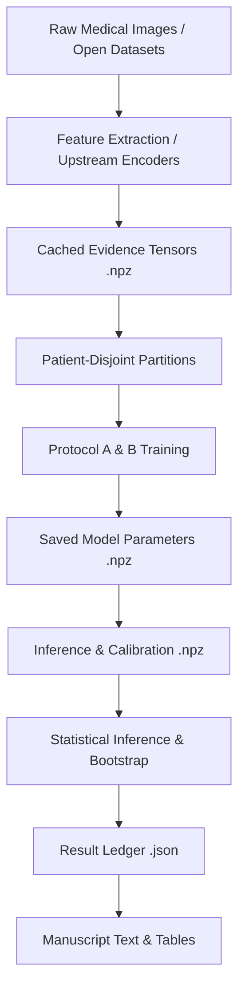

# EXPERIMENT PROVENANCE GRAPH: END-TO-END REPRODUCIBILITY AUDIT

**Target Manuscript:** *"Auditing Quantum Machine Learning in Digital Health: One Deployed System and Five Published Claims Under Symmetric Evaluation"*  
**Repository Root:** `E:/AURA/aura-main`  
**Audit Date:** October 11, 2026

---

## 1. Overview of the Evidence Architecture

This document establishes the full cryptographic and operational lineage linking every published scientific statement in the manuscript to its upstream code, data, training logs, and binary prediction artifacts.

---

## 2. Evidence Chains for Core Manuscript Experiments

### Chain 1: MIMIC-CXR Fusion Comparison (§2.2, §2.3, Table 1 & Table 2)

1. **Research Claim:** Symmetrically evaluated, the reported calibration and likelihood advantage of the 8-qubit variational circuit disappears; all 4 backends perform comparably on likelihood.
2. **Experimental Hypothesis:** Asymmetric temperature scaling caused the apparent calibration gap; matched learning-rate grids and patient-disjoint splits eliminate significant likelihood differences between Quantum VQC and Product-of-Experts.
3. **Dataset & Version:** MIMIC-CXR-JPG v2.0.0 (PhysioNet Credentialed Health Data License 1.5.0).
4. **Cohort & Sampling Unit:** 447 patient-disjoint test studies, 446 calibration studies, 540 training studies (`quantum_study_evidence.npz`).
5. **Split Definition:** Patient-level stratified split (70/10/20 train/cal/test) ensuring zero patient overlap across splits (`build_real_evidence_dataset.py`, `random_seed=7`).
6. **Preprocessing & Encoder:** DenseNet-121 pre-trained on chest radiographs, extracting an 8-dimensional evidence vector (7 informative pathology probabilities + 1 reference zero-channel). Platt scaling applied per finding (`vision_serving_calibration.json`).
7. **Model Implementations:**
   - **Product-of-Experts (Classical):** 54 parameters (`fusion_baselines._served_classical`).
   - **Variational Quantum Circuit:** 8 qubits, 3 layers, RY($\pi x$) encoding, RY-RZ ansatz, CNOT ring topology, $\langle Z \rangle$ readout, 102 parameters (`device.make_qnode`, `train_fusion.train_quantum`).
   - **Gated Head (Learnable):** Attention-gated MLP, 126 parameters (`fusion_baselines._served_learnable`).
   - **Multinomial Logistic Regression:** 54 parameters, L-BFGS converged anchor (`fusion_baselines._converged_logistic`).
8. **Training Protocol (Matched):** Shared Adam optimizer, batch size 50, maximum 150 epochs, early stopping patience 20, learning rate grid $\{0.01, 0.05, 0.1\}$ selected on calibration cross-entropy, seed 7, zero weight decay (`matched_optimiser.py`).
9. **Calibration Protocol (Symmetric):** Independent post-hoc temperature scaling fitted via NLL minimization on the 446-study calibration set for each arm separately.
10. **Checkpoints & Predictions:**
    - Evidence: `aura/artifacts/quantum_study_evidence.npz`
      - `Xtr` SHA-256: `8ed01c9003d4a2208b616fb23c9aa5418d9ac012848aa67305bf5be37708a3ef`
      - `Xcal` SHA-256: `12637328dad9a096cf2048829d1a8304a3210ecb646098943c674c0ce8a055db`
      - `Xte` SHA-256: `b2334f917cf4182b4bc66db20988f2d0e31efdae426fa9b43b6308d364035d27`
      - `yte` SHA-256: `b948e6a0779323868128767628773bc04ac7fafead472c8711c8be05072adde6`
    - Predictions: `aura/artifacts/fusion_matched_optimiser_predictions.npz`
      - `probs_classical` SHA-256: `6bf57c127e4a18be75b18801b794523e4ffc4f1504ee618215cbedee4a58e973`
      - `probs_quantum` SHA-256: `5cf2cea2007aa2b592404e635b6a827369ceced5f31f29cc85296ff128fd9865`
11. **Statistical Tests:**
    - Paired Wilcoxon signed-rank test on per-study NLL with Holm-Bonferroni correction ($p = 1.0$).
    - McNemar test on classification accuracy with Holm-Bonferroni correction ($p = 1.0$).
    - Two One-Sided Test (TOST) equivalence testing with margin $\Delta = \pm 0.010$ NLL ($p_{\text{TOST}} = 0.3592$).
12. **Numerical Output:** `aura/artifacts/fusion_matched_optimiser.json`:
    - PoE: Acc 0.5593, NLL 1.2362, ECE 0.0810, Macro-AUROC 0.8219.
    - Quantum: Acc 0.5436, NLL 1.2395, ECE 0.0486, Macro-AUROC 0.8009.
    - Gated Head: Acc 0.5682, NLL 1.2291, ECE 0.0804, Macro-AUROC 0.8252.
    - Logistic: Acc 0.5570, NLL 1.2310, ECE 0.0862, Macro-AUROC 0.8227.

---

### Chain 2: Entanglement Ablation & Data Re-uploading (§2.5)

1. **Research Claim:** Removing entanglement from the variational circuit consistently improves negative log-likelihood across multiple seeds, repeated splits, and parameter-matched architectures.
2. **Experimental Hypotheses:**
   - H1: Entanglement imposes an NLL penalty on the additive clinical target across 10 random seeds.
   - H2: The penalty replicates across $K=5$ patient-disjoint re-splits.
   - H3: The penalty persists when matched on parameter count (72 parameters) via data re-uploading.
3. **Dataset:** `quantum_study_evidence.npz` (MIMIC-CXR n=447 test cohort).
4. **Model Architectures:**
   - Arm 1 (Entangled): 7 informative qubits, 3 layers, CNOT ring (72 parameters).
   - Arm 2 (Unentangled / Product): 7 informative qubits, 3 layers, zero entangling gates (72 parameters).
   - Arm 3 (Data Re-uploading Entangled): Alternating encoding and parameter blocks (72 parameters).
   - Arm 4 (Data Re-uploading Unentangled): Alternating encoding and parameter blocks without CNOTs (72 parameters).
5. **Execution Scripts:** `ablation_patient_bootstrap.py`, `reuploading_ablation.py`, `revision_v51.py`.
6. **Artifact Lineage:** `aura/artifacts/revision_v51.json`:
   - Analysis B (10 seeds): Mean $\Delta\text{NLL} = 0.0250$, SD 0.0171, 95% $t$-CI $[0.0127, 0.0373]$, $t$-test $p = 0.00127$, Wilcoxon $p = 0.00195$. Unentangled won in 10/10 seeds.
   - Clustered Patient Bootstrap (10,000 resamples): 95% CI $[0.00158, 0.04828]$, two-sided $p = 0.0360$.
   - Analysis C ($K=5$ re-splits): Split-level mean $\Delta\text{NLL} = 0.0325$, SD 0.0097, 95% CI $[0.0205, 0.0445]$. Unentangled won on all 5 splits.
   - Analysis D (Re-uploading 10 seeds): Mean $\Delta\text{NLL} = 0.0229$, SD 0.0189, 95% CI $[0.0094, 0.0365]$, $t$-test $p = 0.00404$.

---

### Chain 3: Analytical Positive Control (§2.4, Table 4)

1. **Research Claim:** The symmetric evaluation apparatus detects a nonlinear advantage when one exists in the data-generating process.
2. **Experimental Hypotheses:**
   - Linear ceiling on linear target T1 is 1.0; on nonlinear targets T2a (conjunctive) and T2b (pairwise quadratic), linear ceiling drops substantially.
   - Nonlinear models (Gated Head, Quantum VQC) achieve significant likelihood improvements over linear models on T2a and T2b.
3. **Targets:**
   - **T1 (Linear Clinical):** Ground-truth target derived from linear weighted-sum heuristic. Linear ceiling = 0.9991.
   - **T2a (Conjunctive):** Target requires logical conjunctions (e.g., heart failure requires edema AND cardiomegaly). Linear ceiling = 0.8740, interaction ceiling = 0.9301.
   - **T2b (Pairwise Quadratic):** Score is quadratic form $x^T M_k x + a_k^T x$. Linear ceiling = 0.9081, interaction ceiling = 0.9821.
4. **Artifact Lineage:** `aura/artifacts/nonlinear_control.json`:
   - Target T1: Classical PoE NLL 0.0382, Gated Head 0.0636, Logistic 0.0736, Quantum 0.1651.
   - Target T2a: Gated Head NLL 0.5075 (beats Logistic 0.5646 by 0.0571, $p < 10^{-4}$); Quantum NLL 0.7980 (worst).
   - Target T2b: Quantum NLL 0.2515 (beats Logistic 0.3155 by 0.0640, $p < 10^{-4}$); Gated Head NLL 0.2560 (beats Logistic by 0.0595, $p < 10^{-4}$).

---

### Chain 4: External Transfer Validation (§2.7, Table 2)

1. **Research Claim:** When transferred frozen to a second clinical institution (CheXpert), all models degrade, and the quantum circuit ranks last on all clinical metrics.
2. **Dataset:** CheXpert-v1.0-small (Stanford University, non-commercial research license).
3. **Cohort:** 1,600 test studies, 1,067 calibration studies (`chexpert_evidence.npz`).
4. **Execution Script:** `aura.ml.evaluation.chexpert_external`.
5. **Artifact Lineage:** `aura/artifacts/chexpert_external.json`:
   - Classical PoE: Acc 0.5273, NLL 1.4193, ECE 0.1346, Macro-AUROC 0.7366.
   - Logistic: Acc 0.5210, NLL 1.3815, ECE 0.1078, Macro-AUROC 0.7298.
   - Gated Head: Acc 0.4829, NLL 1.5116, ECE 0.1424, Macro-AUROC 0.7367.
   - Quantum VQC: Acc 0.4721, NLL 1.5782, ECE 0.1586, Macro-AUROC 0.7259.

---

### Chain 5: Literature Field Audit (§2.1, Table 5)

1. **Research Claim:** Published empirical claims of quantum superiority in healthcare machine learning collapse under symmetric baseline selection and leak-free validation.
2. **Screening Protocol:** 231 PubMed records screened -> 129 health-related -> 41 claimed quantum superiority -> 8 eligible (clinical prediction with accessible data) -> 5 reproducible.
3. **Audited Studies:**
   - **CKD (Variational Classifier, PMID 38505507):** Reported 99.2% accuracy. Reproduction under nested-selected classical arm: Quantum 87.70% vs Classical 97.35% ($\Delta = -9.65\%$, Nadeau-Bengio corrected $p = 0.000915$). `ckd.json`.
   - **Parkinson's (Quantum Kernel Stacking, PMID 42286086):** Reported superiority over untuned SVM. Audit shows advantage driven by global PCA fitted across all data and recording-level rather than subject-level cross-validation. `stack_parkinsons.json`, `factors_parkinsons.json`.
   - **Pima Diabetes (PMID 42286086):** Reported advantage collapses when standard classical tuning is applied. `stack_pima.json`.
   - **EEG Schizophrenia (PMID 38441727):** Reported 100% accuracy. Audit shows subject epochs crossed train/test splits. Subject-grouped splits yield ~52% accuracy. `eeg_qsvm.json`.
   - **Glioma Grade (BraTS 2020, PMID 37880295):** QKL matched classical RBF kernel on official 369 subjects ($\Delta = +0.2\%$, 95% CI $[-1.2, +1.6]$). `glioma.json`.
